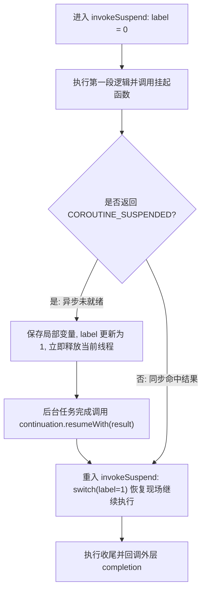

## 面试答题思路

- **先下定义**：Kotlin 协程本身并不是操作系统层面的“微线程”，而是编译期生成状态机 + 运行时借助线程池（`Dispatcher`）实现的**可挂起计算抽象**。
- **核心切入点**：`suspend` 关键字本身不负责切换线程，它的真正作用是**标记可暂停/恢复点**，并触发编译器的 **CPS（Continuation-Passing Style）变换**。
- **挂起与恢复闭环**：挂起点返回特殊标志 `COROUTINE_SUSPENDED` 让出当前线程；异步结果就绪后通过回调 `Continuation.resumeWith()` 将状态机推进到下一个 `label` 分支。

## 核心原理解析

### 1. 挂起（Suspend）的本质：切线程 + 不阻塞
调用传统阻塞方法（如 `Thread.sleep`）时，线程处于等待态不能复用；而调用挂起函数（如 `withContext(Dispatchers.IO)` 或 `delay`）时，主线程遇到 `COROUTINE_SUSPENDED` 后**立刻从该函数返回并继续处理 UI 绘制与点击事件**，不会发生卡顿或 ANR。

### 2. CPS 变换与 `Continuation` 回调
编译器在编译 `suspend fun` 时会改写方法签名：
- 为函数隐式追加最后一个参数 `completion: Continuation<T>`，即“剩余未执行代码”的回调封装；
- 返回值类型提升为 `Any?`，用于同时兼容“同步直接返回结果”与“异步挂起标志 `COROUTINE_SUSPENDED`”。

### 3. `label` 状态机驱动分段执行
如果一个 `suspend` 函数内部有多个挂起点，编译器会生成一个继承自 `SuspendLambda` / `BaseContinuationImpl` 的状态机类：
- 内部维护整型 **`label` 字段**记录执行进度，并将跨越挂起点的局部变量保存为状态机实例字段；
- 每次调用 `invokeSuspend(result)` 时通过 `switch(label)` 跳转到对应代码块，检查前一步返回值并驱动下一阶段执行，直到 `label` 走到终点回调外层 `completion`。

## 图解流程

## 高频追问与关键词

- **追问 1**：为什么说 `suspend` 关键字本身不会切换线程？
  - 关键词：`suspend` 只负责提醒调用方必须在协程或另一挂起函数中执行并生成状态机，真正切线程依靠 `ContinuationInterceptor`（即 `Dispatchers`）。
- **追问 2**：普通函数为什么不能直接调用 `suspend` 函数？
  - 关键词：缺少编译器注入的 `Continuation` 回调上下文与状态机恢复载体，需要通过 `launch` / `async` / `runBlocking` 等协程构建器创建根 `Continuation`。
- **追问 3**：挂起函数内如果只是写普通计算逻辑而不真正挂起，会发生什么？
  - 关键词：不返回 `COROUTINE_SUSPENDED`，直接以同步快路径返回结果，零切换开销。

## 延伸参考

建议结合 Kotlin 官方协程设计文档回顾状态机反编译结构，并对比 Android 主线程调度实践。
