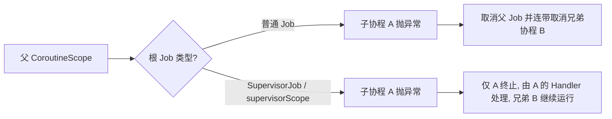

## 面试答题思路

- **核心价值**：结构化并发解决的是传统异步回调或 `GlobalScope` 带来的**任务失控、内存泄漏与异常吞没**问题——任何子协程都必须绑定在一个有明确生命周期的 `CoroutineScope` 内。
- **两条核心传播法则**：默认 `Job` 下，**取消向下传播，异常双向传播**；而 `SupervisorJob` 将异常改为**仅向下传播，不连累父级和兄弟协程**。
- **高频工程坑点**：`CancellationException` 不会被当成失败异常向上传播，捕获 `Throwable`/`Exception` 时必须注意重新抛出 `CancellationException`。

## 核心原理解析

### 1. 父子 `Job` 树形关系
`CoroutineScope` 本质上是持有一个 `CoroutineContext` 的作用域容器。在其内部启动 `launch` 或 `async` 时，新协程会自动通过 `context[Job]` 找到父 `Job` 并注册为子节点：
- **生命周期等待**：父协程即使自身代码块已走完，也会等待全部子协程结束后才进入 `Completed` 状态；
- **级联取消**：调用 `scope.cancel()`（如 `viewModelScope` 在 `onCleared()` 时），会向所有子孙协程发送 `CancellationException`，配合挂起点的可取消检查统一回收资源。

### 2. `Job` 与 `SupervisorJob` 的异常传播差异
- **普通 `Job`**：某个子协程抛出非 `CancellationException` 异常时，首先向上取消父 `Job`，父 `Job` 随即连带取消全部其他兄弟协程，并在所有子协程退出后处理该异常。
- **`SupervisorJob` / `supervisorScope`**：子协程失败时自行承担异常，不取消父 `Job` 也不影响并行请求的其他子协程（如页面首页多个独立卡片并发拉取接口）。

### 3. `launch` vs `async` 与 `CoroutineExceptionHandler` 边界
- `launch` 在未捕获异常发生时**立即向父级抛出**，若挂载在顶层根协程且配置了 `CoroutineExceptionHandler` 可兜底捕获；
- `async` 将异常封装在 `Deferred` 结果中直到调用 `await()` 才抛出，**但若处于普通 `Job` 父子关系下，未捕获异常仍会立刻上报触发父级取消**；
- `CoroutineExceptionHandler` 仅对**根协程（或 `supervisorScope` 直接子 `launch`）** 生效，挂载在普通内层子 `launch` 上会被忽略。

## 图解流程

## 高频追问与关键词

- **追问 1**：为什么不能把 `SupervisorJob()` 直接传给 `withContext(SupervisorJob())` 或 `launch(SupervisorJob())` 来隔离它内部多个子协程？
  - 关键词：传入 `SupervisorJob()` 会打破原本的父子 `Job` 链使该协程成为独立父节点，内部若再用 `launch` 才有效，且会切断外层作用域的取消联动；正确用法是外层容器创建时用 `CoroutineScope(SupervisorJob() + ...)` 或代码块内部使用 `supervisorScope {}`。
- **追问 2**：`try-catch` 包裹 `launch { throw ... }` 为什么抓不到异常？
  - 关键词：`launch` 仅异步启动任务并立即返回 `Job`，异常发生在协程体异步执行阶段，需在 `launch` 内部 `try-catch` 或配合 `CoroutineExceptionHandler`。
- **追问 3**：`try { delay(...) } catch (e: Exception)` 捕获通用异常会引发什么 Bug？
  - 关键词：误吞 `CancellationException` 导致父级 `cancel()` 失效，协程继续执行浪费资源甚至崩溃；需判断 `if (e is CancellationException) throw e`。

## 延伸参考

结合 Android `viewModelScope`（内置 `SupervisorJob() + Dispatchers.Main.immediate`）源码与官方协程异常处理指南对照记忆。
