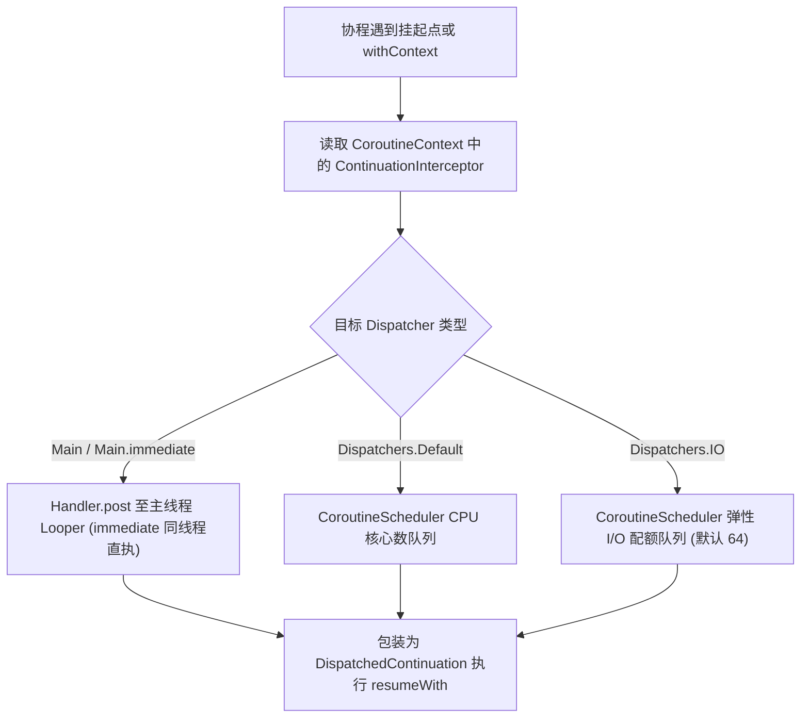

## 面试答题思路

- **本质原理**：`CoroutineDispatcher` 实现了上下文元素 **`ContinuationInterceptor`**；每当协程初始化或从挂起点恢复时，都会通过 `interceptContinuation` 将原始 `Continuation` 包装为 `DispatchedContinuation`，把后续执行投递到指定线程或线程池。
- **四大调度器分工**：`Main`（Android 主线程 Handler）、`Default`（CPU 密集，核心数上限）、`IO`（阻塞 I/O，默认 64 并发上限，与 `Default` 共享底层线程弹性复用）、`Unconfined`（不切线程，恢复在触发线程执行）。
- **高频工程陷阱**：主线程 `runBlocking` 死锁风险、`Dispatchers.Main` vs `Main.immediate` 区别、`IO` 并发限流（`limitedParallelism`）。

## 核心原理解析

### 1. `Main` 与 `Main.immediate` 的细微却关键差异
- `Dispatchers.Main` 无论当前是否已经在主线程，都会通过主线程 `Handler.post()` 入队到下一轮消息循环执行；
- `Dispatchers.Main.immediate`（`viewModelScope` / `lifecycleScope` 默认配置）会先判断当前是否在主线程：**如果是则立即同步执行**，避免一帧延迟或 UI 状态闪烁。

### 2. `Default` 与 `IO` 的共享线程池优化
早期直觉认为两者完全隔离，实际上在 kotlinx.coroutines 中它们共享同一套 `CoroutineScheduler` 后台线程池：
- 当协程从 `Default` 切到 `IO` 时（`withContext(Dispatchers.IO)`），调度器**优先尽量在当前工作线程直接继续执行**，省去线程上下文切换代价，仅在并发数与阻塞配额层面做独立隔离。

### 3. `withContext` vs `launch`
- `withContext` 是**串行挂起切线程**，返回代码块最后一行结果，切入后执行完毕自动切回原上下文；
- `launch` 是**异步并发启动子协程**，不阻塞当前流程继续往下走，返回 `Job`。

## 图解流程

## 高频追问与关键词

- **追问 1**：为什么在 Android 主线程使用 `runBlocking` 容易导致死锁或 ANR？
  - 关键词：`runBlocking` 会阻塞调用线程等待内部协程结束；若在主线程调用且内部又尝试切回 `Dispatchers.Main`（必须靠主线程 `Looper` 消费消息），就会形成互相等待的经典死锁。
- **追问 2**：如果一个后台高频任务只允许最多 4 并发读写数据库或文件，怎么优雅限流？
  - 关键词：`Dispatchers.IO.limitedParallelism(4)`，在共享池之上建立独立并发视图而不新建重型线程池。
- **追问 3**：为什么不推荐全局滥用 `Dispatchers.Unconfined`？
  - 关键词：恢复线程取决于唤醒它的库回调线程（如 OkHttp 线程池或定时器线程），后续直接操作 UI 会引发 `CalledFromWrongThreadException`。

## 延伸参考

对照 Android 官方协程进阶指南，排查业务代码中 `withContext` 阻塞调用与主线程安全问题。
