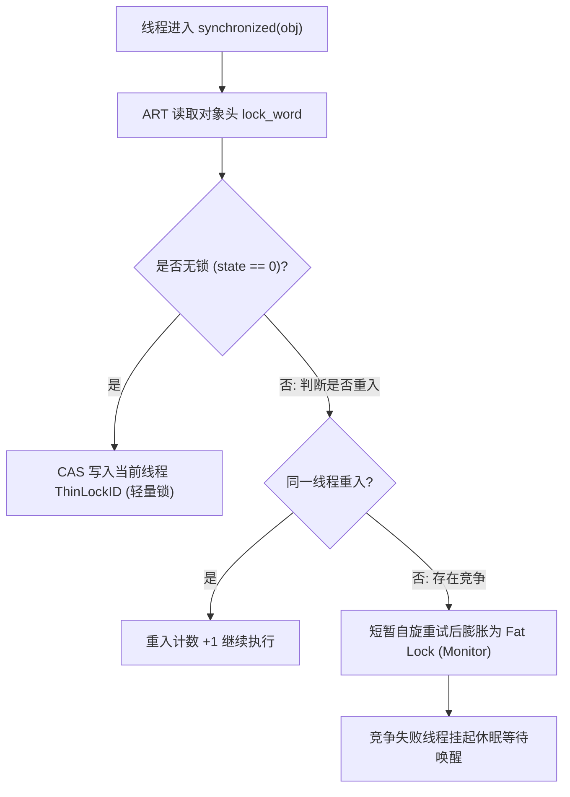

## 面试答题思路

- **锁的底层差异（Android 加分点）**：面试不仅要能讲出 HotSpot 对象头 Mark Word 锁演进（无锁 → 轻量级 CAS 自旋 → 重量级 Monitor；注意 **JDK 18 起 JEP 374 已彻底移除偏向锁**），还要指出 **Android ART 虚拟机并未沿用 HotSpot 偏向锁**，而是使用对象头的 **`lock_word`** 在 **Thin Lock（轻量自旋）** 与 **Fat Lock（膨胀为 Monitor 互斥休眠）** 之间切换。
- **`ReentrantLock`（AQS）**：基于 `volatile int state` + **CLH 双向等待队列**，借助 CAS 抢锁失败后 `LockSupport.park()` 挂起线程，支持公平/非公平锁、可中断与多 `Condition`。
- **`volatile` 双重语义**：保证**内存可见性**（强制读写主内存）和**禁止指令重排序**（写前写后插入内存屏障），但**不保证 `count++` 复合操作的原子性**。

## 核心原理解析

### 1. `synchronized` 在 HotSpot 与 ART 上的不同表现
- **Java HotSpot（传统面试八股）**：早期分为偏向锁 → 轻量级锁（CAS 自旋栈帧 LockRecord） → 重量级锁（依赖操作系统 `mutex` 切换内核态）；现代 JDK 15 废弃、JDK 18（JEP 374）直接移除了维护成本高且高并发收益低的偏向锁。
- **Android ART 虚拟机**：每个 `mirror::Object` 拥有 32 位 **`lock_word`**：
  - 无竞争时通过 CAS 将持有线程 ID（`Thin Lock ID`）与重入计数写入 `lock_word`，极低开销；
  - 发生并发竞争或调用 `wait()/notify()` 时膨胀为 **Fat Lock**，在内部 `Monitor` 表中挂载互斥量与等待队列，让未抢到锁的线程休眠避免耗电空转。

### 2. `ReentrantLock` 与 AQS 核心机制
`AbstractQueuedSynchronizer (AQS)` 是 `ReentrantLock`、`Semaphore`、`CountDownLatch` 的共同底座：
- **状态管理**：`state == 0` 表示无锁，`> 0` 表示重入次数；
- **非公平 vs 公平**：非公平锁进门直接尝试 CAS 抢一次 `state`（减少线程唤醒切换，吞吐更高）；公平锁先检查队列前驱是否有等待者再决定是否入队。

### 3. `volatile` 与 Happens-Before 原则
- 写 `volatile` 变量时，通过内存屏障保证之前的普通写全部刷出到主内存对其他核可见；读 `volatile` 时丢弃本地工作缓存重新加载主内存最新值；
- 经典用法：双重校验锁（DCL）单例中的 `volatile instance` 阻止 `new` 对象三步曲（分配内存 → 初始化对象 → 赋值引用）重排导致其他线程拿到半初始化对象。

## 图解流程

## 高频追问与关键词

- **追问 1**：既然有了 `synchronized`，为什么还要用 `ReentrantLock`？
  - 关键词：可中断等待 `lockInterruptibly()`、超时放弃 `tryLock(timeout)`、公平锁开关、多条件等待队列 `newCondition()`（精准唤醒生产者或消费者）。
- **追问 2**：`volatile` 修饰一个数组或引用对象，里面元素修改对其他线程可见吗？
  - 关键词：仅保证引用本身重新赋值和读取时的可见性与屏障语义，不代表数组内部元素读写自动线程安全。

## 延伸参考

参考 AOSP ART 运行时锁机制说明与 Kotlin 共享可变状态并发指南。
