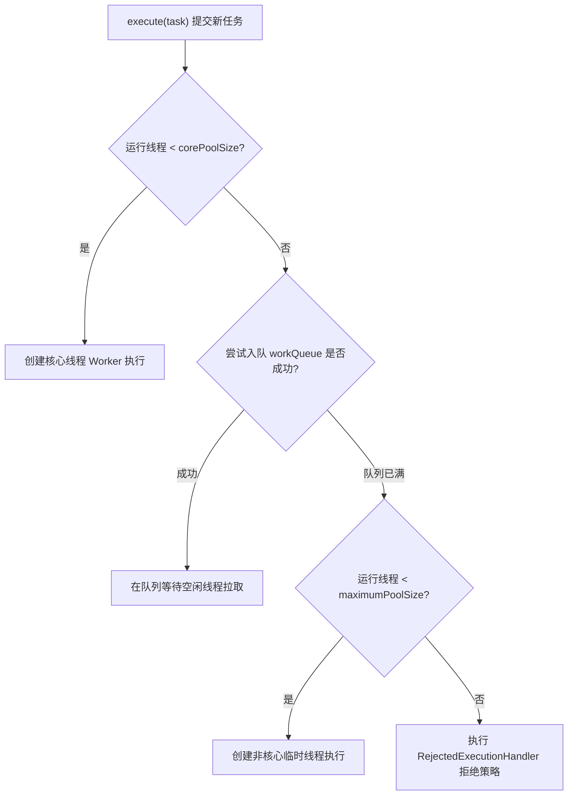

## 面试答题思路

- **核心价值**：复用已创建线程降低频繁创建/销毁带来的内核开销，并通过核心线程数与任务队列限制总并发度防止线程爆炸导致 OOM。
- **任务流转铁律（必考顺序）**：新任务提交 → **核心线程未满先建核心线程** → **核心满则入阻塞队列** → **队列满才建非核心线程至 `maximumPoolSize`** → **仍满触发拒绝策略**。
- **Android 避坑选型**：严禁直接使用 `Executors.newFixedThreadPool/CachedThreadPool`（队列或最大线程无界易 OOM）；在现代 Android 工程中多使用 Kotlin 协程共享调度器或自定义命名线程工厂的 `ThreadPoolExecutor`。

## 核心原理解析

### 1. 七大核心构造参数
- **`corePoolSize`**：核心常驻线程数（开启 `allowCoreThreadTimeOut(true)` 后空闲超时也可回收，适合移动端省内存）；
- **`maximumPoolSize`**：允许并发最大线程总数；
- **`keepAliveTime` / `unit`**：非核心空闲线程存活时间；
- **`workQueue`**：任务缓冲队列（`ArrayBlockingQueue` 有界数组、`LinkedBlockingQueue` 注意需传容量防无界、`SynchronousQueue` 不存元素直递交线程）；
- **`threadFactory`**：**强烈建议自定义命名**（如 `"net-pool-%d"`），排查 ANR `traces.txt` 或 OOM 线程数溢出时极度重要；
- **`handler`（RejectedExecutionHandler）**：四种拒绝策略——`AbortPolicy`（默认抛异常）、`CallerRunsPolicy`（回退给提交方线程执行以天然限流）、`DiscardPolicy`（静默丢弃）、`DiscardOldestPolicy`（丢弃队头最老任务）。

### 2. 为什么默认先入队列，满了才扩容到 `maximumPoolSize`？
这是出于资源保守原则：线程创建与上下文切换代价远高于向内存队列投递任务对象。仅当队列积压到极限时，才临时扩充“应急非核心线程”消化峰值流量。

### 3. 移动端线程数配置经验
- **CPU 密集型**（加密/图像计算/解析）：核心数 `N_cpu + 1`；
- **I/O 密集型**（网络/磁盘读写）：线程大多阻塞在等待响应，可设为 `2 * N_cpu` 左右或受限并发池；同时要设置 `Thread.setPriority(Process.THREAD_PRIORITY_BACKGROUND)` 避免后台线程与 UI 线程抢占 CPU。

## 图解流程

## 高频追问与关键词

- **追问 1**：线程池里的非核心线程和核心线程有身份标记区别吗？
  - 关键词：没有固定身份标记！所有 `Worker` 本质一样，回收判定是在 `getTask()` 时判断当前存活总数是否超过 `corePoolSize`，先超时等待的任意空闲线程就会被淘汰退出。
- **追问 2**：Android 中向线程池提交任务发现线程数突然飙升到上千引发 `pthread_create failed OOM`，如何治理？
  - 关键词：统一收敛散落的线程池与三方库全局共享池（如统一复用 OkHttp Dispatcher 或协程调度器）、自定义 `ThreadFactory` 审计线程归属、禁止 `Executors.newCachedThreadPool()` 无上限建线程。

## 延伸参考

对照 Android 官方线程管理文档回顾线程优先级设定（`THREAD_PRIORITY_BACKGROUND`）与统一线程池收敛思路。
