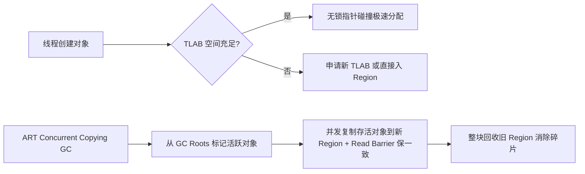

## 面试答题思路

- **存活判定**：主流虚拟机（HotSpot/ART）不采用引用计数（无法解决循环引用），而是从 **GC Roots**（栈帧局部变量、静态变量、JNI 全局引用、活跃线程等）出发执行可达性分析。
- **四种引用分级**：强引用（绝不回收） > 软引用 `SoftReference`（内存将 OOM 时回收，现已不推荐作图片主缓存） > **弱引用 `WeakReference`**（下次 GC 必回收，LeakCanary / Handler 防泄漏核心） > 虚引用 `PhantomReference`（必须配合 `ReferenceQueue` 追踪对象被真正回收或释放 Native 堆外内存）。
- **ART GC 核心优势**：Android 8.0+ 引入并强化了 **Concurrent Copying（CC）并发复制回收器**与分代区域（Region）管理，结合 **`TLAB`（Thread Local Allocation Buffer）** 消除了老版本 Dalvik 停顿久、不整理碎片导致“明明有剩余空间却因无连续大块而 OOM”的顽疾。

## 核心原理解析

### 1. 四种引用的 Android 真实使用边界
- **`WeakReference` + `ReferenceQueue`**：对象被 GC 标记准备回收时，引用外壳会被压入绑定的 `ReferenceQueue` 队列——这正是 `LeakCanary` 验证 Activity Destroy 后是否真正被回收，以及 `Glide` 活动缓存（`ActiveResources`）追踪不再使用的 Bitmap 的核心机制。
- **为什么现在不建议用 `SoftReference` 做图片缓存？**：ART 对软引用回收时机较激进（内存紧张时可能一次全清导致缓存命中率暴跌），远不如设定精确容量的 `LruCache` 稳定可控。

### 2. ART 垃圾回收演进与 `TLAB`
- **Dalvik 时代痛点**：单线程 Mark-Sweep，STW（Stop-The-World）卡顿明显且不压缩内存导致内存碎片化。
- **ART Concurrent Copying（CC，并发复制）**：
  - 将堆划分为等大 **Region**，支持**应用线程与 GC 线程并发执行对象搬迁与紧凑整理**（利用 Read Barrier 读屏障保证并发搬移时地址一致性），STW 停顿压至亚毫秒级；
  - **Generational CC（Android 10+）**：区分年轻代（高回收频率、高存活率低成本）与老年代，进一步缩短单次 GC 耗时降低发热量。
- **`TLAB`（Thread Local Allocation Buffer）**：每个线程在堆中预先独占一小块连续分配缓冲区，普通小对象直接通过指针碰撞（Bump-the-pointer）无锁高速分配，仅在 TLAB 耗尽时才加锁向全局申请新块。

## 图解流程

## 高频追问与关键词

- **追问 1**：为什么调用 `System.gc()` 不保证立刻执行回收？
  - 关键词：仅仅是向虚拟机发出建议提示（受系统省电策略与 ART GC 并发调度控制），因此 `LeakCanary` 在通知 GC 后会短暂等待并结合观察队列二次校验。
- **追问 2**：Android 中 App 切到后台时 ART GC 行为会有什么变化？
  - 关键词：切后台（`HeapTransition`）时系统倾向执行内存压缩与裁剪回收（归还空闲物理页给内核），降低被 LMKD 杀掉的概率。

## 延伸参考

参考 Android 官方内存管理概览与 AOSP ART GC 调试指南。
