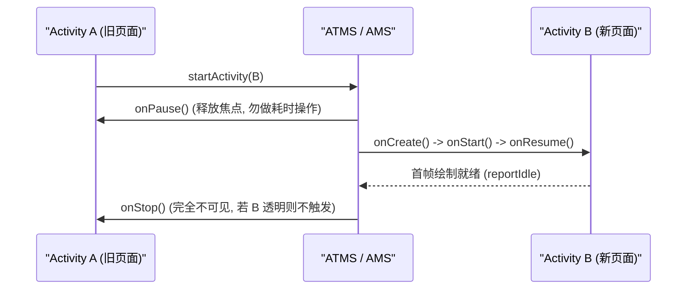

## 面试答题思路

- **两大维度划分**：生命周期分**完整生命周期**（`onCreate` → `onDestroy`）、**可见生命周期**（`onStart` → `onStop`）与**前台焦点生命周期**（`onResume` → `onPause`）。
- **核心交错规律**：A 启动 B 时并非等 A 走完 `onStop` 才建 B，而是 **`A.onPause()` → `B.onCreate()` → `B.onStart()` → `B.onResume()` → `A.onStop()`**，这是为了保证旧页面让出交互焦点的同时，最快速度把新页面首帧绘制并展示出来。
- **避坑意识**：绝对不要在 `onPause()` 做重量级磁盘/网络耗时操作（会直接卡住新页面 `B` 的启动速度）。

## 核心原理解析

### 1. 为什么 A 启动 B 时 `A.onPause()` 在前、`A.onStop()` 在后？
- **安全与响应**：AMS 必须先让 `A` 暂停释放独占硬件/输入焦点（如相机预览、媒体播放），然后才能拉起 `B`；
- **防黑屏体验**：只有当 `B` 完成 `onResume()` 并触发主窗口首帧布局挂载（Looper `IdleHandler` / `reportIdle` 通知系统 `B` 已经真正可见覆盖住下层）后，系统才安心回调 `A.onStop()` 将其转入不可见后台态。

### 2. `onPause()` 与 `onStop()` 的触发分水岭
- **半透明/Dialog 风格 Activity 盖在上方**：`A` 失去了焦点但仍然部分可见，因此**只触发 `A.onPause()`，不会触发 `A.onStop()`**，按返回键时只走 `A.onResume()`；
- **多窗口 / 分屏模式（Android 7.0+ / 10+ Multi-Resume）**：两个窗口同时可见，Android 10+ 引入 **Multi-Resume** 支持双可见窗口同时处于 `RESUMED` 状态，仅以 `onTopResumedActivityChanged(boolean)` 区分哪个真正拥有顶层输入焦点。

## 图解流程

## 高频追问与关键词

- **追问 1**：如果在 `Activity A` 的 `onCreate()` 里直接调用 `finish()`，生命周期会怎么走？
  - 关键词：直接跳过 `onStart` / `onResume` / `onPause` / `onStop`，从 `onCreate()` 直奔 `onDestroy()`。
- **追问 2**：前后台切换（按 Home 键再切回）时生命周期与 `onRestart` 何时调用？
  - 关键词：按 Home 走 `onUserLeaveHint` → `onPause` → `onStop`（`onSaveInstanceState`）；切回走 `onRestart` → `onStart` → `onResume`。

## 延伸参考

结合 Android 官方 Activity 生命周期状态机图回顾 `onTopResumedActivityChanged` 与分屏适配。
