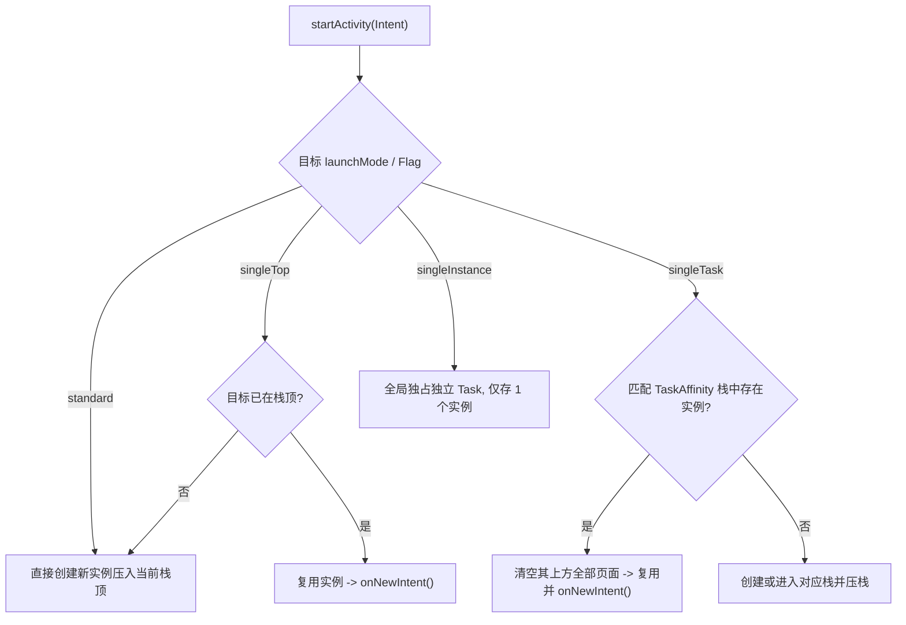

## 面试答题思路

- **模式分工**：`standard`（默认多实例）；`singleTop`（栈顶复用防连点重叠）；`singleTask`（栈内复用并清空其上方全部实例，常用于主页 MainActivity）；`singleInstance`（独占独立任务栈，全局唯一实例）。
- **Flag 优先级更高**：代码动态设置的 `Intent.FLAG_ACTIVITY_*` 优先级高于 Manifest 静态声明的 `android:launchMode`。
- **`TaskAffinity` 配合**：`singleTask` 单独配合不同 `taskAffinity` 时，会把目标 Activity 推入与该亲和度同名的独立任务栈（这也是早期很多三方共享页面/通知栏落地页控制返回栈的关键）。

## 核心原理解析

### 1. 四种模式栈调度细节与 `onNewIntent`
- **`standard`**：直接压入**启动者所在任务栈**栈顶（因此用 `ApplicationContext` 启动非栈内模式 Activity 时必须加 `FLAG_ACTIVITY_NEW_TASK` 否则报 `AndroidRuntimeException`）。
- **`singleTop`**：仅检查当前目标栈的**最栈顶**是否是同一类，是则复用回调 `onNewIntent(intent)`（注意内部需调用 `setIntent(newIntent)` 更新 Intent 数据），否则新建压栈。
- **`singleTask`**：先查找与其 `taskAffinity` 匹配的栈；若栈内已有该实例，将其上方所有其他 Activity 全部出栈销毁（ClearTop），使自己重登栈顶并回调 `onNewIntent`。
- **`singleInstance`**：强制开一个仅容纳它一个实例的孤岛任务栈；若在该页面再打开普通 `standard` 页面，新页面会落回默认应用栈，导致返回键先退回普通栈。

### 2. 常用 `Intent Flag` 组合实战
- **`FLAG_ACTIVITY_NEW_TASK | FLAG_ACTIVITY_CLEAR_TOP`**：类似 `singleTask` 的动态组合（如推送点击跳回首页并清除中间流程页）；
- **`FLAG_ACTIVITY_CLEAR_TASK | FLAG_ACTIVITY_NEW_TASK`**：清空整个旧栈并重建全新根页面（经典用于**退出登录跳登录页**防止按返回键回到主界面）；
- **`FLAG_ACTIVITY_REORDER_TO_FRONT`**：把栈中已有页面直接拎到栈顶而不销毁上方页面（注意容易打乱用户常规返回预期）。

## 图解流程

## 高频追问与关键词

- **追问 1**：如果在 `onNewIntent()` 里通过 `getIntent()` 取参数，为什么拿到的还是旧数据？
  - 关键词：默认 `getIntent()` 仍返回首次启动时的旧 Intent 对象，必须在 `onNewIntent(intent)` 内显式调用 **`setIntent(intent)`** 覆盖更新。
- **追问 2**：Android 12+ 点击通知/桌面图标返回桌面按 Back 键为什么不退出而把根 Activity 移到后台？
  - 关键词：Android 12 行为变更——根 Launcher Activity 按系统返回不再默认 `finish()` 而是直接退至后台保活提升下次冷/温启动体感速度。

## 延伸参考

对照 Android 官方任务栈与返回栈（Tasks and the back stack）文档复习 `allowTaskReparenting` 与 `alwaysRetainTaskState`。
