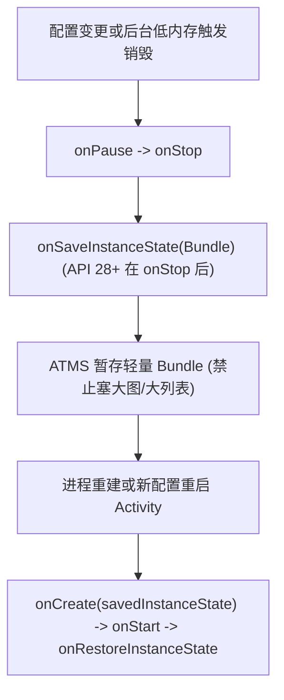

## 面试答题思路

- **触发条件**：`onSaveInstanceState()` 仅在 **“系统可能在未征得用户同意前销毁 Activity”** 时调用（如屏幕旋转、语言/深浅色切换、内存不足退后台被回收），而用户主动按返回键或调用 `finish()` **不会触发**。
- **恢复双通道**：`onCreate(savedInstanceState)` 均能收到非空 `Bundle`，而 `onRestoreInstanceState(savedInstanceState)` 仅在 `Bundle` 非空时才调用且位于 `onStart()` 之后。
- **现代三层存储分工**：**瞬态轻量 UI 状态**（输入框文本、滚动偏移）靠 `onSaveInstanceState` / `rememberSaveable`；**配置变更内存对象**靠 `ViewModel`（配合 `SavedStateHandle` 抗进程被杀）；**大体积/持久化数据**存 Room/Disk。

## 核心原理解析

### 1. API 28（Android 9.0）前后的调用时机变化
- API 28 之前：`onSaveInstanceState()` 在 `onStop()` 之前调用，与 `onPause()` 无严格先后；
- **API 28 及以后**：系统统一调整为**在 `onStop()` 之后调用**，确保用户在 `onStop()` 之前的所有 UI 事务与提交都已经安全落定。

### 2. View 状态自动恢复的隐性前提
系统会自动保存/恢复视图树（如 `EditText` 输入文字、`ScrollView` 滚动位置），但有两个严格条件：
1. 该 View **必须设置了唯一 `android:id`**；
2. 该 View 所属类重写了 `onSaveInstanceState()` / `onRestoreInstanceState()`。

### 3. `Bundle` 的 Binder 容量陷阱（`TransactionTooLargeException`）
`onSaveInstanceState(outState)` 写入的 `Bundle` 最终会经由 Binder IPC 传给系统进程 `ATMS` 暂存（以便应用进程被杀重建后回传）：
- **所有活跃组件共享的 Binder 事务缓冲上限约为 `1MB - 8KB`**（甚至单次建议远低于 50KB）；
- **千万不能往 `savedInstanceState` 里塞大列表、大图 `Bitmap` 或长串 JSON**，否则退后台 `onStop` 之后直接闪退 `TransactionTooLargeException`。

## 图解流程

## 高频追问与关键词

- **追问 1**：如果在 `Manifest` 中配置了 `android:configChanges="orientation|screenSize|screenLayout|smallestScreenSize"` 拦截旋转重建，会走什么回调？
  - 关键词：不再销毁重建 Activity 和 `ViewModel`，而是直接回调 **`onConfigurationChanged(newConfig)`**，适合视频全屏播放等特殊场景，但会丢失自动重新加载横竖屏两套 XML 资源的能力（需手动适配布局）。
- **追问 2**：退后台进程被系统杀掉后重进 App，内存单例全重置为 null 怎么排查和防范？
  - 关键词：用 `adb shell am kill <pkg>` 模拟后台被杀恢复；核心状态（登录 Token、列表关键参数）不能只挂 `Application` 或全局静态单例，必须通过 `SavedStateHandle` 或本地持久化兜底。

## 延伸参考

参考 Android 官方 Saving UI states 指南，对比 `ViewModel`、`SavedStateHandle` 与 `onSaveInstanceState` 的容量边界。
