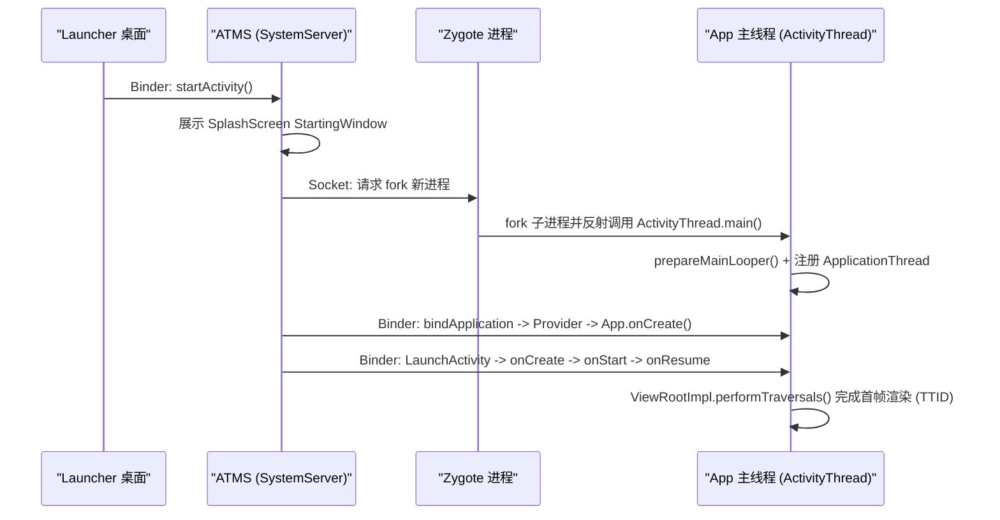

## 面试答题思路

- **分段切入法（防止一团乱麻）**：把冷启动拆成清晰的三段接力——**① 跨进程调度（Launcher → ATMS）** → **② 进程孵化（ATMS → Zygote）** → **③ 应用主线程初始化与首帧渲染（`ActivityThread` → `Application` → `Activity` → `ViewRootImpl`）**。
- **核心机制点睛**：Zygote 通过 Socket 接收 `fork` 指令并利用 Linux **写时复制（Copy-on-Write）** 共享预加载类与系统资源；主线程 `Looper.prepareMainLooper()` 启动后借助 **`ClientTransaction` / Handler `H`** 调度组件生命周期；最终 `onResume` 后调用 `WindowManager.addView` 创建 **`ViewRootImpl`** 完成首帧绘制并撤掉 `StartingWindow`（SplashScreen）。

## 核心原理解析

### 1. 阶段一：Launcher 发起请求与系统白屏/启动页占位
桌面点击应用图标调用 `startActivity()`，通过 Binder 跨进程发往系统服务 **`ActivityTaskManagerService (ATMS)`**（Android 10 从 `AMS` 拆分负责任务栈与窗口调度）。ATMS 校验权限与 Intent 后先弹出 **StartingWindow（启动预览窗 / SplashScreen）** 立即响应用户点击感，避免等待进程孵化时屏幕呆滞。

### 2. 阶段二：Zygote 孵化新进程
ATMS 发现目标进程尚不存在，通过 Socket 通知 **Zygote 进程** `fork()` 出新应用进程。由于 Zygote 开机时早已预先加载好框架类、ART 运行时和公共系统资源，新进程只需极短时间即可启动并反射执行入口类 **`ActivityThread.main()`**。

### 3. 阶段三：`ActivityThread` 绑定与首帧上屏
- `ActivityThread.main()` 初始化主线程 **`Looper.prepareMainLooper()`**，创建 `ApplicationThread`（Binder 服务端）回连系统，并开启 **`Looper.loop()`**；
- 系统经 Binder 下发 `bindApplication`（由 `H` Handler 转发）：加载 `LoadedApk`、创建 **`ContentProvider`（先于 Application.onCreate!）**、反射创建 `Application` 并执行 **`attachBaseContext()` → `onCreate()`**；
- 接着系统下发 `LaunchActivityItem` 事务：创建目标 `Activity`、`PhoneWindow` 与 `ContextThemeWrapper`，依次走 **`onCreate`（`setContentView` 仅填充 `DecorView` 树）→ `onStart` → `onResume`**；
- 最后在 `handleResumeActivity()` 中调用 `WindowManagerImpl.addView(decorView)`，实例化 **`ViewRootImpl`** 并触发首次 `requestLayout()` → `Choreographer` 注册 VSync → **`performTraversals()`（Measure/Layout/Draw）**，首帧提交给 `SurfaceFlinger` 后通知 WMS 移除 StartingWindow，至此冷启动首帧呈现完毕（TTID）。

## 图解流程

## 高频追问与关键词

- **追问 1**：为什么 `ContentProvider.onCreate()` 会比 `Application.onCreate()` 更早执行？第三方 SDK 为什么常借它无侵入初始化？
  - 关键词：`ActivityThread.handleBindApplication()` 源码顺序为 `attachBaseContext()` → `installContentProviders()` → `Application.onCreate()`。若三方库过多各自注册 Provider 会严重拖慢冷启动，官方推荐使用 Jetpack **`App Startup`** 合并为单一 `InitializationProvider`。
- **追问 2**：`Activity.onResume()` 执行完时，控件的 `getWidth()` 为什么还是 0？
  - 关键词：因为创建 `ViewRootImpl` 触发 `performTraversals()` 测量布局是在 **`onResume()` 之后** 的 `handleResumeActivity` 调用 `wm.addView()` 才异步排队下一次 VSync 触发的。

## 延伸参考

结合 Android 官方冷启动指标（TTID / TTFD）与 Gityuan Activity 启动源码解析梳理各阶段耗时点。
