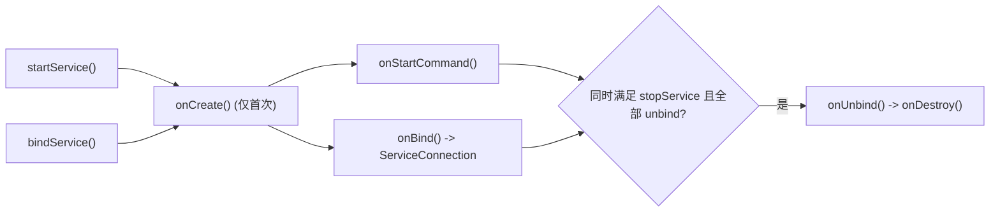

## 面试答题思路

- **本质区分**：`startService` 面向 **“长期后台干活”**（与调用者解耦，必须显式 `stopSelf`/`stopService` 才停止）；`bindService` 面向 **“客户端 C/S 交互”**（生命周期绑定全部连接方，所有客户端 `unbindService` 后自动销毁）。
- **混合使用销毁铁律**：如果同时既 `startService` 又 `bindService`，只有当 **`stopSelf/stopService` 被调用 AND 所有客户端都 `unbindService` 之后**，系统才会回调 `onDestroy()`。
- **高版本强约束**：Android 8.0 禁止后台隐式静默拉起普通 Service（需用 `startForegroundService()` 并在 **5 秒内**调用 `startForeground()` 弹出通知）；Android 12 限制后台从零起前台服务；Android 14+ 强制在 Manifest 与代码声明精确的 **`foregroundServiceType`**（且上架需审核合规理由）。

## 核心原理解析

### 1. 两条生命周期分支与 `onStartCommand` 返回值
- **`startService`**：`onCreate()`（仅首次）→ `onStartCommand()`（每次 start 均触发）→ `onDestroy()`。返回值决定进程被杀后的重启策略：`START_STICKY`（尝试重建但 `intent` 为 null）、`START_NOT_STICKY`（不自动重建）、`START_REDELIVER_INTENT`（重建并重传最后一次 Intent）。
- **`bindService`**：`onCreate()` → `onBind()`（返回 `IBinder` 给 `ServiceConnection.onServiceConnected`）→ `onUnbind()` → `onDestroy()`。注意：**`Service` 默认仍运行在应用主线程**，耗时任务必须切子线程或改用协程/WorkManager。

### 2. Android 8.0–15/16 前台服务适配要点
- `ContextCompat.startForegroundService()` 后必须在短时间内调用 `Service.startForeground(id, notification)` 绑定可见常驻通知，否则抛 **`ForegroundServiceDidNotStartInTimeException`** 崩溃；
- Android 14（API 34）起必须为每个前台服务声明具体类型（如 `mediaPlayback`、`location`、`dataSync`、`connectedDevice` 等）并申请对应前置权限，且 `dataSync` 在 Android 15+ 被限制单日最大运行时间（6 小时超时回调 `onTimeout` 必须自我停止否则崩溃）。

## 图解流程

## 高频追问与关键词

- **追问 1**：`IntentService` 为什么在 Android 11（API 30）被正式废弃？现代如何替代？
  - 关键词：因为 `IntentService` 底层本质仍依赖后台普通 `Service` + `HandlerThread`，受 Android 8.0 后台限制极其严重且无法自动对接省电约束；官方建议改用 **`WorkManager`**（持久化延迟/条件任务）或绑定具体类型的 **ForegroundService + 协程**。
- **追问 2**：普通后台不适合用 Service 后，进程退出后还想确保文件上传成功怎么办？
  - 关键词：`WorkManager`（内部委托 `JobScheduler` 并通过 Room 持久化任务），或者加急任务 `setExpedited()`。

## 延伸参考

参考 Android 官方 Services 概览与 Foreground Service Types 审核适配规范。
