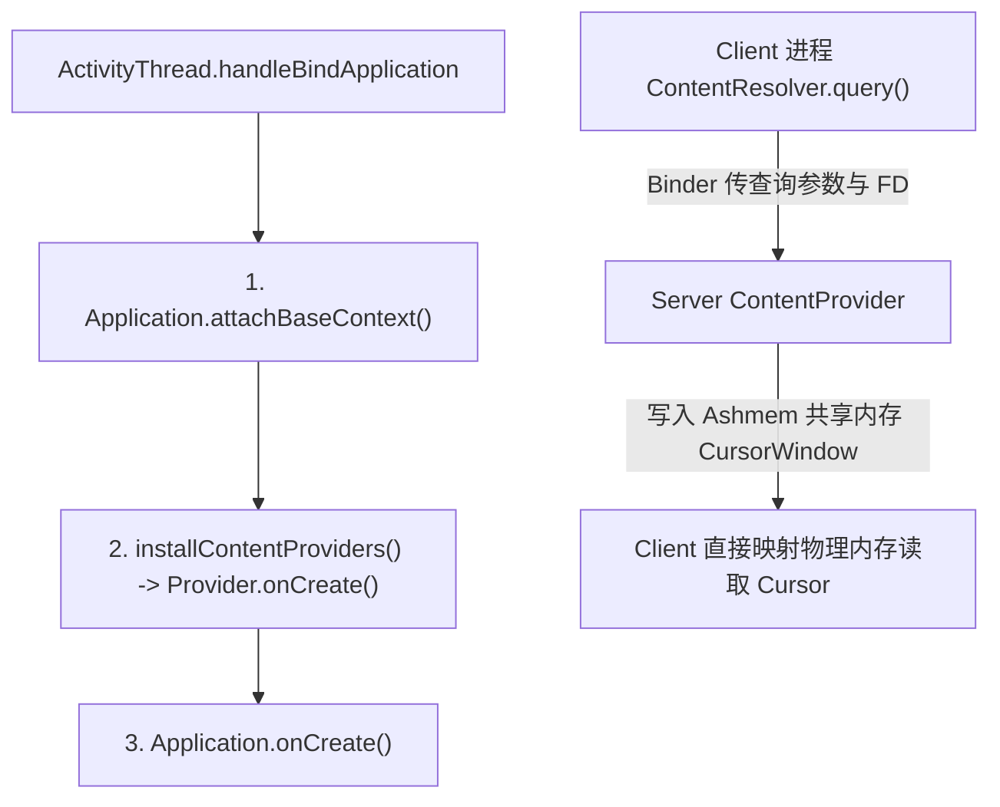

## 面试答题思路

- **两大核心定位**：① 对外提供统一 CRUD 抽象与安全跨进程数据共享（包括 `FileProvider` 跨应用临时授权分享文件 URI 取代危险的 `file://`）；② 因为其加载时机**早于 `Application.onCreate()`**，常被三方库用来“自动无侵入初始化”。
- **底层零拷贝加速**：除了使用 Binder 传递指令外，大批量查询结果（`Cursor`）并不直接塞进 1MB Binder 缓冲区，而是通过 **匿名共享内存（Ashmem）封装成的 `CursorWindow`** 跨进程映射共享。
- **冷启动优化抓手**：过多三方 SDK 自带空白 Provider 会产生多次反射与遍历成本，工程上需接入 Jetpack **`App Startup`** 合并为一个 `InitializationProvider`。

## 核心原理解析

### 1. 跨进程共享为什么快？（`CursorWindow` + 共享内存）
单纯靠 Binder 跨进程拷贝大量数据库结果集不仅性能低还会触发 `TransactionTooLargeException`。`ContentProvider` 查询时，服务端将结果填充进由 **`MemoryFile` / Ashmem** 创建的共享内存块 **`CursorWindow` **（通常约 2MB），仅通过 Binder 把对应**文件描述符（FD）** 传给调用方进程映射同一片物理内存，实现海量行数据的高效跨进程读取。

### 2. 启动初始化时机源码序
在 `ActivityThread.handleBindApplication()` 中，执行顺序严格为：
1. `Application.attachBaseContext()`（Multidex / Tinker 注入在此）
2. **`installContentProviders()`**（遍历并实例化清单声明的全部 `ContentProvider`，调用其 **`onCreate()`**）
3. **`Application.onCreate()`**
这解释了为什么 `FileProvider`、WorkManager、Lifecycle 等都能在用户完全不写代码时自动初始化。

### 3. `App Startup` 如何优化启动耗时？
若 App 集成 10 个三方库各自注册了独立 `ContentProvider`，冷启动期间反射解析和初始化耗时叠加可达上百毫秒。Jetpack `App Startup` 通过唯一的 `InitializationProvider` 在 Manifest 中聚合所有实现了 **`Initializer<T>`** 的组件，并支持 `dependencies()` 自动拓扑排序依赖关系与按需手动懒加载（延迟非首屏 SDK 到首帧后初始化）。

## 图解流程

## 高频追问与关键词

- **追问 1**：为什么 Android 7.0+ 跨应用分享文件（如调系统相机拍照或安装 APK）必须用 `FileProvider`？
  - 关键词：Android 7.0 起严格禁止暴露 `file://` URI（抛 `FileUriExposedException`），改用 `FileProvider` 生成 **`content://`** 临时 URI，并配合 `FLAG_GRANT_READ_URI_PERMISSION` 授予接收方单次临时读写权限，防止暴露底层私有沙盒路径。
- **追问 2**：App Startup 如何让某个重型非必须 SDK（如客服/地图）不卡死在启动期初始化？
  - 关键词：在 Manifest 里给对应 `Initializer` 的 `<meta-data>` 配置 `tools:node="remove"` 禁用自动启动，进入主界面后再手动调用 `AppInitializer.getInstance(context).initializeComponent(...)`。

## 延伸参考

对照 Android 官方 ContentProvider 与 App Startup 指南优化应用冷启动 Provider 初始化清单。
