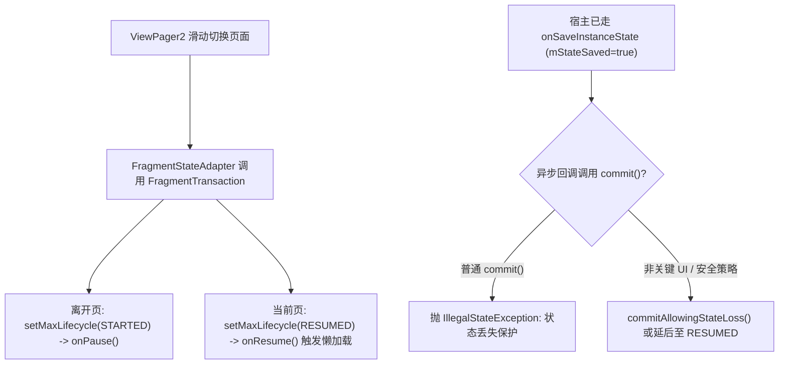

## 面试答题思路

- **最关键的生命周期分离**：Fragment 拥有**实例生命周期**（`onCreate` ↔ `onDestroy`）与**视图生命周期**（`onCreateView` ↔ `onDestroyView`）；当被放入回退栈或 `ViewPager2` 滑出缓存窗口时，视图销毁但实例仍在，因此所有 ViewBinding / LiveData 观察必须绑定 **`viewLifecycleOwner`** 并在 `onDestroyView` 置空视图引用防泄漏。
- **`ViewPager2` 懒加载进化**：彻底摒弃老 `ViewPager` 靠 `setUserVisibleHint` 拼凑的 hack 方案，直接依托 **`FragmentTransaction.setMaxLifecycle(fragment, State.STARTED/RESUMED)`**，只有当前真实可见页面才推进到 `onResume()`，天然把网络懒加载写进 `onResume()`（配合标志位防重复）即可。
- **`Can not perform this action after onSaveInstanceState` 本质**：在宿主状态已保存后执行普通 `commit()` 提交事务会被系统拦截防状态丢失；异步回调处应先检查生命周期或慎用 `commitAllowingStateLoss()`。

## 核心原理解析

### 1. 视图销毁但实例存活的典型泄漏坑
Fragment 被 `replace()` 加入 BackStack 后跳转到下一页面时：
- 仅回调 `onPause` → `onStop` → **`onDestroyView`**（并不走 `onDestroy`）；
- 返回时重新执行 **`onCreateView`**。
若在 Fragment 里错误地把 LiveData/Flow 订阅绑定在 `this`（Fragment 自身）而非 **`viewLifecycleOwner`**，每次重进 `onCreateView` 都会叠加注册重复观察者导致界面回调多次执行且泄漏旧视图树。

### 2. `ViewPager` vs `ViewPager2` 懒加载核心机制
- **老 `ViewPager`**：提前预创建相邻页并直接走完 `onResume`，只能靠 `BEHAVIOR_RESUME_ONLY_CURRENT_FRAGMENT` 或过时的 `setUserVisibleHint` 探测可见性；
- **`ViewPager2`**：底层是一个横向/竖向的 **`RecyclerView`** 配合 `FragmentStateAdapter`：
  - 滑出视野的邻近页生命周期上限被 `FragmentStateAdapter` 精确锁死在 `STARTED`（甚至后台销毁仅保留状态）；
  - **只有处于屏幕正中央的当前 Fragment 才会被允许走到 `RESUMED`**，使生命周期回调与真实用户可见严格一致，且自带 `DiffUtil` 局部刷新能力。

### 3. 为什么会抛出状态丢失异常？
宿主进入后台执行 `onSaveInstanceState()` 时，`FragmentManager` 会将内部 `mStateSaved` 置为 `true`：
- 若此时恰好异步网络请求返回并调用 `transaction.commit()`，这部分 UI 变更将**不会被记入已保存的 Bundle 状态快照中**，进程被杀恢复后会凭空消失；
- 系统主动抛出 `IllegalStateException` 提醒开发者；如果确认该 UI 变更无需跨进程重建恢复（如弹窗关闭），可使用 `commitAllowingStateLoss()` 或利用 **`lifecycleScope.launchWhenResumed` / `repeatOnLifecycle`** 安全延后到宿主恢复后再提交。

## 图解流程

## 高频追问与关键词

- **追问 1**：`add + show/hide` 切换多个 Tab Fragment 时，生命周期会回调吗？怎么感知切换可见？
  - 关键词：纯 `show/hide` 不会回调 `onResume`/`onPause`，需重写 **`onHiddenChanged(hidden)`** 或同样结合 `setMaxLifecycle()` 控制；推荐在 `Navigation` 或 `FragmentTransaction` 中配合 `setMaxLifecycle`。
- **追问 2**：ViewBinding 在 Fragment 中为什么强调必须在 `onDestroyView()` 置 `binding = null`？
  - 关键词：因为 Binding 类直接持有整个根布局和所有子 View 的强引用，Fragment 实例进回退栈比 View 活得更久，不置空会使整棵废旧 View 树无法被 GC 回收。

## 延伸参考

对照 Android 官方 Fragment Lifecycle 与 ViewPager2 迁移文档复习 `FragmentResultListener` 替代接口回调通信。
