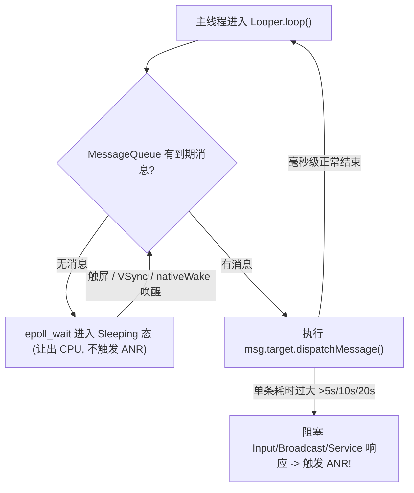

## 面试答题思路

- **先破误区**：把“死循环”等同于“卡死/ANR”是对阻塞模型和事件循环模型的混淆——死循环本身反而是所有 GUI 应用保活的基石（一旦退出 `Looper.loop()`，主线程结束，App 直接退出了）。
- **核心原因两条腿**：
  1. **为什么不耗电/不卡死 CPU**：当 `MessageQueue` 没有待处理消息时，主线程在 `nativePollOnce()` 里通过 Linux **`epoll_wait`** 陷入内核态睡眠，**完全让出 CPU**，直到有新消息或触屏/VSync 信号到来才瞬间唤醒；
  2. **ANR 到底是谁触发的**：ANR（Application Not Responding）不是因为主线程在“循环”，而是因为**某条正在主线程执行的消息耗时太长（比如主线程查库/死锁/重度计算）**，导致系统发过来的输入事件（5s）、前台广播（10s）或服务启动消息（20s）长期堵在队列里**得不到及时响应超时**，由 AMS/InputDispatcher 炸雷报出的超时异常。

## 核心原理解析

### 1. 主线程为什么必须是个“死循环”？
普通 Java 控制台程序跑完 `main()` 进程就结束了；但桌面端和移动端界面程序必须等待用户随时触屏、网络返回、系统回调。`ActivityThread.main()` 启动 `Looper.loop()` 后，四大组件的生命周期调度（`ActivityThread.H`）、界面重绘信号（`Choreographer`）与点击分发全部转化为一个个 `Message` 投递进主线程队列串行消费，保证整个 UI 线程状态安全。

### 2. CPU 休眠 vs 主线程卡顿的本质区别
- **空闲死循环**：`queue.next()` → `nativePollOnce(-1)` → Linux 内核把线程置为 `Sleeping` 等待事件句柄就绪，CPU 占用率为 0%；
- **真发生 ANR 的过程**：系统进程（如 `InputDispatcher`）往应用发了一个点击事件并启动 5 秒倒计时炸弹；恰好主线程正在一条 `Message` 里死锁或同步写入超大 SP 文件卡了 6 秒没回到 `Looper.loop()` 取下一条消息 → 倒计时到点还没收到回执 → 系统弹出 ANR 对话框并收集 `traces.txt`。

## 图解流程

## 高频追问与关键词

- **追问 1**：如果在主线程执行一个极其耗时的空循环 `while(true) {}`，和 `Looper.loop()` 有什么本质区别？
  - 关键词：业务代码里写 `while(true)` 是在**用户态疯狂空转占满单核 CPU** 且永远无法交还控制权给 `Looper.loop()` 取下一条事件，**5 秒内触屏必 ANR**；而 `Looper.loop()` 内核休眠等待新消息，醒来快速处理完就回到等待点。
- **追问 2**：`ActivityThread.main()` 的 `Looper.loop()` 正常情况下有可能退出吗？
  - 关键词：主线程 `MainLooper` 初始化时传入 `quitAllowed = false`，正常不允许主动退出；只有当内部抛出未捕获异常或进程终止时才离开循环。

## 延伸参考

参考 Android 官方 ANR Vitals 指南，理解系统埋雷与拆雷的异步超时检测机理。
