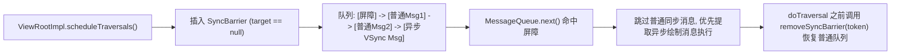

## 面试答题思路

- **核心设计动机**：Android 主线程队列里塞满了普通业务消息（网络回调、埋点、点击跳转）；当 VSync 屏幕刷新信号到来时，如果 UI 绘制消息老实排在几十个耗时普通消息后面，页面就会卡顿掉帧。因此系统设计了**同步屏障机制为渲染任务插队开绿灯**。
- **核心识别特征**：普通消息 `msg.target` 必然指向发送它的 `Handler`，而**同步屏障消息是一条 `msg.target == null` 的特殊消息**，由 `MessageQueue.postSyncBarrier()` 插入队列。
- **调度行为**：`MessageQueue.next()` 扫描到队头是屏障消息时，会**跳过所有普通同步消息**，专门向后检索并执行标记了 **`msg.setAsynchronous(true)`** 的异步消息（主要是 `Choreographer` 注册的绘制帧回调）。

## 核心原理解析

### 1. 插入屏障与放行异步消息源码链路
当调用 `View.invalidate()` 或 `requestLayout()` 触发 `ViewRootImpl.scheduleTraversals()` 时：
1. 立即调用 `mHandler.getLooper().getQueue().postSyncBarrier()` 插入一条 `target == null` 的屏障消息并拿到 `token` 凭据；
2. 请求系统下发下次 VSync；VSync 抵达时 `Choreographer` 发送一条 `setAsynchronous(true)` 的异步消息执行 `doFrame()`；
3. `MessageQueue.next()` 遍历链表一旦发现队头 `msg.target == null`，就进入 `while` 循环向后跳过所有普通同步消息，只取出 `msg.isAsynchronous()` 为真的异步消息执行；
4. **`doTraversal()` 执行前第一时间调用 `removeSyncBarrier(token)` 移除屏障**，恢复正常普通消息排队调度。

### 2. 常见异常与防泄漏规范
- `postSyncBarrier()` 与 `removeSyncBarrier()` 在 Android SDK 中属于 `@hide` 系统级 API，普通应用不建议通过反射强行调用——**一旦忘记移除或异常分支跳过移除，主线程所有普通同步消息将被永久饿死卡死页面**；
- 若业务确实需要在特定 Handler 中创建异步消息，可通过 `Handler.createAsync(looper)`（API 28+）或给 `Message` 设 `isAsynchronous = true`（注意只有遇到系统插入同步屏障期间才会体现优先级）。

## 图解流程

## 高频追问与关键词

- **追问 1**：异步消息一定能跳过已经正在执行的普通消息吗？
  - 关键词：不能抢占！主线程依然是单线程串行执行，异步消息只能在“选下一条消息”时越过排队中的同步消息；如果前一条同步消息本身卡了 2 秒，异步 VSync 消息一样要等它跑完，这就是主线程耗时导致丢帧的原因。
- **追问 2**：除了 `ViewRootImpl`，系统还有哪些地方用异步消息？
  - 关键词：`Choreographer` 帧动画、部分 `MediaCodec` 回调与 `ViewPropertyAnimator` 等对时序敏感的系统回调。

## 延伸参考

查看 AOSP `MessageQueue.java` 与 `ViewRootImpl.java` 的 `scheduleTraversals` / `unscheduleTraversals` 源码。
