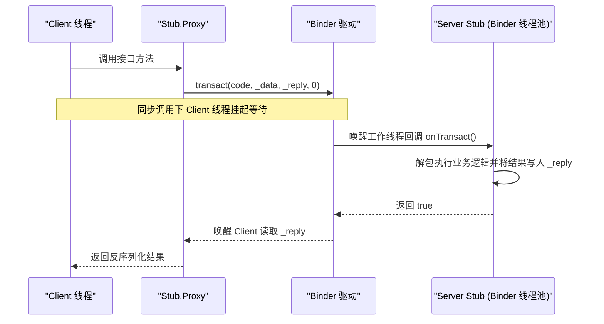

## 面试答题思路

- **核心类比**：AIDL 本质上是编译期帮开发者自动生成一套标准的 Binder 序列化打包（Proxy）与解包分发（Stub）模板代码。
- **同进程 vs 跨进程智能识别**：客户端拿到 `IBinder` 调用 `Stub.asInterface(service)` 时，底层调用 `queryLocalInterface()` 判断是否处于同一进程——**同进程直接强转直调本对象（零 Binder 开销）**；**跨进程则返回 `Stub.Proxy`** 走底层 `transact()`。
- **三大实战关键点**：**`oneway` 异步修饰**（不阻塞调用方且异步事务缓冲区减半）、**服务端默认 Binder 线程池并发上限（普通进程最多 15 个非主调度线程 + 1 主Binder线程，须做好服务端线程安全）**，以及 **`linkToDeath()` 死亡监听自动重连**。

## 核心原理解析

### 1. Proxy → Kernel → Stub 全流程
1. **客户端 `Proxy`**：把方法参数按顺序写入请求 `Parcel _data`（通过 `writeInterfaceToken` 写校验标识），调用 `mRemote.transact(TRANSACTION_code, _data, _reply, flags)` 陷入内核并挂起当前客户端线程（除非带 `oneway`）；
2. **服务端 `Stub`**：Binder 驱动唤醒服务端空闲 **Binder 线程池**里的某个工作线程，回调 `Stub.onTransact(code, data, reply, flags)`；解包参数调用真实 `Service` 实现方法，把返回值写回 `_reply` 后唤醒客户端读取结果（最终务必 `recycle()` 释放 `Parcel`）。

### 2. 定向修饰符与 `oneway` 注意事项
- **`in` / `out` / `inout`**：控制对象在跨进程序列化时的数据流向（`in` 单向传入服务端改动不影响客户端；`out` 不传初始值只从服务端带回填充结果；`inout` 双向拷贝开销最大），避免盲目全写 `inout` 浪费传输性能。
- **`oneway`**：仅可用于返回 `void` 且无 `out`/`inout` 参数的方法；调用后立刻返回不阻塞调用端，**但异步事务在同进程下的共享 Binder 空间只允许占一半上限（约 508KB）**，且同一代理上的异步请求串行保序。

### 3. 死亡代理（`linkToDeath`）与回调解绑
- 客户端向远程 `IBinder` 调用 `binder.linkToDeath(deathRecipient, 0)`；当服务端意外崩溃或被强杀时，内核驱动立刻触发 `binderDied()`，客户端可安全清理状态并在后台重新 `bindService`；
- 双向通信注册客户端回调监听（`registerCallback`）时，服务端必须使用 **`RemoteCallbackList<T>`** 管理跨进程接口（底层以 `IBinder` 为 Key，能在客户端意外崩溃时自动感知清理防止死回调及内存泄漏）。

## 图解流程

## 高频追问与关键词

- **追问 1**：如果在服务端方法里加 `synchronized` 需要吗？AIDL 服务端方法运行在哪个线程？
  - 关键词：运行在服务端的 **Binder 线程池**（默认上限 `ProcessState` 设置 `15 + 1` 共 16 个，不能直接在内部操作 UI）；多个客户端并发请求会并行打入不同 Binder 线程，因此共享状态必须做好线程同步控制。
- **追问 2**：`ServiceConnection.onServiceDisconnected` 和 `IBinder.DeathRecipient.binderDied` 有什么区别？
  - 关键词：`onServiceDisconnected` 回调在客户端**主线程**（适合更新 UI 重连）；`binderDied()` 回调在客户端的 **Binder 线程池**（需切回主线程或加锁处理，而且对非 `bindService` 获取的普通匿名 Binder 依然可用）。

## 延伸参考

参考 Android Developers 官方 AIDL 与 Bound Services 指南，重点复习 `RemoteCallbackList` 与 `oneway` 约束。
