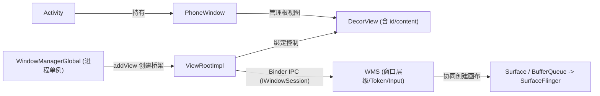

## 面试答题思路

- **一句话打通各组件角色**：**`Window` 是抽象窗口契约**，唯一实现类是 **`PhoneWindow`**；**`DecorView`** 是挂在 `PhoneWindow` 里的根 `FrameLayout` 容器（包含状态栏占位与用户 `content` 区）；**`WindowManagerImpl` / `WindowManagerGlobal`** 负责管理窗口；真正干活并打通跨进程与绘制的桥梁是 **`ViewRootImpl`**；最终由系统服务 **`WMS`（WindowManagerService）** 协调 `SurfaceFlinger` 分配绘制画布 **`Surface`** 并统一管理窗口 Z-Order 层级与输入焦点。
- **高频误区纠正**：`Window` 本身并不是一个实实在在存在的像素窗口，真正向屏幕输出图像靠的是绑定到每个 `ViewRootImpl` 上的一块底层 **`Surface`**（对应生产-消费图元缓冲队列 `BufferQueue`）。

## 核心原理解析

### 1. `setContentView()` 时发生了什么？
在 `Activity.onCreate()` 调 `setContentView(layoutRes)` 时：
1. 调用 `PhoneWindow.setContentView()`；
2. 首次初始化创建顶级容器 **`DecorView`**（继承自 `FrameLayout`），并根据主题加载内置基础布局（顶部 Title/ActionBar 与下方 `id = com.android.internal.R.id.content` 的 `FrameLayout`）；
3. `LayoutInflater` 把开发者的 XML 布局填充挂载到这个 **`content` 容器**中。
注意：**此时窗口还未真正添加到屏幕，也不存在 `ViewRootImpl`！**

### 2. `ViewRootImpl` 何时诞生并与 `WMS` 握手？
在 `Activity.onResume()` 之后（`ActivityThread.handleResumeActivity`）：
1. 调用 `WindowManagerImpl.addView(decorView, layoutParams)`，内部委托给进程单例 **`WindowManagerGlobal`**；
2. `WindowManagerGlobal` 创建核心大管家 **`ViewRootImpl`** 并调用 `viewRoot.setView(decorView, ...)`；
3. `ViewRootImpl` 一方面调用 `requestLayout()` 触发第一次完整测量布局绘制；另一方面通过 Binder (`IWindowSession`) 请求 **`WMS.addWindow()`** 校验 Token、按 Z-Order 排序窗口、创建输入通路 **`InputChannel`**，并由 `SurfaceFlinger` 分配出对应的 **`Surface`** 供 `ViewRootImpl` 渲染提交图像帧。

## 图解流程

## 高频追问与关键词

- **追问 1**：一个应用进程里能同时有多个 `Window` 和多个 `ViewRootImpl` 吗？
  - 关键词：可以！每个正在展示的 `Activity`、弹出的 `Dialog`、`PopupWindow` 或 `Toast` 都有各自独立的 `PhoneWindow`/视图根及对应的 **`ViewRootImpl`**（`WindowManagerGlobal` 内用三个 List 维护全局所有活跃窗口 View、ViewRootImpl 和 LayoutParams）。
- **追问 2**：非 UI 线程为什么不能更新 UI？`ViewRootImpl` 是怎么检查的？
  - 关键词：`ViewRootImpl` 构造时会记录当前创建线程 `mThread = Thread.currentThread()`；每次 `invalidate()` / `requestLayout()` 向上冒泡最终都会触发 `ViewRootImpl.checkThread()`，一旦发现不是主线程即抛 `CalledFromWrongThreadException`（反推可知：在 `onCreate()` 刚刚启动子线程趁 `ViewRootImpl` 还没创建前短暂改 UI 竟然不会立即崩，但绝不合规）。

## 延伸参考

参考 AOSP Graphics Architecture 文档，梳理 `Surface`、`BufferQueue` 与 `WMS` 的跨进程协作链路。
