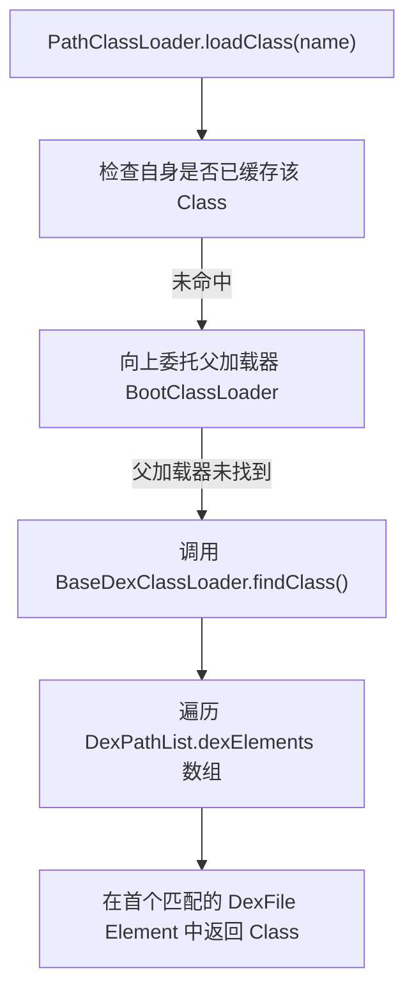

## 面试答题思路

- **核心类族谱**：Java 标准是 `Bootstrap / Ext / AppClassLoader`，而 Android 替换为 **`BootClassLoader`**（加载系统 Framework 类）和继承自 **`BaseDexClassLoader`** 的 **`PathClassLoader`**（加载已安装 APK 内的主/从 dex）与 **`DexClassLoader`**（可动态加载外部目录 `.apk`/`.dex`/`.jar`，Android 8.0+ 后两者代码几乎合并）。
- **双亲委派本质**：加载某个类时先自下而上委托 `parent` 检查是否已加载；只有全部父加载器都找不到时才自行在当前 `DexPathList.dexElements` 数组里依次遍历寻找（防止系统核心类如 `java.lang.String` 被恶意篡改，并避免同一类被重复加载）。
- **MultiDex 分包突破 65536 原理**：单一 `.dex` 文件方法索引（16 位 `short`）上限为 65536；在 API 21 以下（Dalvik），`MultiDex.install()` 在 `attachBaseContext()` 阶段通过反射将 `classes2.dex`、`classes3.dex` 追加进宿主 `PathClassLoader` 的 `dexElements` 数组里；API 21+（ART）在安装期（`dex2oat`）直接把多个 dex 原生合并编译进机器码，无需运行时反射插桩。

## 核心原理解析

### 1. `BaseDexClassLoader` 内部查找机制
`PathClassLoader` 和 `DexClassLoader` 核心查找逻辑都在父类 `BaseDexClassLoader.findClass(name)` 中：
- 内部持有一个 **`DexPathList pathList`**；
- `pathList` 内部包含核心数组 **`Element[] dexElements`**，每个 `Element` 封装了一个 `.dex` 文件（`DexFile`）；
- **`findClass` 顺序遍历 `dexElements`**：一旦在靠前的某个 `Element` 中命中目标类名就立即返回，**后面的同名类根本不会被加载**（这正是热修复和很多插件化方案的核心突破口！）。

### 2. Android 14+ 动态代码加载安全限制（DCL）
在现代版本中动态从可写目录（如 SD 卡或私有可写文件夹）通过 `DexClassLoader` 加载 `.dex` 已被严格管控：**Android 14（API 34）要求所有动态加载的 dex/jar 文件必须设为只读（Read-only）**，否则直接抛出 `SecurityException`，防范热更新/外部文件被篡改注入。

## 图解流程

## 高频追问与关键词

- **追问 1**：双亲委派一定不能打破吗？Android 哪些场景打破了它？
  - 关键词：并非绝对。如热修复类加载插桩虽然没有直接推翻双亲委派父子顺序，而是通过操纵同级 `dexElements` 数组前置顺序抢先命中修复类；此外一些隔离插件框架会重写 `loadClass()` 优先查插件自身私有类，再走宿主委派。
- **追问 2**：如果开启 MultiDex 支持老设备（`minSdk < 21`），主 `classes.dex` 漏放启动核心类会报什么错？
  - 关键词：在 `MultiDex.install()` 还没执行完前就用到的类（如 `Application` 本身及早期静态引用、自定义 `ContentProvider`）如果不在主 dex 中，会直接抛出 **`NoClassDefFoundError`**；可通过 `multiDexKeepProguard` / `MainDexList` 显式保留。

## 延伸参考

参考 Android 官方 MultiDex 文档与 `DexClassLoader` 参考指南梳理 Android 14 动态加载只读限制。
