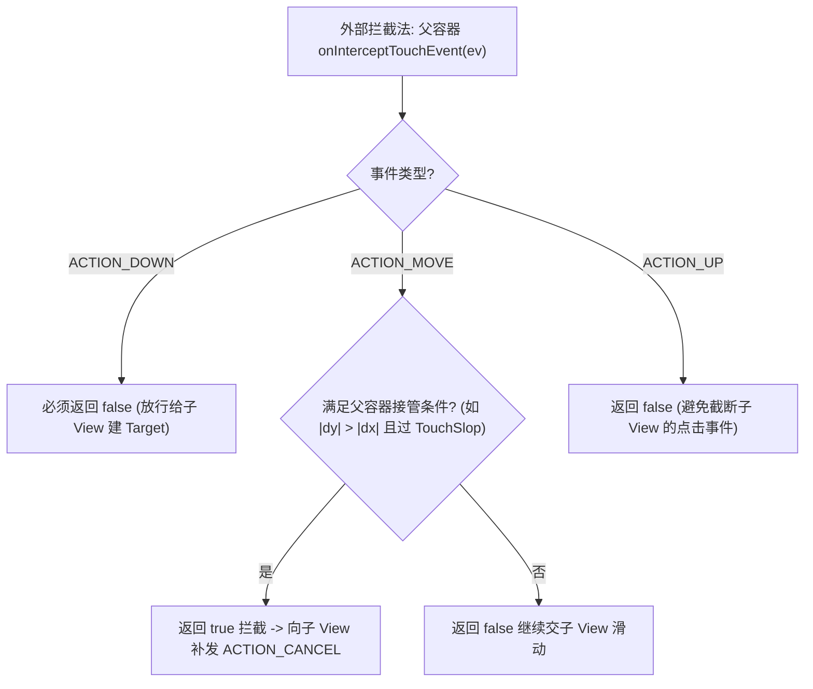

## 面试答题思路

- **滑动冲突三大类型**：① **方向交错冲突**（外层横向 `ViewPager2` / `Banner`，内层竖向 `RecyclerView`；或外层竖向滑动嵌套横向轮播卡片）；② **同向滑动冲突**（外层 `ScrollView` / 刷新头套内层列表，取决于谁滑到顶部/底部边界）；③ **复合混合冲突**（上述叠加，如抽屉侧滑套横向瀑布流）。
- **核心解法两派**：
  - **外部拦截法（推荐首选，符合分发直觉）**：所有点击与拖动优先由**父容器 `onInterceptTouchEvent()`** 统一决策：`ACTION_DOWN` 必放行（返回 `false` 否则子 View 收不到后续），`ACTION_MOVE` 根据业务条件/斜率决定是否拦截（返回 `true` 则父容器接管并向子 View 补发 `ACTION_CANCEL`），`ACTION_UP` 必放行（避免吞掉子 View 点击）。
  - **内部拦截法**：父容器默认除 `ACTION_DOWN` 外都放开拦截判断；**子 View 在 `dispatchTouchEvent()` 主动控权**——`DOWN` 时立刻调用 `parent.requestDisallowInterceptTouchEvent(true)` 锁住父容器，`MOVE` 时发现该交给父容器了再调 `requestDisallowInterceptTouchEvent(false)` 归还控制权（前提：父容器的 `onInterceptTouchEvent` 在非 `DOWN` 阶段得默认返回 `true` 才能在还权瞬间拦截下来）。

## 核心原理解析

### 1. `ACTION_CANCEL` 到底什么时候触发？
1. **父容器半路抢劫**：`ACTION_DOWN` 交给了子 View 并建立了 `mFirstTouchTarget`；在后续 `ACTION_MOVE` 时用户手指位移触发了父容器（如 `RecyclerView`、`ViewPager2`）的滑动阈值 `touchSlop`，父容器 `onInterceptTouchEvent()` 返回 `true` 拦截事件，此时 `ViewGroup` 立刻构造一个 **`ACTION_CANCEL`** 投递给原目标子 `View` 并清空 `mFirstTouchTarget`（提醒子 View 恢复按钮未按下态、取消点击检测）；
2. **窗口焦点丢失 / 移出屏幕**：手指滑出控件作用域或系统弹窗/来电抢走窗口焦点时也会收到 `ACTION_CANCEL`。

### 2. 横竖方向滑动冲突经典案例实战
**案例：`ViewPager2`（横向翻页）内嵌套横向滑动的 `RecyclerView` / Banner，或竖向 `RecyclerView` 内嵌套横向 `ViewPager2`**：
- **判别规则（防斜滑误触）**：记录 `ACTION_DOWN` 坐标 `(downX, downY)`，在 `ACTION_MOVE` 计算 `dx = |x - downX|`、`dy = |y - downY|`，先过 **`ViewConfiguration.get(context).scaledTouchSlop`** 防抖阈值：
  - 若 `dx > dy`（横向意图更强，如角度 `< 45°` 甚至可收紧到 `dx > dy * 1.2`）：交由横向滑动容器处理；
  - 若是**同为横向的 `ViewPager2` 套横向 Banner / 画廊**：Banner 在 `ACTION_DOWN` 调用 `requestDisallowInterceptTouchEvent(true)`，并在 `MOVE` 时判断**当滑到第一页继续右滑（`!canScrollHorizontally(-1)`）或滑到最后一页继续左滑（`!canScrollHorizontally(1)`）** 时再设 `false` 归还给外层 `ViewPager2` 翻页！

## 图解流程

## 高频追问与关键词

- **追问 1**：为什么 `ViewPager2` 官方不直接内置解决多层同向嵌套滑动冲突？官方怎么处理？
  - 关键词：因为同向嵌套涉及“滑到第几项/边界何时让父容器接管”的业务语义；官方示例提供了轻量外包包装器 **`NestedScrollableHost`**，核心原理就是利用内部拦截法检查 `canScrollHorizontally/Vertically` 并结合 `scaledTouchSlop` 调用 `requestDisallowInterceptTouchEvent`。
- **追问 2**：外部拦截法中，如果父容器在 `ACTION_UP` 返回 `true` 会出什么 Bug？
  - 关键词：若之前没有拦截子 View 的 `MOVE`，子 View 的 `UP` 将被父容器半路截走变成子 View 收到 `ACTION_CANCEL`，导致子控件点击事件（`OnClickListener`）完全失效。

## 延伸参考

对照 Android 官方 ViewGroup 手势冲突指南与官方 `ViewPager2` `NestedScrollableHost` 源码实现加深实战印象。
