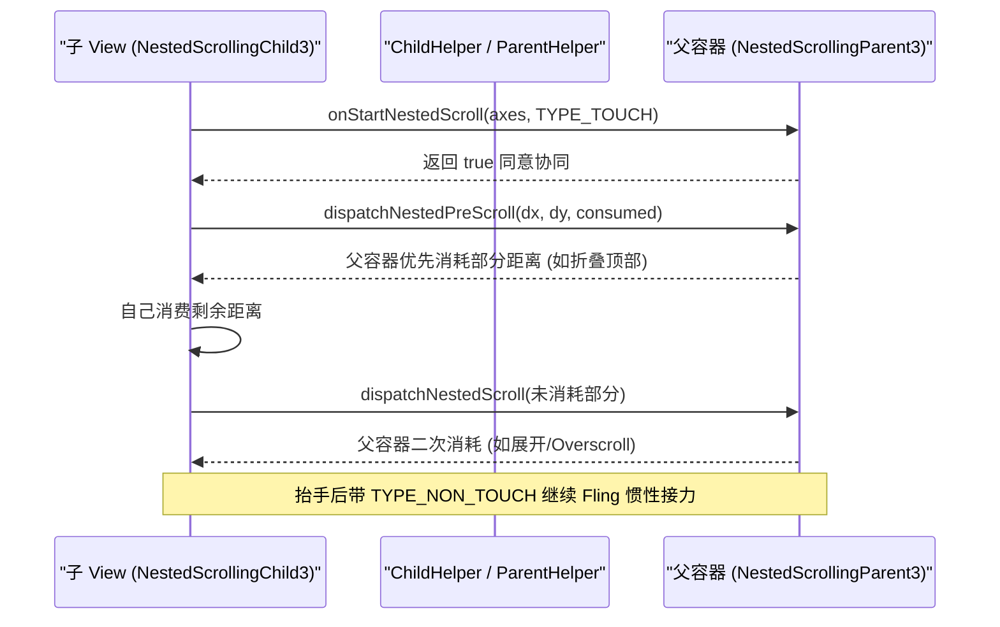

## 面试答题思路

- **传统分发为什么搞不定同向嵌套联动？**：传统事件分发一旦被父容器 `onInterceptTouchEvent` 截胡，同一根手指不抬起时子 View 就彻底失去了后续事件（做不到“先把顶部头图滑折叠，不松手紧接着列表无缝滚动”）。**嵌套滑动机制（`NestedScrolling`）改由子 View 主导接收事件，每移动一点距离都先问父容器要不要协同消费，剩余距离自己再用**。
- **核心接口进化**：从 `Parent/Child` → `2`（区分 `TYPE_TOUCH` 手指拖动与 `TYPE_NON_TOUCH` Fling 惯性滑动）→ **`3`（`onNestedScroll` 补充精确返回父容器二次未消费完的距离 `consumed[]`）**。
- **`NestedScrollView` 五大实战踩坑（必答重点）**：① 内部直接嵌 `RecyclerView` 导致**全量测量、ViewHolder 缓存复用彻底失效引发滑动卡顿甚至大图 OOM**；② `fillViewport="true"` 未设置导致子控件撑不满屏；③ 列表内嵌 `RecyclerView` 时误关 `isNestedScrollingEnabled` 导致联动断层；④ 快速惯性 Fling 在父子边界卡顿衔接不畅。

## 核心原理解析

### 1. 嵌套滑动完整协同周期（子 View 驱动）
1. **启动阶段**：子 View（如 `RecyclerView`、`NestedScrollView`）在 `ACTION_DOWN` 时调用 `startNestedScroll(axes, type)`，通过 `NestedScrollingChildHelper` 逐级向上找实现了 `NestedScrollingParent` 的父容器（如 `CoordinatorLayout` 或外层 `NestedScrollView`）并回调 **`onStartNestedScroll()`** 配对成功；
2. **滑动前优先让父容器先滑（`onNestedPreScroll`）**：手指产生偏移 `(dx, dy)` 时，子 View 先不急着滑，而是调用 **`dispatchNestedPreScroll()`** 询问父容器要消耗多少（比如 `AppBarLayout` 先把头部折叠掉 `consumed[1]` 像素）；
3. **子 View 自己消费剩余距离**：子 View 消费 `(dy - consumed[1])`；
4. **滑动后兜底再交还父容器（`onNestedScroll`）**：如果子 View 已经滑到底或滑到顶还有富余距离（overscroll），在 `NestedScrollingParent3` 中回调父容器 **`onNestedScroll(..., consumed)`** 处理底部回弹或下拉展开。
5. **Fling 与收尾**：抬手惯性期间通过 **`type = ViewCompat.TYPE_NON_TOUCH`** 持续联动（例如把列表高速回顶后的多余惯性速度传给顶部 `AppBarLayout` 顺滑弹出），最终调 `stopNestedScroll()` 结束。

### 2. 为什么强烈不建议在 `NestedScrollView` 里直接放 `RecyclerView`？
当外层 `NestedScrollView` 把 `RecyclerView` 的高度模式设为 `UNSPECIFIED`（或常见套用 `wrap_content`）测量时：
- `RecyclerView` 为了算总高度不得不**一口气把所有条目全量 `createViewHolder` + `bindViewHolder` 实例化并贴进屏幕里**；
- **`RecyclerView` 引以为傲的四级视图复用机制直接废掉**，如果列表有 100 条带图片的数据，首屏加载瞬间就会卡死甚至直接 OOM！
- **正确解法**：
  - 优先使用 **单层 `RecyclerView` 多 `ViewType`**（把顶部 Header、Banner 和下面列表全都变成 `RecyclerView` 的不同 ItemType，或者使用 **`ConcatAdapter`** 拼接多个 Adapter，性能最优）；
  - 必须联动折叠头图时，使用 **`CoordinatorLayout` + `AppBarLayout` + `RecyclerView`**，让 `RecyclerView` 保持固定可滚动视口，千万不要外面再套一层 `NestedScrollView`！

## 图解流程

## 高频追问与关键词

- **追问 1**：如果历史老页面实在无法改成单 `RecyclerView`，非要 `NestedScrollView` 里嵌列表且需要展示“头部+多组独立内容”怎么办？
  - 关键词：首先极力重构为 **`ConcatAdapter`** + 多 `ViewType`；若局部只有固定十几条轻量 Item，设置 `recyclerView.isNestedScrollingEnabled = false` 交由外层统一滚动，或改用 Jetpack Compose `LazyColumn`（原生支持任意混合 Slot）。
- **追问 2**：`NestedScrollView` 里的子布局设置 `match_parent` 高度为什么经常只占一小半屏？
  - 关键词：因为 `ScrollView`/`NestedScrollView` 传给子 View 的 MeasureSpec 是 `UNSPECIFIED` 允许无限长，子容器不知道一屏高度有多高；必须在 XML 上开启 **`android:fillViewport="true"`** 强制子 View 至少铺满视口高度。

## 延伸参考

参考 Android 官方 `NestedScrollingParent3` 与 `NestedScrollView` 文档，结合 `ConcatAdapter` 替代嵌套滚动方案。
