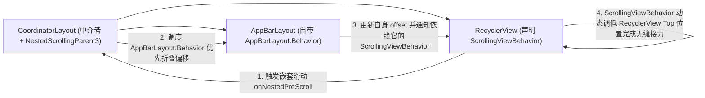

## 面试答题思路

- **本质架构（中介者/插件化调度）**：`CoordinatorLayout` 本身几乎不写死任何具体动画逻辑，它扮演的是一个**超级协调中心（实现了 `NestedScrollingParent3`）**，所有直接子 View 都可以通过 `LayoutParams` 挂载一个 **`Behavior`** 插件；`CoordinatorLayout` 在测量、布局、触摸分发与嵌套滑动四个时机统一把事件转发给各子 View 的 `Behavior`。
- **最经典联动组合**：`CoordinatorLayout` + `AppBarLayout`（默认绑 `AppBarLayout.Behavior` 拦截或响应子列表滚动）+ 下方滚动体 **`RecyclerView` / `ViewPager2`（必须声明 `app:layout_behavior="@string/appbar_scrolling_view_behavior"`）**。
- **高频工程坑点**：`AppBarLayout` 折叠区域内如果自带可滑控件或快速点击切换容易产生 **Fling 抖动** 与半折叠态停滞（需配置 `snap` 或新版 Material 修正）；另外不要把非直接子 View 挂 `Behavior`（无效！）。

## 核心原理解析

### 1. `Behavior` 的两大核心能力维度
自定义或内置 `CoordinatorLayout.Behavior<V>` 主要做两件事：
1. **视图间位置/状态依赖联动**：
   - 重写 `layoutDependsOn(parent, child, dependency)` 声明“我依赖哪个兄弟 View”；
   - 当被依赖的兄弟 View 移动或大小改变时（例如 `Snackbar` 弹出或 `AppBarLayout` 折叠偏移），回调 `onDependentViewChanged()` 驱动当前 `child`（如 `FloatingActionButton` 上移避让、标题栏渐变显隐）。
2. **接管嵌套滑动（核心用于折叠吸顶）**：
   - 借助 `onStartNestedScroll` / `onNestedPreScroll` / `onNestedScroll` 监听下方带着 `ScrollingViewBehavior` 的列表滚动距离：
     - **上滑折叠时**：在 `onNestedPreScroll` 中由 `AppBarLayout.Behavior` 优先吃掉滑动距离把自己往上缩起（直到全部折叠进屏幕外或剩 `minHeight` 吸顶栏），再让下方 `RecyclerView` 滚动内部元素；
     - **下滑展开时**（不带 `enterAlways`）：列表先滚回顶部 `canScrollVertically(-1) == false` 后，剩余向下距离在 `onNestedScroll` 传给 `AppBarLayout` 重新撑开。

### 2. `AppBarLayout` 常用 `layout_scrollFlags` 组合含义
- `scroll`：必备基础标记，允许随滚动体滚出屏幕；
- `enterAlways`：只要列表稍微往下拉一点，顶栏立刻优先滚回显示（常用于搜索栏快速召回）；
- `exitUntilCollapsed`：折叠时保留 `minHeight` 或内部固定栏（如 `TabLayout`）停在顶部不完全消失（**吸顶 Tab 经典必配**）；
- `snap`：松手时如果折叠了一半没过阈值，自动弹性吸附到完全折叠或完全展开，消除尴尬半截态。

## 图解流程

## 高频追问与关键词

- **追问 1**：为什么 `AppBarLayout` 配 `RecyclerView` 滑动时偶尔出现猛滑停下来后，接着按住 `AppBarLayout` 自身拖动滑不动或剧烈抖动？
  - 关键词：老版本 `AppBarLayout` 的惯性 Fling `OverScroller` 与下方 `RecyclerView` Fling 未做完全隔离停止，快速点击 `AppBarLayout` 区域时必须通过停止正在进行中的 Fling 动画（现代 Material 库已大幅修复，自定义时需在 `onInterceptTouchEvent` / `ACTION_DOWN` 取消惯性 scroller），另外检查 `app:layout_scrollFlags` 是否误对吸顶后的外层布局导致测量抖动。
- **追问 2**：想实现页面滚动时顶部渐变半透明 TitleBar + 状态栏图标变色，用 `CoordinatorLayout` 还是直接监听 `RecyclerView.addOnScrollListener` 好？
  - 关键词：如果只是纯顶部浮层渐变 + 单列表吸顶，单 `RecyclerView` 监听滚动或 `ConcatAdapter` 配合吸顶 `ItemDecoration` 往往更轻量可控、无多组件耦合坑；只有在**多组件协同视差缩放（`CollapsingToolbarLayout`）+ 多个嵌套页面切换（`ViewPager2` 共用同一个折叠头部）** 时，`CoordinatorLayout + AppBarLayout` 才是不可替代的最佳方案。

## 延伸参考

参考 Android Developers `CoordinatorLayout` 与 Material `AppBarLayout` 官方 API 文档梳理自定义 `Behavior` 回调顺序。
