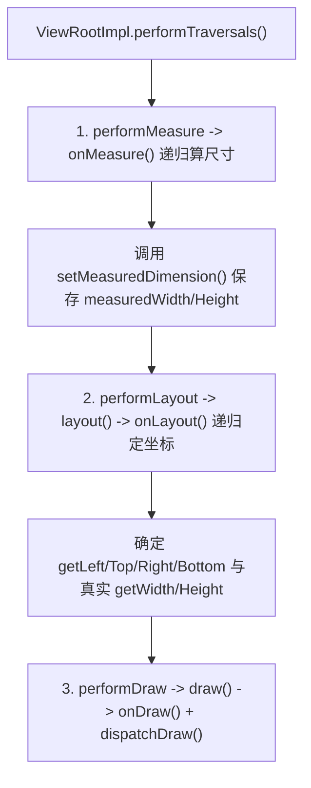

## 面试答题思路

- **总控调度链路**：任何界面显示或 `requestLayout()` 最终都汇总到 **`ViewRootImpl.performTraversals()`**，按严格顺序依次推进三个阶段：**`performMeasure()`**（算自身及子视图宽高）→ **`performLayout()`**（确定上下左右相对父容器坐标）→ **`performDraw()`**（绘制背景、自身内容、子视图及滚动条等装饰）。
- **`MeasureSpec` 压缩结构**：一个 32 位 `int` 打包了 **高 2 位 `Mode`**（`UNSPECIFIED` 不限制、`EXACTLY` 精确值、`AT_MOST` 最大不超过）和 **低 30 位 `Size`**（数值上限）。
- **核心协商法则**：**子 View 的最终 `MeasureSpec` 不是自己说了算，而是由“父容器传下来的剩余约束 `MeasureSpec`” + “子 View 自身 `LayoutParams`（match_parent / wrap_content / 固定值）”通过 `ViewGroup.getChildMeasureSpec()` 共同查表合成**。

## 核心原理解析

### 1. MeasureSpec 合成核心矩阵规律
- **子 View 写了固定值（如 `100dp`）**：无论父容器什么模式，结果都是 `EXACTLY + 100dp`（除非受限）；
- **子 View 写了 `match_parent`**：如果父容器是 `EXACTLY`，子也是 `EXACTLY`；如果父容器是 `AT_MOST`，子也是 **`AT_MOST`**（最大不超过父容器上限）；
- **子 View 写了 `wrap_content`**：无论父容器是 `EXACTLY` 还是 `AT_MOST`，子 View 拿到的都是 **`AT_MOST + 父容器剩余可用空间`**！这也直接解释了为什么自定义 View 不重写 `onMeasure()` 处理 `AT_MOST` 时，`wrap_content` 的效果会跟 `match_parent` 一模一样（全撑满父容器上限）。

### 2. 为什么根视图与复杂容器可能会触发多次 `measure`？
- **`DecorView` 根测量**：`ViewRootImpl` 计算根视图 `MeasureSpec` 时取屏幕尺寸 + `WindowManager.LayoutParams`；
- **容器特性导致二次测量**：例如 `LinearLayout` 配置了 `weight` 权重分配，或者 `RelativeLayout` 需要先横向测依赖再纵向测位置，以及 `ConstraintLayout` 的约束求解——**嵌套越深，二次测量呈 `2^n` 指数级放大**，这就是布局优化强调“扁平化减少层级”的底层数学原因。

### 3. `onDraw()` 标准绘制六步曲（注意 `setWillNotDraw`）
1. 绘制背景 `drawBackground()`；2. 如有需要保存渐变边缘图层；3. **`onDraw(canvas)`** 画自身内容；4. **`dispatchDraw(canvas)`** 遍历绘制所有子 View；5. 绘制边缘阴影/前景与滚动条装饰。
注意：**`ViewGroup` 默认开启了 `setWillNotDraw(true)` 跳过 `onDraw()` 省性能**，如果自定义 `ViewGroup` 需要自己在画布上画背景或分割线，务必手动调 `setWillNotDraw(false)`。

## 图解流程

## 高频追问与关键词

- **追问 1**：`getMeasuredWidth()` 和 `getWidth()` 有什么区别？分别什么时候才有值？
  - 关键词：`getMeasuredWidth()` 在 `onMeasure()` 调完 `setMeasuredDimension()` 后就有值（测量宽高）；`getWidth()` 等价于 `mRight - mLeft`，要等到 **`onLayout()` 阶段执行完毕** 才算最终确定（大多数正常情况下两者相等，但有些父容器可以在 `onLayout` 时强行给出不同于测量值的边界）。
- **追问 2**：为什么在 `Activity.onCreate()` / `onResume()` 里直接拿 `view.width` 为 0？除了等渲染完成还有哪些正确拿尺寸方式？
  - 关键词：因为首次 `performTraversals` 是在 `onResume` 之后才调度执行的；安全取法：① `view.post { view.width }`（投递到 `ViewRootImpl` 初始化完成才执行的消息队列末尾）；② `ViewTreeObserver.addOnGlobalLayoutListener`（记得取完即移除防重复回调）；③ `view.doOnLayout {}` (KTX)。

## 延伸参考

参考 Android Developers 官方 View 绘制指南与 HenCoder 绘制原理剖析巩固 `getChildMeasureSpec` 查表逻辑。
