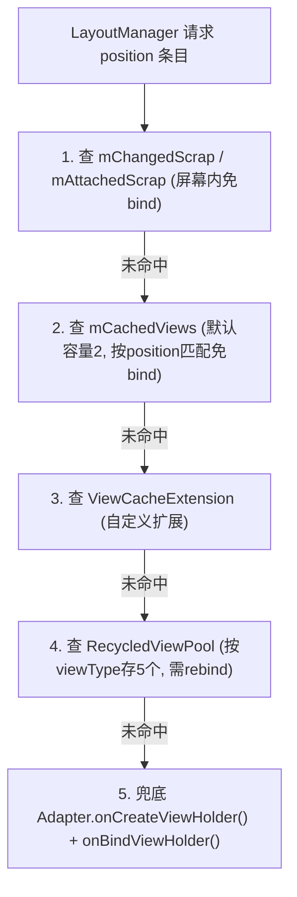

## 面试答题思路

- **本质概括**：`RecyclerView` 相比老 `ListView` 最大的性能飞跃是把缓存拆分成**“免重新绑定数据的纯复用层”**（Scrap + CachedViews）与**“需重新走 `onBindViewHolder` 的跨类型通用池”**（RecycledViewPool），从而大幅减少滑动时的布局解析与数据重绑。
- **核心四级缓存职责与默认容量**：
  1. **一级 `mAttachedScrap` / `mChangedScrap`**：屏幕内临时剥离的 ViewHolder（如执行局部刷新或布局调整），**无需 `create` 也无需 `bind`**；
  2. **二级 `mCachedViews`（默认容量 2）**：刚滑出屏幕外的一小批 ViewHolder，**按原始 `position` 精确匹配**，来回微滑瞬间找回，**无需重新 `onBindViewHolder`**；
  3. **三级 `ViewCacheExtension`**：预留给开发者的自定义缓存扩展插槽（极少使用）；
  4. **四级 `RecycledViewPool`（按 `viewType` 分类，每类默认上限 5 个）**：淘汰下来的 ViewHolder 会清空 position 与脏数据复位，取回时**只需免 `onCreateViewHolder` 的 inflate，必须重新执行 `onBindViewHolder`**。

## 核心原理解析

### 1. `Recycler.tryGetViewHolderForPositionByDeadline()` 完整查找顺序
每次 `LayoutManager` 请求加载位置 `position` 的条目时，严格走以下 5 道关卡：
1. 如果是局部更新动画状态，先去 **`mChangedScrap`** 按 position / stableId 找；
2. 未动画态去 **`mAttachedScrap`** 与 **`mHiddenViews`** 找（屏幕内布局复用），找不到再去 **`mCachedViews`** 按 position/id 找；——**前两级命中全免 rebind！**
3. 若设置了稳定 ID（`hasStableIds`），重新去 Scrap 和 CachedViews 按 `itemId` 精准核对；
4. 尝试用户自定义的 **`ViewCacheExtension`**；
5. 根据 **`getItemViewType(position)`** 去 **`RecycledViewPool`** 里弹出一个同类型旧 ViewHolder（拿出来后标记需要重新调用 **`onBindViewHolder()`**）；
6. **四级全未命中**：迫不得已调用 `Adapter.onCreateViewHolder()`（执行昂贵的 XML `LayoutInflater.inflate`）+ `onBindViewHolder()`。

### 2. 滑动淘汰与回写流转机制
- 列表向上滚动，顶部条目移出视口：`LayoutManager` 将其回收进 **`mCachedViews`**；
- 当 `mCachedViews` 超过上限（默认 2 个，可通过 `setItemViewCacheSize()` 调整）时，按照 **FIFO 规则把最老的 ViewHolder 踢出 `mCachedViews`**；
- 被踢出的 ViewHolder 会执行 `resetInternal()` 洗掉旧位置与状态标志，压入 **`RecycledViewPool`** 对应的 `viewType` 桶里（若池子该类型已满 5 个则直接丢弃等 GC 回收）。

## 图解流程

## 高频追问与关键词

- **追问 1**：`ListView` 的两级缓存和 `RecyclerView` 四级缓存本质区别是什么？
  - 关键词：`ListView` 只有 `ActiveViews`（屏幕内）和 `ScrapViews`（离屏，取出必重走 `getView` 重新绑定内容，且只缓存 View 没强绑定 ViewHolder 规范）；`RecyclerView` 多了 **`mCachedViews`（离屏滑回来也不用 rebind）**，并支持多个独立 `RecyclerView` **通过 `setRecycledViewPool()` 共享同一个复用池**（如 `ViewPager2` 多 Tab 页签同构信息流）。
- **追问 2**：为什么滑出屏幕的条目，如果用户往回滑超过 3 个位置就必然要重新走 `onBindViewHolder()`？怎么权衡调大 `setItemViewCacheSize`？
  - 关键词：因为 `mCachedViews` 默认只有 2 个；适当调大（如 5–8）能进一步减少高频回滑绑定耗时，但会直接多常驻对应数量的复杂 View 树和图片引用占用堆内存，需结合机型内存折中。

## 延伸参考

参考 Android 官方 RecyclerView 文档与 AOSP `RecyclerView.Recycler` 源码深入理解预取（Prefetch）协作。
