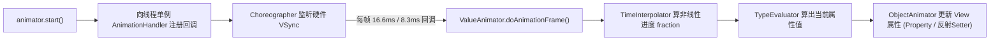

## 面试答题思路

- **本质原理**：属性动画并不是开了子线程 `sleep` 循环，而是通过线程单例 **`AnimationHandler`** 向主线程的 **`Choreographer`** 注册每一帧 `CALLBACK_ANIMATION` 回调；每次收到硬件 **VSync** 脉冲时统一计算所有运行中动画的当前属性值。
- **核心计算管道**：真实流逝时间百分比 `t` → **`TimeInterpolator`（插值器：控制加速/减速/回弹变化率 `fraction`）** → **`TypeEvaluator`（估值器：根据 `fraction` 在起始值与结束值之间算出真实数值/颜色/坐标）** → 反射或 `Property` 写入目标对象（如 `ObjectAnimator` 调 `setTranslationX`）。
- **高频内存泄漏陷阱**：当启动了一个 **`INFINITE` 无限循环属性动画**（如加载呼吸圈）时，动画注册在主线程静态单例 `AnimationHandler` 里，而 `ObjectAnimator` 强引用着目标 `View`、`View` 又强引用着 `Activity` Context；如果页面关闭时忘记调 **`animator.cancel()`**，该 `Activity` 将彻底内存泄漏且动画在后台空跑耗电！

## 核心原理解析

### 1. 插值器（`TimeInterpolator`）vs 估值器（`TypeEvaluator`）
- **`TimeInterpolator`**：输入匀速流逝的时间进度 `0f..1f`，输出经过物理曲线扭曲后的动画进度百分比（如 `AccelerateDecelerateInterpolator` 先快后慢、`BounceInterpolator` 弹跳）；
- **`TypeEvaluator`**：输入扭曲后的百分比 `fraction` 以及起点 `startValue`、终点 `endValue`，算出具体中间态对象（如 `IntEvaluator`、`FloatEvaluator`、`ArgbEvaluator` 颜色平滑插值）。

### 2. `ObjectAnimator` 如何做到更新任意属性？如何规避反射开销？
- 若仅传入字符串属性名（如 `"alpha"` 或自定义 `"progress"`），内部 `PropertyValuesHolder` 首次初始化时会通过 **Java 反射**查找对应的 `get/set` 方法（而且**该自定义属性必须同时提供合法的 `setXxx()` 方法**，若未传初始值还必须有 `getXxx()` 方法；同时在开启 R8 混淆时要注意保留自定义方法名防混淆失败！）；
- **更优写法**：直接传入标准静态属性对象（如 **`View.TRANSLATION_X`**、**`View.ALPHA`**），或者自定义 **`Property<T, Float>`** 对象直接读写字段，完全零反射、不惧怕代码混淆。

## 图解流程

## 高频追问与关键词

- **追问 1**：`animator.cancel()` 和 `animator.end()` 有什么区别？退后台和销毁页面分别怎么处理？
  - 关键词：`cancel()` 立即停在当前这一瞬间的半截数值位置并从 `AnimationHandler` 解绑；`end()` 直接把动画瞬间跳到终点最终值再停止退出。在 `onDestroy()` / `onDestroyView()` 务必调用 **`cancel()`**，若只是页面不可见退后台 `onStop` 可调 `pause()`、`onStart` 调 `resume()` 省电。
- **追问 2**：Android 开发者选项里如果把“动画程序时长缩放”调为 0（关闭系统动画）或省电模式生效，属性动画会怎样？
  - 关键词：所有标准 `ValueAnimator` 受全局 `DurationScale` 控制，缩放为 0 时 `start()` 后直接跳过中间帧一步到达 `end` 终点回调；而自写协程/时间戳动画若不感知 `ValueAnimator.areAnimatorsEnabled()` 可能会跟系统降级动效规范脱节。

## 延伸参考

参考 Android Developers 属性动画官方概览与 AOSP `ValueAnimator.java` 实现。
