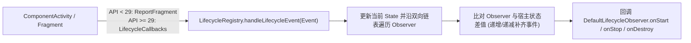

## 面试答题思路

- **解决什么痛点**：过去播放器、定位、Glide 请求需要在 `Activity/Fragment` 的 `onStart`/`onStop`/`onDestroy` 手动写大量胶水绑定与释放代码；`Lifecycle` 通过观察者模式把控制权反转，让业务组件自己感知宿主生老病死。
- **核心双轨设计**：内部是 **`State`（5 个状态节点：`DESTROYED` / `INITIALIZED` / `CREATED` / `STARTED` / `RESUMED`）** 与 **`Event`（7 种跃迁事件：`ON_CREATE` … `ON_DESTROY`）** 的双向状态机模型。
- **低版本与现代分发演进**：在普通 `Activity`（API 29 以下）中，通过注入一个透明无视图的 **`ReportFragment`** 借其同步回调拦截分发；API 29+ 则直接在 `ComponentActivity` 注册 **`ActivityLifecycleCallbacks`** 统一向 `LifecycleRegistry` 推送事件（新版 `Fragment` 直接在自身方法内派发，无需多余 Fragment）。

## 核心原理解析

### 1. 新注册观察者如何追平当前宿主状态？（状态对齐机制）
如果宿主已经处于 `RESUMED` 状态，此时才通过 `lifecycle.addObserver(obs)` 挂载一个新观察者：
- `LifecycleRegistry` 会拿观察者初始状态 `INITIALIZED` 对比宿主当前状态 `RESUMED`；
- 按状态机阶梯自动补齐发送 `ON_CREATE` → `ON_START` → `ON_RESUME` 一系列事件，直到观察者与宿主状态对齐一致（同理若在 `DESTROYED` 销毁后绑定，不会触发任何激活回调）。

### 2. 为什么官方废弃 `@OnLifecycleEvent` 注解而力推 `DefaultLifecycleObserver`？
- 旧版 `@OnLifecycleEvent` 依赖运行期反射解析方法注解或需额外接入编译期生成适配器代码；
- 现代 **`DefaultLifecycleObserver`**（基于 Java 8+ 接口默认方法）零反射开销、编译期类型安全且可直接享受 R8 混淆无痛内联优化。

## 图解流程

## 高频追问与关键词

- **追问 1**：如果在 `onStop` 回调里不小心执行了移除另一个正在遍历中的 Observer，会导致并发修改异常吗？
  - 关键词：`LifecycleRegistry` 内部使用 **`FastSafeIterableMap`** 管理观察者集合，支持在遍历迭代期间安全增删观察者且不会触发 `ConcurrentModificationException`，同时用 `mAddingObserverCounter` 标记防止重入状态紊乱。
- **追问 2**：`ProcessLifecycleOwner` 是怎么监听整个 App 处于前台还是退到后台的？
  - 关键词：统计所有活跃 Activity 的 `STARTED` 计数归零（配合一个 700ms 延迟派发防屏幕旋转重建误判为退后台），当全部 Activity 停止且超 700ms 才发送 `ON_STOP` 标记 App 进入后台。

## 延伸参考

参考 Android 官方 Lifecycle-aware Components 文档与 AOSP `LifecycleRegistry` 源码。
