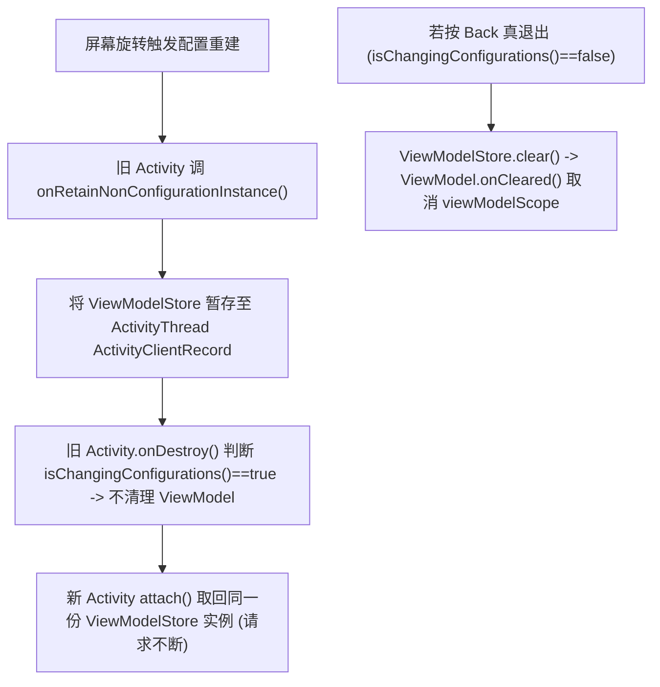

## 面试答题思路

- **核心结论（先分场景）**：`ViewModel` 的存活保证仅覆盖**“配置变更引起的 Activity 重建（如旋转屏幕、切深浅色、改系统语言）”**，但**不抗后台低内存进程被杀**！抗进程被杀必须协同 **`SavedStateHandle`**（本质接入 `SavedStateRegistry` 持久化轻量状态进 `Bundle`）。
- **配置变更存活底层秘密**：`Activity` 因配置变化销毁前，`ActivityThread.performDestroyActivity()` 会回调 `onRetainNonConfigurationInstance()` 把包含 **`ViewModelStore`** 的 `NonConfigurationInstances` 对象**暂存进 `ActivityThread` 的 `ActivityClientRecord` 里**；新 Activity 创建重启 `attach()` 时原封不动接回旧的 `ViewModelStore`，里面原有的 `ViewModel` 实例原样复用，因此正在跑的 `viewModelScope` 请求完全不断！
- **何时真正销毁**：`ComponentActivity` 监听 `Lifecycle` 收到 `ON_DESTROY` 时检查 `!isChangingConfigurations()`——确认**不是配置变更（即真关闭退出）**才调 `viewModelStore.clear()` 并触发 `ViewModel.onCleared()` 取消协程。

## 核心原理解析

### 1. 为什么不能让 `ViewModel` 持有 `Activity`、`View` 或 `Binding` 引用？
正因为 `ViewModel` 活得比发生旋转重绘的那一任 `Activity` 实例还要长：如果它持有了第一任 `Activity` 或其 `TextView` 的强引用，旋转屏幕后旧 `Activity` 无法回收立即泄露，甚至操作到已脱离窗口的旧控件崩溃！需资源时只能传 **`ApplicationContext`**（继承 `AndroidViewModel`）或让 UI 通过状态流单向订阅。

### 2. `SavedStateHandle` 如何补全“进程被杀恢复”最后一块拼图？
- 系统后台低内存杀掉整个进程时，内存里的 `ActivityClientRecord` 和 `ViewModelStore` 全部烟消云散；
- **`SavedStateHandle` 原理**：在 `ViewModelProvider` 通过默认工厂创建时注入一个关联了宿主 `SavedStateRegistry` 的 `SavedStateHandle`（本质是一个包装 `Map` + `StateFlow`/`LiveData` 的键值对，内部向系统注册 `SavedStateProvider`）；
- 当退后台走 `onSaveInstanceState` 时，它自动把关键轻量参数（如搜索框文本、分页页码、Tab 下标）写进系统暂存 `Bundle`；用户切回重启进程时再把这些参数恢复进全新生成的 `ViewModel` 构造函数中继续无缝加载。

## 图解流程

## 高频追问与关键词

- **追问 1**：多个同 Activity 下的 `Fragment` 如何共享同一个 `ViewModel` 数据？
  - 关键词：在 Fragment 中使用 **`by activityViewModels()`**（底层传入 `requireActivity()` 作为 `ViewModelStoreOwner`，大家共享宿主的同一个 `ViewModelStore`）；若只需在 `Navigation` 某个子导航图内共享，可用 `by navGraphViewModels(R.id.graph_id)`。
- **追问 2**：`SavedStateHandle` 能存大列表对象吗？为什么？
  - 关键词：绝对不能！底层与 `onSaveInstanceState` 共用同一份发往系统 `ATMS` 的 `Bundle` 管道，受 Binder `1MB - 8KB` 共享池约束，只能存基础类型、短字符串或核心 ID，大数据集应查本地 Room/磁盘缓存。

## 延伸参考

对照 Android Developers `ViewModel` 与 `SavedStateHandle` 文档核对多 Fragment 作用域共享方案。
