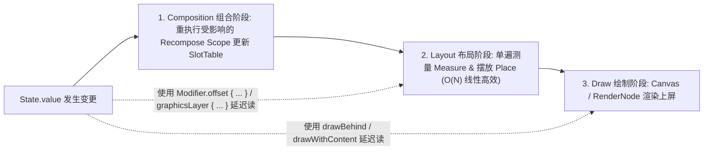

## 面试答题思路

- **核心理念转变**：传统 View 是面向对象的指令式树状修改（`textView.setText()`）；Compose 是**声明式状态函数映射（`UI = f(state)`）**，状态变动时框架仅智能重新执行受到影响的局部 Composable 函数区域，称为**重组（Recomposition）**。
- **三大渲染阶段（单向流水线）**：
  1. **组合（Composition）**：执行 `@Composable` 函数构建并更新代表 UI 树的 **`SlotTable`**（间隙缓冲区结构）；
  2. **布局（Layout）**：遍历 Node 树单次测量（Compose **严禁对同一子元素重复测量两次**，天然避免 View 层级嵌套指数级耗时）并确定坐标；
  3. **绘制（Draw）**：在 `Canvas` 上实际渲染像素；**性能黄金法则——能只在 Layout 或 Draw 阶段读取 State（如传递 Lambda `{ offset }` 或用 `Modifier.offset { ... }` / `drawBehind {}`），就绝不要在 Composition 阶段过早读取状态触发整块重组！**
- **智能跳过前提**：只有当函数所有入参类型满足 **稳定性（Stable）且值与上次相等** 时，Compose 才能安全跳过该函数的无意义重组。

## 核心原理解析

### 1. 什么是重组作用域（Recompose Scope）与 SlotTable？
编译器插件会给每一个没有返回值且读取了 `State` 的非内联 `@Composable` 函数体生成一块独立更新锚点。当某 `State` 改变时，Runtime 只使**真正读取了该 `State.value` 的最小外围非内联作用域**失效并局部重执行（注意：`Column`/`Row`/`Box` 属于 `inline` 函数，**它们内部读状态可能会牵连外层父 Composable 一起重组**！）。

### 2. 参数“稳定性（Stability）”判断与常见坑点
传统常见误区：传进 Composable 一个 `List<User>` 或带普通 `var` 字段的 `data class`、或来自未引入 Compose 编译器模块的数据类，编译器无法保证它们内容不会在暗处悄悄变化，于是判定为 **Unstable（不稳定）**，导致父组件刷新时**子组件被迫跟着全部重组**！
- **解决手段**：
  - 使用不可变字段 `val` + Kotlin `kotlinx.collections.immutable`（`ImmutableList`）；
  - 或在确定安全时标注 **`@Immutable`** / **`@Stable`**；
  - **Compose 1.7 / Kotlin 2.0 强跳过模式（Strong Skipping Mode，现已默认开启）**：即使参数类型不稳定，只要**引用实例相等（`===`）** 同样允许直接跳过重组，并自动把捕获不稳定参数的 Lambda 记住（`remember`），大大降低老工程迁移成本。

## 图解流程

## 高频追问与关键词

- **追问 1**：为什么说 Compose 相比 XML 列表滑动动画（如改透明度、位移）性能反而更容易做高？如何做状态延迟读取？
  - 关键词：使用 **`Modifier.graphicsLayer { alpha = ...; translationX = ... }`** 或 **`Modifier.offset { IntOffset(...) }`** 把状态读取推迟到 **Layout 或 Draw 阶段**（配合 Lambda `() -> Float` 传参），动画每一帧滚动甚至**完全跳过 Composition 组合阶段**，零重组开销！
- **追问 2**：为什么 Composable 函数执行顺序可能并不保证严格自上而下，甚至可能被多线程或中途丢弃重启？
  - 关键词：Compose 架构允许**并发组合、按优先级重排或丢弃半途失效的重组**，因此绝不能在 Composable 函数体顶层直接写产生副作用的阻塞网络/修改全局变量操作，必须放进 `LaunchedEffect` / 回调中执行。

## 延伸参考

参考 Android Developers Jetpack Compose Phases 与 Stability 优化官方文档。
