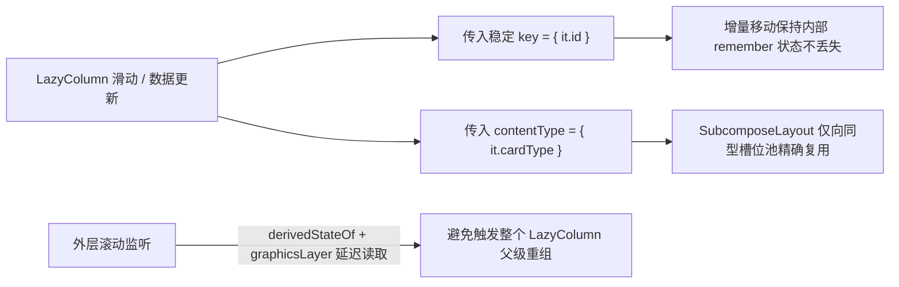

## 面试答题思路

- **底层机制**：`LazyColumn` 不同于把全部元素塞进 `Column(Modifier.verticalScroll)` 一次性组合测量，它依托 **`SubcomposeLayout`** 只按需组合并测量**当前屏幕可见区间及少量前后预取缓冲区内**的列表项。
- **四大核心调优抓手**：
  1. **必传稳定唯一的 `key`**：`items(list, key = { it.id })`，否则列表插入/排序/删除时按默认下标定位会引发全列表位置错位、状态（如点赞展开态）张冠李戴与整片无意义重组；
  2. **多类型必传 `contentType`**：`contentType = { it.type }`（Compose 1.2+），使底层复用池按卡片类型分组复用组合槽位（Slot），不跨异构布局白白拆重建；
  3. **滚动状态与位置偏移延迟读**：读取 `LazyListState.firstVisibleItemScrollOffset` 配合 `derivedStateOf` 或只在 `Modifier.graphicsLayer { ... }` 内读，严禁把高频滚动偏移量当参数直接传给整个列表父组件重组；
  4. **警惕 Debug 模式测性能误区**：Compose **务必在 Release 模式（开启 R8 优化 + Baseline Profiles 基准配置）下评估滑动流畅度**，Debug 包未内联且全量 JIT 解释会显得明显比实际卡顿很多。

## 核心原理解析

### 1. 为什么不传 `key` 会导致动画与内部 `remember` 状态错乱？
在没有传 `key` 时，Compose 只能用该 Item 在列表里的**索引下标 `index`（0, 1, 2...）**作为唯一身份标识：
- 假设顶部新插入一条置顶消息：原本第 0 项变成第 1 项，第 1 项变成第 2 项……Compose 会认为所有下标的内容全变了，不仅**从头到尾每一行全部被迫重新组合**，还会让某条评论里 `remember { mutableStateOf(false) }` 记录的“已展开”状态留在第 0 行新数据身上导致严重错位！
- 传入 **`key = { it.id }`** 后，Runtime 精准识别旧条目只是位置往下移了一格，直接搬运已有组合节点且触发 `animateItem()` 平滑位移动画。

### 2. 禁止在列表条目写 0dp 或嵌套同向可滚布局
- **严禁嵌套同向无限高 `LazyColumn`**：若外层和内层都是竖向滚动，切勿用常规 `Column` 强撑，也不要在 `LazyColumn` 内套另一个不设固定高度的 `LazyColumn`（会直接抛 `IllegalStateException: Vertically scrollable component was measured with an infinity maximum height constraints` 崩溃！），应直接把子段扁平拆解进同一个 `LazyColumn { item {} items(...) {} }` DSL 里实现高性能混排；
- **善用 `Prefetch`**：新版 Compose Material/Foundation 已支持基于帧空闲间隙的自适应预取组合下一条卡片。

## 图解流程

## 高频追问与关键词

- **追问 1**：`key` 传入时有什么坑会导致直接崩溃？
  - 关键词：首先同一列表内 `key` **绝不能重复**（否则抛出 `IllegalArgumentException: Key was already used`）；其次若搭配 `rememberSaveable`，返回的 `key` 类型必须支持写入 `Bundle`（如 `String`/`Int`/`Long`）。
- **追问 2**：为什么有人说刚接入 Compose 时感觉 `LazyColumn` 滑动没有传统 `RecyclerView` 顺滑？一般踩了哪些坑？
  - 关键词：① 在 **Debug 未开启 R8** 下直观体感；② 未开启 **Baseline Profiles** 导致首次滑动实时解释大量 Compose 基础设施代码；③ 列表卡片传入不稳定类型（老版本未开强跳过）或缺少 `contentType` 复用，或在条目内做重计算/未记住 `Modifier`/`Brush` 等高频分配对象。

## 延伸参考

参考 Android Developers Lists & Grids 与 Compose Performance 优化官方文档。
