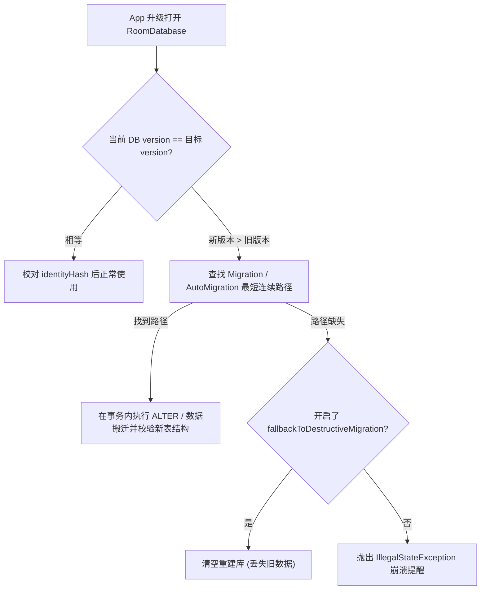

## 面试答题思路

- **Room 核心价值**：在原生 `SQLiteOpenHelper` 之上做的编译期抽象层——利用 **KSP/APT 注解处理器**在编译阶段直接校验 `@Query` SQL 语法、表列名是否存在及返回值类型匹配，彻底消除手写 SQL 拼写错误到线上才崩溃的问题，并无缝支持返回 `Flow`（表变动自动推送新列表）和 `suspend` 挂起执行。
- **版本升级核心流程**：`version` 递增后必须提供连续的升级路径（如 `1→2`、`2→3`，或跨版本 `1→3`）；简单加表/加有默认值字段用 **`@AutoMigration`**，改类型/拆表/复杂清洗则编写 **`Migration(startVersion, endVersion)`**。
- **线上避坑铁律**：务必开启 **`exportSchema = true`** 并将生成的 `schemas/<ver>.json` 提交进 Git 仓库（既是 `AutoMigration` 计算 Diff 的前提，也方便编写 `MigrationTestHelper` 单元测试）。

## 核心原理解析

### 1. Room 如何感知表变更并自动刷新 UI（`InvalidationTracker`）？
当你在 DAO 中定义一个返回 `Flow<List<User>>` 的查询时：
- Room 在初始化时会向 SQLite 注册一张临时内存追踪表（`room_table_modification_log`）及触发器（Trigger）；
- 任何线程执行 `@Insert` / `@Update` / `@Delete` 事务提交后，`InvalidationTracker` 会收到脏表标记，唤醒监听该表的 Flow 重新异步查库并发射最新结果。

### 2. 数据库升级（Migration）常见崩溃与保底手段
- **`IllegalStateException: Room cannot verify the data integrity`**：开发期改了 `@Entity` 字段却忘了升 `version` 或未写 `Migration`；
- **`fallbackToDestructiveMigration()` 使用边界**：仅限纯本地可丢弃的临时缓存库（直接删表重建不保留历史数据）；对用户离线草稿、聊天记录等核心本地库**绝对不能简单清库**，必须配合 `Migration` 或 `fallbackToDestructiveMigrationOnDowngrade()`（仅在跨大降级防崩时兜底）。
- **SQLite `ALTER TABLE` 局限**：老版本 SQLite 不支持直接 `ALTER COLUMN` 改类型或删列，复杂改表需通过“创建新临时表 → `INSERT INTO new SELECT ... FROM old` 迁数据 → `DROP` 旧表 → `RENAME` 新表”四步原子事务完成（`AutoMigration` 底层也是帮你生成这四步）。

## 图解流程

## 高频追问与关键词

- **追问 1**：Room DAO 默认允许在主线程直接读写数据库吗？有什么例外？
  - 关键词：默认严格禁止（在主线程执行同步查询直接抛出 `IllegalStateException: Cannot access database on the main thread`）；返回 **`Flow` / `LiveData`** 或标注 **`suspend`** 的方法由 Room 自动切换内部 `ArchTaskExecutor`/协程 IO 线程调度执行，只有显式调 `.allowMainThreadQueries()` 才放行（仅限测试）。
- **追问 2**：多表一对多查询怎么防 N+1 查询与读出半截不一致数据？
  - 关键词：使用 **`@Transaction`** 注解修饰返回 `@Relation` 嵌套实体的方法，让底层的多条关联 SELECT 包裹在同一个原子读事务中执行。

## 延伸参考

参考 Android Developers Room 官方文档与数据库迁移测试指南（`MigrationTestHelper`）。
