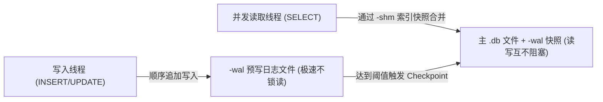

## 面试答题思路

- **批量写入必用事务**：SQLite 默认每条独立的 `INSERT`/`UPDATE` 都包裹一个隐式独立事务（每次都要刷盘 `fsync` 保证持久性）；插入 1000 条记录不开事务耗时可达数秒，**放进显式 `beginTransaction() ... setTransactionSuccessful() ... endTransaction()`（Room 中 `@Transaction` 或 `withTransaction`）只需几十毫秒**（仅 1 次合并刷盘）。
- **日志模式演进（Journal vs WAL）**：Android 9（API 28）+ 及 Room 默认启用 **WAL（Write-Ahead Logging，预写式日志）**，彻底解决了老模式（Rollback Journal）“写操作独占锁死所有读取导致主线程/子线程互相卡死报错 `SQLiteDatabaseLockedException`”的痛点，实现了**读与写并发互不阻塞**。
- **三种锁起点**：SQLite 是文件级库锁，`DEFERRED`（默认，读不锁直到真写才升写锁，多连接并发易死锁回滚）、`IMMEDIATE`（进事务立刻拿写保留锁避免冲突）、`EXCLUSIVE`（独占排他读写全拦）。

## 核心原理解析

### 1. Rollback Journal vs WAL 核心机制对比
- **传统 Rollback Journal（回滚日志）**：修改主数据库文件（`.db`）前先把旧数据页备份进 `.db-journal`；发生崩溃或回滚时靠 journal 覆盖还原。**致命缺陷**：写期间必须持有排他锁阻止其他线程读，否则读到修改一半的脏页，并发体验极差。
- **WAL 模式（预写式日志）**：
  - 写操作**不再直接改原 `.db` 文件**，而是把新页数据顺序追加写进 **`-wal` 独立日志文件**（顺序写磁盘速度极快！）；
  - 读操作借助 `-shm` 共享内存索引读取原 `.db` + `-wal` 中属于该事务开启瞬间的历史一致性快照；
  - 只有等累积到一定页数（如 1000 页）或空闲时执行 **`Checkpoint`** 将 `-wal` 合并回写进主 `.db` 文件。**优势：读写完全并发（1 写 + N 读同时跑），写不阻塞读、读不阻塞写**（注意多写之间依然串行互斥）。

### 2. SQLite 索引与性能调优实战要点
- **高频索引失效踩坑**：① `LIKE '%abc'` 前缀模糊匹配走不了索引（只能全表扫描）；② 对索引列做运算或函数转换（`WHERE length(name) > 5`）；③ 使用 `!=`、`IS NULL` 或类型隐式转换；④ 联合索引不满足最左前缀法则。
- **游标分页与局部列查询**：大数据量翻页避免大 `OFFSET` 慢查询，改用基于主键/时间戳游标 `WHERE id < lastId LIMIT 20`；列表页仅用 `SELECT id, title` 投影避免拉取大字段导致 `CursorWindow` 频繁换页。

## 图解流程

## 高频追问与关键词

- **追问 1**：为什么开启 WAL 模式后，直接拷贝手机私有目录下的单个 `.db` 文件导出到电脑打开，会发现最近刚插入的数据不见了？
  - 关键词：因为最近写入的增量页还留在 **`-wal` 和 `-shm` 文件** 里尚未合并进主 `.db`！拷贝备份数据库前必须先执行 **`PRAGMA wal_checkpoint(FULL/TRUNCATE)`** 强制刷回主库或关闭数据库实例，或者把 `.db`、`.db-wal`、`.db-shm` 三个文件一并拷贝。
- **追问 2**：WAL 模式下“读写不阻塞”是不是代表多个线程可以同时并发写入？
  - 关键词：**不可以**！SQLite 底层是文件锁，任何时候**最多只允许 1 个写事务**进行；多线程并发写时应通过单一队列串行或设置 `busy_timeout` 排队等待，否则会抛出 `SQLITE_BUSY`（`SQLiteDatabaseLockedException`）。

## 延伸参考

参考 SQLite 官方 WAL 技术文档与 Android Developers SQLite 性能最佳实践。
