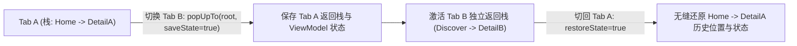

## 面试答题思路

- **核心设计模型**：采用 **单 Activity + 多 Fragment（或 Compose 路由）** 统一托管架构——**`NavGraph`** 定义全量页面拓扑与动作关系，**`NavHost`** 充当容器插槽，**`NavController`** 统一驱动进栈出栈、转场动画、返回键联动以及 `AppBar` 标题联动。
- **核心优势亮点**：
  1. **SafeArgs / 类型安全路由**：编译期生成强类型 `Directions`/`Args` 类（Compose Navigation 2.8+ 原生支持 `@Serializable` Kotlin 对象直传），彻底告别手工 `Bundle` key 拼写错误；
  2. **官方原生支持多返回栈（Multi Back Stacks）**：底部 `BottomNavigationView` / `NavigationBar` 在多个 Tab 间切换时，自动借助 `saveState = true` 与 `restoreState = true` 保存各自独立的子返回栈历史与视图/ViewModel 状态；
  3. **DeepLink 无缝支持**：一条声明同时打通外部推送/网页 H5 跳转并自动合成符合直觉的父级导航返回栈（Synthetic Back Stack）。

## 核心原理解析

### 1. 多返回栈切换状态不丢失的原理（`saveState` / `restoreState`）
在 Navigation 2.4+ 结合 FragmentManager 的 `saveBackStack` / `restoreBackStack`：
- 当用户从 Tab A（已经点进详情页 A1→A2）切到 Tab B 时，Navigation **不是直接销毁 A1/A2，而是保存 Tab A 整个 Fragment 返回栈状态树与对应 `ViewModelStore` 引用**，再切出 Tab B；
- 当用户切回 Tab A 时，`restoreBackStack` 把原 A1→A2 返回栈原汁原味还原回来（滚动位置和页面状态完整保留），同时用 `popUpTo(startDestination) { saveState = true }` 防止重复堆积过深。

### 2. `FragmentNavigator` 默认使用 `replace` 的常见疑问
传统 Fragment `Navigation` 默认切换执行 `replace()`（旧页面走 `onDestroyView` 释放重视图树内存以省 RAM，仅留实例/ViewModel）；如果某些重页面（如复杂地图或带表单页）希望彻底保留视图实例避免重建，通常需要配合 `ViewModel` 持久化表单状态，或自定义 `Navigator` 改为 `show/hide`。

## 图解流程

## 高频追问与关键词

- **追问 1**：怎么防止连续快速双击某个跳转按钮，导致同一个详情页被重复连续压入两次栈？
  - 关键词：除了防抖点击节流外，可在 `NavOptions` 配置 `launchSingleTop = true` 或在导航前判断 **`navController.currentDestination?.id == 当前页Id`** 再触发 `navigate()`，防止因已经离开原 Destination 而找不到 Action 抛出 `IllegalArgumentException`。
- **追问 2**：登录拦截在 Navigation 中怎么做最优雅？
  - 关键词：利用 **`SavedStateHandle` + 条件导航模式**——未登录跳往 `LoginFragment` 并把结果通过上一个 BackStackEntry 的 `savedStateHandle.set("LOGIN_SUCCESS", true)` 回传，或者基于全局状态流驱动根视图条件切换。

## 延伸参考

参考 Android Developers Navigation 概览与 Multiple Back Stacks 官方文档。
