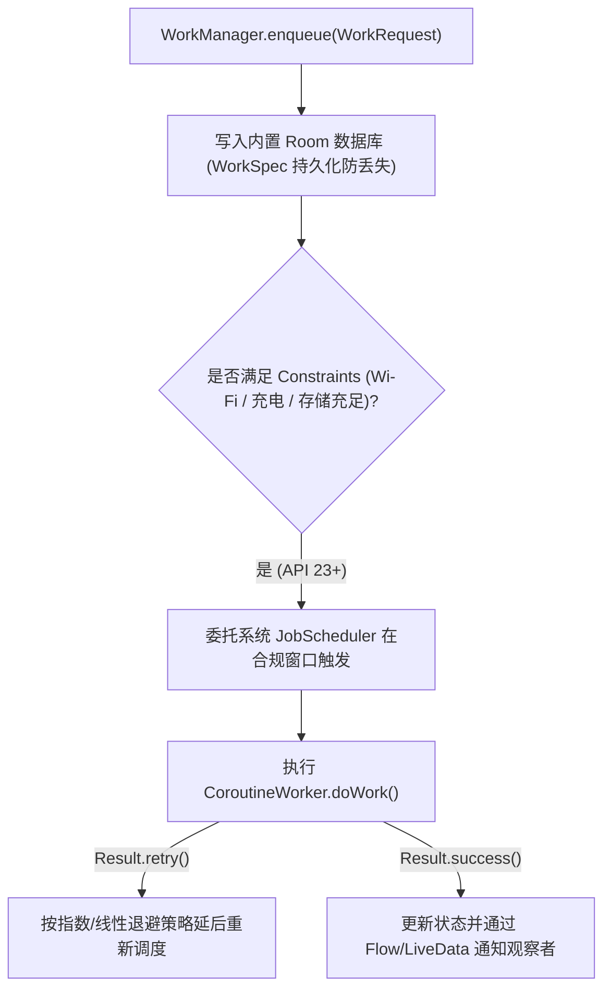

## 面试答题思路

- **精确定位（不是万能后台保活）**：`WorkManager` 专治**“可延迟、但必须确保最终可靠完成（即使退出 App 甚至重启手机后）”**的持久化后台任务（如日志异步上报、离线同步、大文件后台压缩备份）；如果是用户离页就不需要的即时并发任务，用协程即可；如果是需要立即跑且持续感知的任务（导航/音乐），用前台 Service。
- **核心架构原理**：
  - **分层调度适配**：API 23+ 统一底层委托给系统的 **`JobScheduler`**（老版本降级为 `AlarmManager + BroadcastReceiver`）；
  - **本地持久化容灾**：内部自带一个独立的私有 **`Room` 数据库（`androidx.work.workdb`）** 实时持久化每个 `WorkRequest` 的参数、状态（`ENQUEUED/RUNNING/SUCCEEDED`）、约束条件及重试计数；即使进程被杀或系统重启，开机广播触发后也会从库里自动捞起未完成的任务继续排队调度。

## 核心原理解析

### 1. 约束条件（`Constraints`）与 Doze 低电耗模式友好
开发时可通过 `Constraints.Builder()` 声明执行门槛，例如：
- `setRequiredNetworkType(NetworkType.UNMETERED)`（仅 Wi-Fi 非计费网络才上传大视频）；
- `setRequiresBatteryNotLow(true)` / `setRequiresCharging(true)`；
- 这些条件会被无缝下发给系统 **`JobScheduler`**，在 Doze 省电窗口期间系统会将多款应用的网络窗口打包批处理（Maintenance Window）统一放行，最大限度省电且不触发后台限制崩溃。

### 2. 加急任务（`setExpedited`）与超长任务（`setForeground`）
- **立即要跑的高优短任务**：调用 `setExpedited(OutOfQuotaPolicy.RUN_AS_NON_EXPEDITED_WORK_REQUEST)` 申请走系统高优先级加急配额（Android 12+ 原生支撑，低版本自动降级调前台通知），不受常规调度延迟影响；
- **超长任务（超过 JobScheduler 10 分钟限制）**：在 `CoroutineWorker` 内调用 `setForeground(ForegroundInfo(...))`，升级成合规前台服务突破单次 10 分钟时间墙。

## 图解流程

## 高频追问与关键词

- **追问 1**：`PeriodicWorkRequest` 周期性任务的最小时间间隔是多少？能否做到每 1 分钟精准触发一次？
  - 关键词：最小周期硬限制为 **15 分钟（`MIN_PERIODIC_INTERVAL_MILLIS`）**（受 `JobScheduler` 省电规范约束）；且受系统电量优化和约束影响存在触发时间窗口（`FlexInterval`）并非秒级精确闹钟。需要精准定时提醒必须用 `AlarmManager`（如日程闹钟）。
- **追问 2**：为什么不能让两个模块各自去触发重复的同步任务？如何防重入？
  - 关键词：使用 **`enqueueUniqueWork(uniqueName, ExistingWorkPolicy.KEEP / REPLACE / APPEND, request)`**（周期任务用 `enqueueUniquePeriodicWork`），避免每次打开首页重复往队列堆积一模一样的后台同步任务。

## 延伸参考

参考 Android Developers WorkManager 概览与加急任务调度规范。
