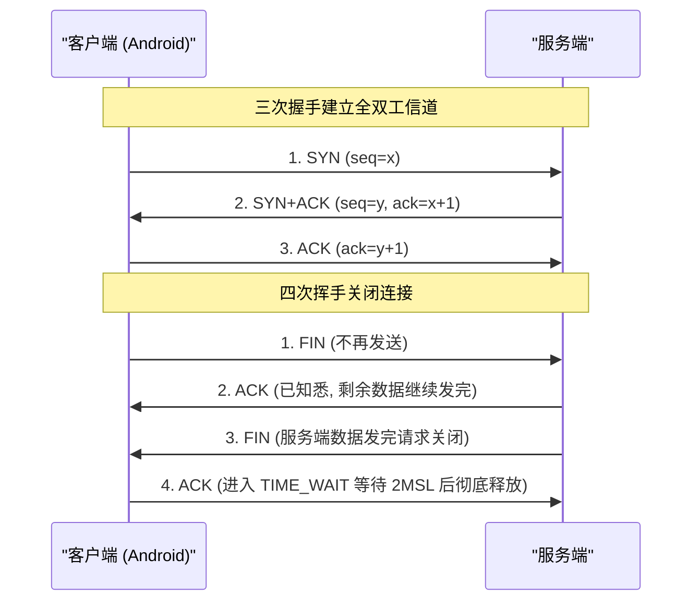

## 面试答题思路

- **为什么握手必须 3 次（不能 2 次）？**：为了**双向确认彼此的发送与接收能力以及同步初始序列号（ISN）**，同时防止网络中滞留的“历史失效连接请求报文”突然飘到服务端引起错误建连白白浪费服务端资源。
- **为什么挥手必须 4 次？**：TCP 是**全双工**通信。主动关闭方发 `FIN` 只代表“我不再发数据了（但还能收数据）”；被动关闭方先回一个 `ACK` 确认（此时进入半关闭态），等自己剩下没发完的响应数据全都发完后再单独发出自己的 `FIN`，因此 `ACK` 与 `FIN` 通常分开发，构成 4 次挥手。
- **客户端核心关注点**：`TIME_WAIT`（主动关闭方等待 **`2MSL`**）确保最后发出的 `ACK` 对方收到且让本连接残留老报文彻底在网络中消亡；客户端高频短连接极易耗尽本地端口与占用 `TIME_WAIT`，因此才强烈依赖 `OkHttp` 连接池复用长连接！

## 核心原理解析

### 1. TCP 可靠传输四大底层机制
- **序列号与确认应答（ACK）+ 超时重传**：每个字节编号保序，丢包未收到 ACK 即自动重传（快速重传收到 3 次冗余 ACK 立即重传）；
- **滑动窗口流量控制**：接收方通过 TCP 头里的 `rwnd` 通告剩余接收缓冲能力，防止发送太快把手机或服务端内存撑爆；
- **拥塞控制**：通过慢启动、拥塞避免、快重传、快恢复动态探测网络链路容量（`cwnd` 拥塞窗口）避免雪崩；
- **校验和**：检验首部与数据位完整性，损坏即丢弃重传。

### 2. 移动端弱网连接异常表现与连接池意义
移动网络（4G/5G 切换、地铁电梯断网）下 TCP 建连耗时占接口延迟很大比重；每次建连都要走完 1 RTT TCP 握手 + 1~2 RTT TLS 握手，**Keep-Alive 持久连接复用池**能够把后续请求耗时瞬间砍半；同时遇到假死连接（半开连接），需要配置合理 `connectTimeout`/`readTimeout` 与心跳保活检测及时剔除僵尸 Socket。

## 图解流程

## 高频追问与关键词

- **追问 1**：为什么主动断开的一方在发送最后一个 `ACK` 后非要等 **`2MSL`（最大报文生存时间的两倍）** 才关闭，不直接释放端口？
  - 关键词：① **防最后一个 ACK 丢包**：若没送到，服务端超时重传 `FIN`，客户端能在 `2MSL` 内重发 `ACK` 让对方正常闭环；② **等旧包消散**：防止马上复用同一组四元组（IP+端口）新连接时收到前一次连接迟到的鬼魂包。
- **追问 2**：Android 客户端在刚切 Wi-Fi/蜂窝网络后，为什么老请求卡死直到超时才失败？
  - 关键词：系统网络切换改变本地源 IP 后，原有的旧 TCP Socket 变成半开僵死状态收不到 FIN/RST 通知；需监听 `ConnectivityManager.NetworkCallback` 或配置合理的 `OkHttp readTimeout/pingInterval` 及时清理失效连接池。

## 延伸参考

结合 MDN TCP 协议解析与 Android Developers 网络管理指南理解客户端连接复用价值。
