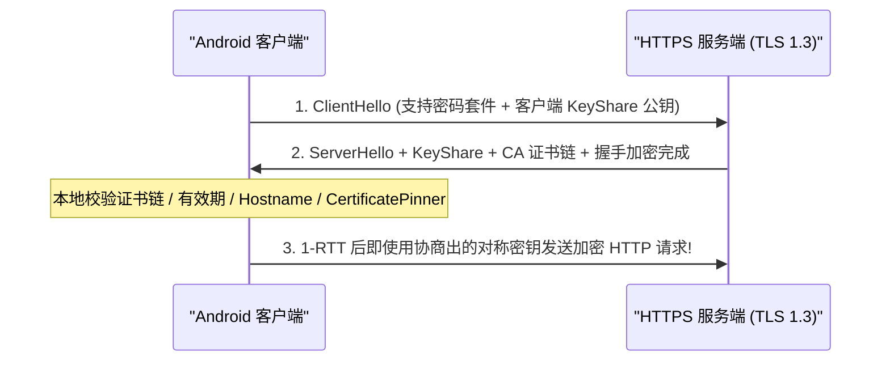

## 面试答题思路

- **HTTPS 核心安全三要素**：机密性（对称加密防窃听）、完整性（HMAC/AEAD 防篡改）、身份真实性（**CA 数字证书链 + 域名匹配校验**防中间人冒充）。
- **混合加密精妙之处**：握手阶段用开销较大的**非对称加密/密钥交换（如 ECDHE）**安全协商出一个临时共享会话密钥，支持**前向保密（Forward Secrecy）**；握手一结束立刻切到极快的**对称加密（如 AES-GCM / ChaCha20-Poly1305）**传输业务报文。
- **TLS 1.2 vs TLS 1.3 飞跃**：TLS 1.2 完整握手需 **2 个 RTT**，而 **TLS 1.3** 剔除过时弱算法，客户端在 `ClientHello` 直接预猜算法把密钥份额（Key Share）带上，**1 个 RTT 即可建连发数据（复用会话甚至 0-RTT）**。
- **Android 端证书鉴权与防抓包**：常规单向 TLS 由系统内置根 CA 池验证服务端；高敏业务（金融/物联网）采用 **双向 mTLS**（客户端也内置客户证书供服务端验证）及 **SSL Pinning（证书公钥锁定）** 拒绝抓包工具安装的用户根证书。

## 核心原理解析

### 1. CA 证书链与中间人防线
服务端下发站点证书时并非只凭自己一张纸自证，而是携带一条信任链：**站点叶子证书 → 中间 CA 证书 → 根 CA 证书**：
1. 客户端用上级 CA 证书里的公钥去解密验证下级证书的**数字签名**（比对摘要是否被篡改）；
2. 逐级追查直到命中手机操作系统 `/system/etc/security/cacerts` 内置预装的受信任**根 CA 证书**；
3. 检查证书是否在有效期内，且借助 `HostnameVerifier` 核对证书里的 `SAN` 域名是否完全匹配当前请求域名。

### 2. 单向认证 vs 双向认证（mTLS）与防抓包
- **为什么装了 Charles/Fiddler 用户根证书就能抓包？**：Android 7.0（API 24）起系统**默认只信任预装系统 CA 而忽略用户自行安装的 CA 证书**（除非你在 `network_security_config.xml` 仅针对 `debug-overrides` 放行），这就是为什么高版本线上包默认防普通用户抓包；但若在 Root 设备上直接塞进系统根证书目录依然可能被中间人拦截；
- **SSL Pinning（证书/公钥锁定）**：通过 OkHttp **`CertificatePinner`** 或 `network_security_config.xml` 的 `<pin-set>` 把服务器公钥（SPKI SHA-256 哈希，推荐锁公钥而非整张证书方便续期）硬编码锁定在 App 内——只要抓包工具伪造的证书公钥哈希对不上，客户端立刻断开连接！（注意务必至少配主备两把 Pin 密钥防止服务器轮换证书造成全员断网）。
- **双向认证（mTLS）**：不仅客户端验服务端证书，服务端在握手时发 `CertificateRequest`，客户端通过配置给 `SSLContext` 的 **`KeyManager`** 出示内置的客户端私钥签名与证书，防止非法第三方脚本伪造客户端请求后台接口。

## 图解流程

## 高频追问与关键词

- **追问 1**：如果在 OkHttp 代码里写死一个信任所有证书的空 `X509TrustManager` 会有什么后果？
  - 关键词：**极其高危的中间人漏洞（MITM）**，而且无法通过 Google Play 与主流安全合规检测（Play Store 会直接下架警告）。调试抓包应严限在 **`network_security_config.xml` 的 `<debug-overrides>`** 中配置，Release 包自动剥离生效。
- **追问 2**：SSL Pinning 一定绝对安全无法绕过吗？逆向人员怎么破？
  - 关键词：不是绝对无法绕过——Root 机配合 **Frida / Xposed Hook `CertificatePinner.check()` 或 `TrustManagerImpl`** 即可摘掉校验；因此金融级 App 还会叠加**本地防 Root/Frida 检测 + 双向 mTLS + 业务报文体二次非对称/动态签名校验**多层纵深防御。

## 延伸参考

参考 Android Developers HTTPS 安全规范与 `network_security_config` 官方配置文档。
