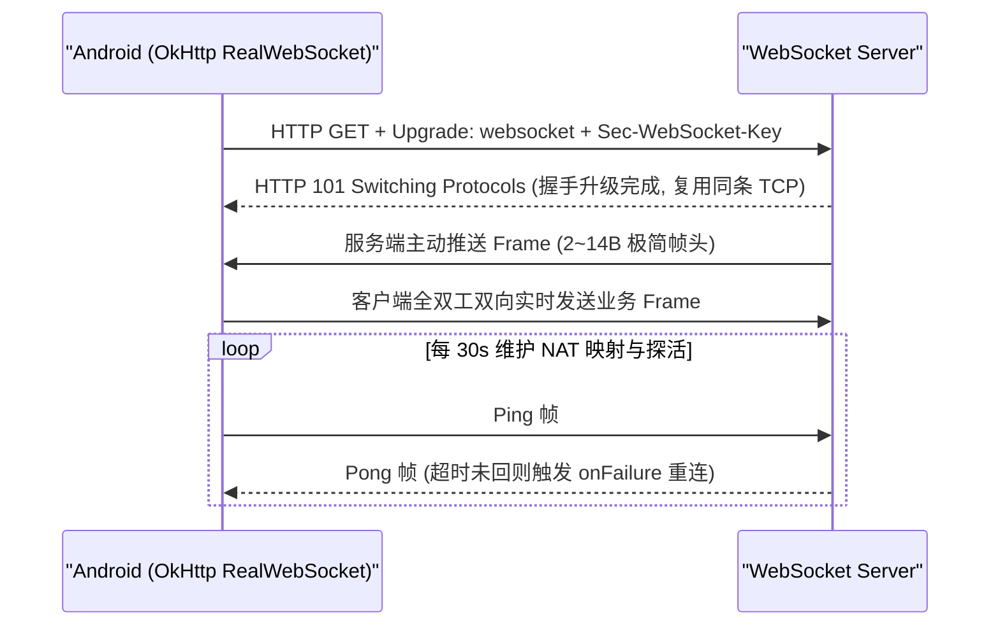

## 面试答题思路

- **Socket 通信核心认知**：TCP 传输的是**无边界的连续字节流（Byte Stream）**，根本没有“一条消息”的概念！因此自研 TCP 长连接必须解决 **粘包（多条小消息黏在一块读出来）与拆包（一条大消息被分成两次读到半截）** 问题，标准解法是**定长包头（Length-Prefixed Frame：先读 4 字节包长再精准读 N 字节体）** 或特殊分隔符。
- **WebSocket 本质定位**：构建在 TCP 之上的应用层**全双工长连接标准协议**。客户端先发一个常规 HTTP 请求带 **`Upgrade: websocket`**，服务端返回 **`101 Switching Protocols`** 后复用同一条 TCP 通道直接切换为轻量级二进制/文本**帧（Frame）**双向实时推送（免去自写粘包拆包协议）。
- **Android 实战保活难点**：长连接在移动网络 NAT 超时（通常 3–5 分钟不发包就会被运营商网关悄悄掐断）和休眠下极其脆弱，必须配合 **`Ping/Pong` 心跳机制（OkHttp `pingInterval`）** + 前后台动态调频 + 指数退避断线重连。

## 核心原理解析

### 1. Socket BIO vs NIO 模型差异
- **BIO（Blocking I/O）**：每个连接配一个阻塞读线程 `InputStream.read()` 干等字节到达，客户端维护单一长连接用 `BIO + 读写双线程`（配合 Okio）其实极其简单稳定；但高并发服务端会因线程爆炸崩溃；
- **NIO（Non-blocking I/O，如 Java `Selector`/Netty）**：通过单线程轮询多路复用 `Channel` 事件就绪态处理海量并发，支持 `ByteBuffer` 与零拷贝通道传输，广泛用于高性能 IM 框架或跨平台底层通信引擎。

### 2. WebSocket 握手升级与帧结构优势
1. **握手阶段**：借道标准的 `HTTP/1.1`（`ws://` 或加密 `wss://` 走 80/443 端口），完美穿透绝大部分企业防火墙与代理网关；请求带 `Connection: Upgrade`、`Upgrade: websocket`、`Sec-WebSocket-Key`；
2. **数据帧传输**：连接升级后不再携带动辄几百字节的冗长 HTTP Header，每条消息仅有 **2–14 字节极简帧头**（包含 `FIN` 结束分片标识、`Opcode` 区分文本/二进制/Ping/Pong/Close、Payload 长度与客户端必须带的随机掩码 Mask）；
3. **OkHttp `RealWebSocket` 落地要点**：
   - 创建 `OkHttpClient.Builder().pingInterval(30, TimeUnit.SECONDS)` 自动定时发 `Ping` 帧，若一个周期内未收到服务端 `Pong` 则判定死链触发 `onFailure` 以便重连；
   - **发送队列限流防 OOM**：`webSocket.send()` 只是把消息压入本地发送队列，弱网发送积压过多（`MAX_QUEUE_SIZE = 16MB`）会拒收或断开，业务层需检查 `queueSize()` 或加确认态流控。

## 图解流程

## 高频追问与关键词

- **追问 1**：既然 WebSocket 已经这么好用，为什么微信/大型 IM 底层（如 Mars）还是偏爱基于裸 TCP / QUIC 自定义私有协议？
  - 关键词：WebSocket 客户端发包强行要求带 4 字节随机 Mask 掩码计算且协议头扩展受限（多路复用、动态压缩、弱网自定义重传确认 ACK 机制不如私有二进制协议灵活极致）；但在常规直播弹幕、股市行情、客服聊天等绝大多数中小型场景，**`OkHttp WebSocket (wss)` 开发成本低、标准通用，是首选方案**。
- **追问 2**：Android 应用退入后台或锁屏进入 Doze 模式时，TCP 心跳定时器不准或被冻住怎么办？
  - 关键词：常规 `Timer`/`Handler` 在 Doze 下会被延迟冻结；若必须维持实时到达，退后台应主动优雅断开长连转为**接入系统级厂商推送通道（FCM / 华为 / 小米 Push）** 唤醒，回到前台再重连恢复。

## 延伸参考

参考 MDN WebSockets 文档与 Square OkHttp WebSocket 官方 API 说明。
