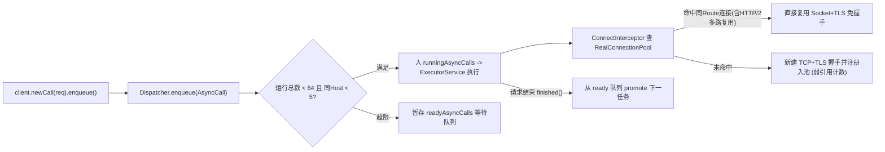

## 面试答题思路

- **工程第一铁律**：**整个 App 必须全局共享一个 `OkHttpClient` 单例**（有特殊超时或独立拦截器需求时应调用 `okHttpClient.newBuilder()` 派生轻量实例），绝不能每次发请求都 `new OkHttpClient()`，否则连接池和调度线程池各自孤立重建，完全失去复用价值并引发内存/线程泄漏！
- **`Dispatcher` 并发调度规则**：内部维护 `readyAsyncCalls`（等待队列）、`runningAsyncCalls`（正在执行的异步队列）和 `runningSyncCalls`，默认受限于 **总并发最大 `64` 个异步请求** 且 **同一主机 Host 最大并发 `5` 个请求**，超出即进入等待队列并在单个请求结束 `finished()` 时主动晋升拉取（`promoteAndExecute`）。
- **`RealConnectionPool` 清理淘汰机制**：默认最多保留 **5 个空闲连接**，空闲保活 **5 分钟**；判断连接是否正在被占用靠**连接内部维护的弱引用列表 `calls: MutableList<Reference<RealCall>>`**（类似引用计数），后台清理线程定期扫描发现引用列表为空且超时即关闭淘汰。

## 核心原理解析

### 1. 为什么 `ConnectionPool` 要对 `RealCall` 使用 `WeakReference` 引用计数？
这是 OkHttp 设计中极巧妙的内存泄漏防线：
- 每当某个请求复用某条 `RealConnection` 时，就把自己包装进一个自定义 `CallReference(WeakReference<RealCall>)` 塞进该连接的 `calls` 列表；请求正常结束时显式移除；
- 万一有粗心的开发者在调用 `execute()` 拿到 `ResponseBody` 后**忘记调 `close()`** 就直接丢弃对象（造成连接泄露），等下次 GC 回收了那个失效的 `RealCall` 对象，清理线程在 `pruneAndGetAllocationCount()` 扫描发现 `WeakReference.get() == null` 时就能强制摘除死引用，打印 leaked connection 告警并安全关闭泄漏的 Socket，不至于把整个连接池永久占死！

### 2. HTTP/1.1 vs HTTP/2 在连接池复用上的巨大差异
- **HTTP/1.1**：同一时刻一条连接只能服务 1 个请求（`allocationLimit = 1`），因此同域名 5 个并发请求会建立并复用最多 5 条 TCP 连接；
- **HTTP/2**：支持多路复用，一条连接允许同时承载成百上千条并发 Stream（`allocationLimit` 极大），因此同域名多个并发请求会**优先全部收敛复用在同一个 TCP+TLS 连接里**！

## 图解流程

## 高频追问与关键词

- **追问 1**：`Dispatcher` 内部的 `ThreadPoolExecutor` 为什么把 `corePoolSize` 设为 `0`、`maximumPoolSize` 设为 `Integer.MAX_VALUE`，Queue 用 `SynchronousQueue`？这不违背普通线程池避坑原则吗？
  - 关键词：不会失控！因为前面还有 `Dispatcher` 严格的 **`maxRequests = 64`** 门神挡着，最多永远只放行 64 个任务进去，而且 `corePoolSize = 0` 保证长期无网络请求空闲 60 秒后线程池会自动彻底归零不留任何闲置后台线程耗费资源。
- **追问 2**：图片加载库（Glide）大量并发拉几十张列表封面图时，默认同 Host 限制 5 会不会互相阻塞 API 接口请求？
  - 关键词：会抢占队列！最佳实践是通过 **`okHttpClient.newBuilder()`** 为**图片下载单独配置隔离的 `Dispatcher`（或适当调高图片请求池上限 `maxRequestsPerHost`）**，同时仍**共享底层的同一个 `ConnectionPool`** 与 `Cache` 实例，兼顾连接复用与业务/图片信道隔离！

## 延伸参考

参考 Square OkHttp `Dispatcher` 与 `ConnectionPool` 官方技术文档。
