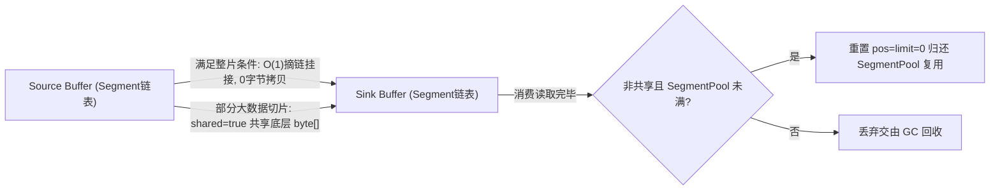

## 面试答题思路

- **为什么抛弃传统 `java.io` 自己造 `Okio`？**：传统 `java.io` 装饰器嵌套冗长且每次读写都需要申请新的字节数组频繁拷贝、缺少对底层超时阻塞的安全打断机制；`Okio` 通过 **`ByteString`（不可变字节串）+ `Buffer`（弹性可变缓冲区）+ `Segment` 分片链表** 实现了极低 GC 开销与零拷贝流转。
- **核心性能密码（`Segment` + `SegmentPool`）**：
  - `Buffer` 内部并不是一大块连续数组（扩容要整块 `Arrays.copyOf`），而是由一个个固定 **8KB（8192B）的 `Segment` 节点构成的双向循环链表**；
  - 当把数据从 `sourceBuffer` 移动到 `sinkBuffer` 时，**如果满足整片搬迁或可共享条件，直接修改链表的指针归属权或引用计数共享底层 `byte[]`，完全免除字节拷贝**；用完归还给最多存 64KB 对象的线程安全 **`SegmentPool`** 复用。
- **可控超时保障（`AsyncTimeout`）**：原生 Socket 阻塞读写一旦对端网络断死就会永远卡住线程；`Okio` 借助一条独立的后台守护线程（Watchdog）管理按到期时间排序的超时链表，到期未完成直接强行触发底层 `Socket.close()` 唤醒并抛出 `InterruptedIOException`。

## 核心原理解析

### 1. `Segment` 所有权转移与零拷贝切片（`share` / `split`）
- 每个 `Segment` 维护 `data: ByteArray(8192)`、`pos`（可读起点）、`limit`（可写起点）、`shared`（是否多份共享只读）与 `owner`（是否拥有独占写入权）；
- **整片移动**：`sinkBuffer.write(sourceBuffer, byteCount)` 时如果发现 `source` 头节点数据能整片移走，直接把 `Segment` 从 `source` 链表摘下来挂进 `sink` 链表尾部——**O(1) 指针操作，0 字节内存复制**；
- **部分切片（`split`）**：若只要一部分，只要目标长度大于阈值（1024B），Okio 也会生成一个共享同一个底层 `byte[]` 的新 `Segment` 切片并将 `shared = true`（确保只读不互污），大幅节省大报文拆包/日志预览（`peek()`）开销。

### 2. `SegmentPool` 如何防高并发 GC 抖动？
`SegmentPool` 是一个全局缓存池（现代版分为多槽分片锁池降低多核竞争）：释放 `Segment` 时只要 `shared == false` 且池子未满上限（64KB / 8 片每桶），就重置 `pos = limit = 0` 压回单链表头待下次复用，避免了网络密集收发时每秒制造海量 8KB 数组引发频繁 Young GC。

## 图解流程

## 高频追问与关键词

- **追问 1**：为什么 `Okio` 的 `AsyncTimeout` 能够安全打断阻塞在底层的 `Socket` I/O，而普通 `Thread.interrupt()` 往往无效？
  - 关键词：传统阻塞式 `java.io.InputStream.read()` 进入系统调用后不响应 Java 的 `interrupt()` 标志；`AsyncTimeout` 守护线程到点后会回调重写好的 `timedOut()` 方法，内部直接执行 **`socket.close()`**，内核立刻向正在 `read()` 的线程返回 `SocketException` 从而安全脱身。
- **追问 2**：`ByteString` 相比原生 `String` 或 `byte[]` 在 OkHttp 里为什么不可或缺？
  - 关键词：`ByteString` 兼具**不可变安全性**（可放心当 HashMap 键、存 HTTP/2 Header 字典或证书指纹）和零成本在 UTF-8 文本、Base64、Hex 与 `sha256` 摘要间直接转换的能力。

## 延伸参考

参考 Square Okio 官方文档与 Timeout 守护机制说明。
