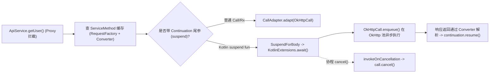

## 面试答题思路

- **本质定位**：Retrofit 本身不做网络请求，它是架在 **`OkHttp` 之上的 RESTful 声明式代理适配框架**——用 **动态代理** 拦截 Java/Kotlin 接口方法，借助 **`Converter`（数据解析）** 与 **`CallAdapter`（调用形态转换与线程调度）** 将注解组装为底层的 `OkHttp Call`。
- **核心调用链路**：`retrofit.create(Api::class.java)` 返回 `Proxy.newProxyInstance` 动态代理对象 → 首次调接口方法时 `loadServiceMethod()` 解析 `@GET/@POST/@Query` 注解并缓存进 `ConcurrentHashMap`（避免每次重复反射耗时）→ 创建 `OkHttpCall` → 交由对应的 **`CallAdapter.adapt()`** 返回最终形态（`Call<T>`、`Observable<T>` 或触发 **`SuspendForBody`** 挂起恢复）。
- **如何原生支持 `suspend fun`**：Retrofit 识别方法最后一个隐藏参数是不是 `Continuation`——如果是，直接构建 `SuspendForBody`，内部调用 **`OkHttp Call.enqueue()` + `suspendCancellableCoroutine`**，在协程取消时联动调 `call.cancel()`，无需用户切 `withContext(Dispatchers.IO)`。

## 核心原理解析

### 1. 两大可扩展工厂核心分工
- **`Converter.Factory`**（如 `GsonConverterFactory`、`MoshiConverterFactory`、`KotlinxSerializationConverterFactory`）：负责**请求体序列化（`@Body` 对象 → `RequestBody`）** 与 **响应体反序列化（`ResponseBody` → 领域实体 `T`）**；支持按链顺序匹配多个 Converter（如前一个返回 `String`、后一个解析 JSON）。
- **`CallAdapter.Factory`**：负责把 Retrofit 统一的 `Call<R>` 包装适配成各种外部异步/响应式框架返回值（例如早期 RxJava `RxJava3CallAdapterFactory` 返回 `Single<T>`；Android 平台默认内置的 **`DefaultCallAdapterFactory`** 会自动给 `enqueue` 回调通过主线程 `Handler` 切回主线程）。

### 2. 为什么 Retrofit 的 `suspend fun` 可以直接在 `Dispatchers.Main` 上调用而不卡主线程？
- `loadServiceMethod()` 解析发现该方法带 `Continuation` 尾参（挂起函数）后，不再走同步 `execute()`，而是交由 `KotlinExtensions.await()`；
- 底层自动发起 **`call.enqueue()`** 把真正 TCP/TLS 和响应读取交到 **OkHttp `Dispatcher` 工作线程池**去执行，而当前协程挂起让出主线程；
- 当响应回来后 `onResponse()` 内通过 `continuation.resume(body)` 切回原协程调度器继续往下跑。此外，借助 **`suspendCancellableCoroutine`** 注册 `invokeOnCancellation { call.cancel() }`，页面退出取消协程时底层 HTTP 连接也会同步中止释放。

## 图解流程

## 高频追问与关键词

- **追问 1**：`Retrofit.create()` 是运行时反射和动态代理，频繁调用对性能影响大吗？最佳实践是什么？
  - 关键词：首先推荐按模块/全局使用 **Hilt 单例复用生成的 Service 代理实例**，不要每次发请求都调 `create()`；其次方法解析结果 `ServiceMethod` 内部已经放进 `ConcurrentHashMap` 缓存，同一接口方法仅首次调用解析一次注解，后续零反射解析开销（也可启用 `validateEagerly = true` 在测试启动期提前检验所有注解拼写错误）。
- **追问 2**：接口返回 `suspend fun fetch(): Response<User>` 和直接返回 `suspend fun fetch(): User` 有什么差异？
  - 关键词：直接返回 `User` 在遇到 HTTP 4xx/5xx（非 200）时会自动抛出 `HttpException`，且若后台接口返回 HTTP 204/空 Body 时反序列化会直接报错；返回 `Response<User>` 则允许你拿到 `code()`、`headers()`、`errorBody()` 并安全判空处理（对应 Retrofit 内部走 `SuspendForResponse` 分支）。

## 延伸参考

参考 Square Retrofit 官方文档与配置源码梳理 `ServiceMethod` 缓存与 Kotlin 挂起扩展实现。
