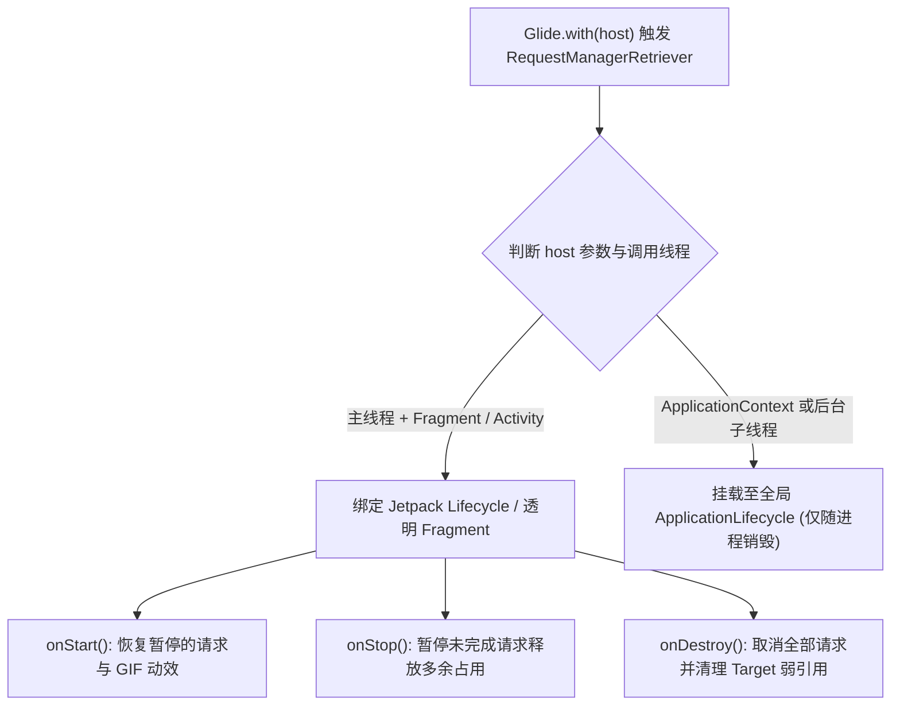

## 面试答题思路

- **核心魔法**：为什么一句简洁的 **`Glide.with(activity/fragment).load(url).into(iv)`** 既不用手工写取消请求代码，也不会因为页面关闭引发 `Activity` 泄漏或回调崩溃？关键全在于 **`RequestManagerRetriever`** 为当前组件绑定了生命周期监听器。
- **底层实现演进**：
  - **传统机制**：向传入的 `FragmentActivity` / `Fragment` 的 `FragmentManager` 中动态塞入一个**看不见的无界面空白 `SupportRequestManagerFragment`**；宿主走到 `onStart`/`onStop`/`onDestroy` 时，该透明 Fragment 同步收到回调并驱动关联的 `RequestManager` 执行**继续加载 / 暂停未完成请求 / 彻底取消并释放 Bitmap 资源**；
  - **Glide 4.14+ 现代优化**：对于实现 Jetpack `LifecycleOwner` 的标准 `FragmentActivity` 和 `Fragment`，逐步改为**直接注册 `Lifecycle` 观察者**（逐步淘汰了老式子 Fragment 注入带来的 FragmentManager 状态提交坑点）。
- **传参作用域大坑**：如果在子线程调 `Glide.with(activity)`、或者传入的已经是 `ApplicationContext`，Glide 无法绑定到具体页面生命周期，会自动退化挂载到**全局 `ApplicationLifecycle`**（仅随进程生死！）。

## 核心原理解析

### 1. 传入不同参数给 `Glide.with(...)` 的行为全对比
- **传 `Fragment`（在 Fragment 内时首选！）**：仅跟这个 `Fragment` 同生共死（即使它所属 `Activity` 还在，只要该 Fragment 被移除销毁，加载立马取消省电省流）；
- **传 `Activity`**：跟着页面走，退后台 `onStop()` 自动暂停排队和 GIF 播放，回到前台 `onStart()` 自动恢复，关闭销毁彻底取消释放；
- **传 `View`**：Glide 会向上顺藤摸瓜寻找所属的 `Fragment` 或 `Activity`（新版基于 `ViewTreeLifecycleOwner` / `findFragment` 查找），找不到再兜底退化为 `ApplicationContext`；
- **传 `ApplicationContext`（或从后台子线程调用 `with()`）**：全局永不自动暂停取消！如果在通知栏/桌面 Widget 下载图片没关系；若误用在列表页加载大图，滑走关页后后台依然继续强行下载解码浪费流量。

### 2. 经典异常 `You cannot start a load for a destroyed activity` 成因与避坑
异步接口刚返回准备调 `Glide.with(activity).load(...)` 时，用户恰好刚按下返回键关闭了 `Activity`（`activity.isDestroyed == true`）：
- Glide 在绑定检查中发现宿主已销毁会直接抛出 `IllegalArgumentException` 拦截无效加载；
- **治理姿势**：在 `Activity/Fragment` 内借助 `lifecycleScope` 发起异步并在界面销毁自动取消；如果是在纯工具弹窗或异步不可控回调前加载图片，应先判 `!activity.isFinishing && !activity.isDestroyed` 或使用绑定页面视图生命周期的 `RequestManager` 提前在安全期创建好引用。

## 图解流程

## 高频追问与关键词

- **追问 1**：在 `RecyclerView` 快速滑动复用 ItemView 时，Glide 如何保证图片不乱序错位闪烁？
  - 关键词：① 在 `into(imageView)` 开始前会自动清除该 `ImageView` 上一次绑定的旧 `Request`（通过 `ViewTarget` 存在 View 的 `Tag` 中）；② 若新的加载还在排队，先立即换上配置好的 `placeholder` 占位图抹掉旧图，旧异步请求即使完成也会因 `Target` 核对不一致被丢弃。
- **追问 2**：为什么不能给开启了 Glide 的 `ImageView` 调用 `imageView.setTag(myObject)` 无参数形式？
  - 关键词：因为 `Glide ViewTarget` 默认使用 `View` 的无参数 `setTag(request)` 存储自身请求句柄，重复占用无参 Tag 会直接抛异常 `You must not call setTag() on a view Glide is targeting`！需要绑业务数据请用带唯一资源 ID 的双参 **`setTag(R.id.my_tag_key, obj)`**。

## 延伸参考

参考 Glide 官方 Getting Started 文档与 Debugging / RequestManager 指南。
