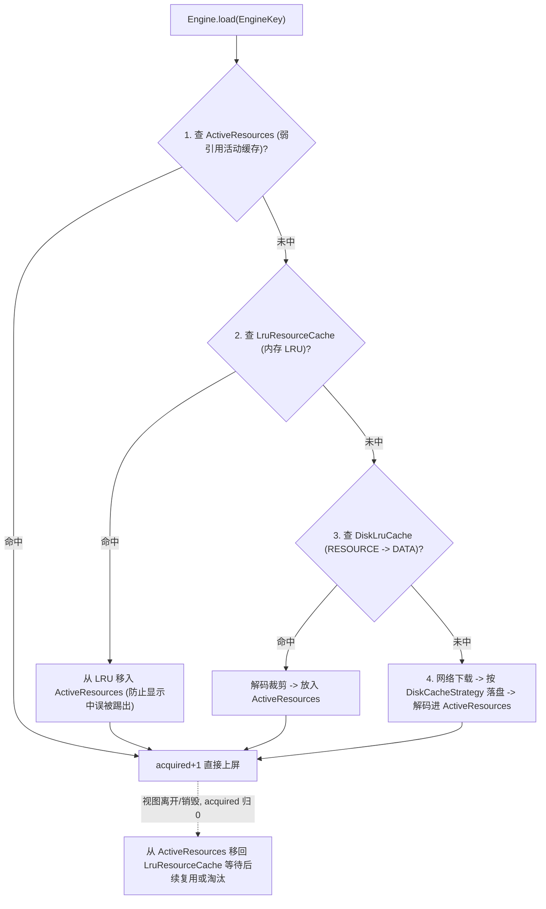

## 面试答题思路

- **核心设计哲学（区别于简单两级缓存）**：Glide 并非简单“LruCache + DiskLruCache”，而是把**内存层精妙拆成两层**：**`ActiveResources`（弱引用活动缓存）** 与 **`LruResourceCache`（内存 LRU 缓存）**，加上底层的 **`DiskLruCache`（磁盘缓存）**，构成完整高效的三级缓存（读顺序：活动缓存 → 内存 LRU → 磁盘缓存 → 网络/本地文件）。
- **为什么要拆出 `ActiveResources`（必考亮点）？**：防止正在屏幕上被多个视图展示的 `Bitmap` 因为新图刷入被 `LruResourceCache` 按最近最少使用强行踢出回收（若强行 `recycle()` 正在绘制的 Bitmap 会直接闪退，不回收则同一个 URL 再次绑定会重复解码浪费双份内存！）。通过 **`ActiveResources` 引用计数 + 弱引用** 保护正在被 UI 展示中的图，只有全部视图不再展示（引用计数归零）才安稳退回 `LruResourceCache` 排队待淘汰。
- **Glide 4 磁盘策略精准命名**：注意 Glide 4 中磁盘缓存枚举已升级为 **`DATA`（原始未解码压缩字节）** 与 **`RESOURCE`（按目标 ImageView 尺寸与变换裁剪解码后的图）**、`AUTOMATIC`（默认智能策略：网络图只缓原图 `DATA`，本地图只缓转换图 `RESOURCE`）、`ALL` 与 `NONE`（早期 Glide 3 叫 `SOURCE`/`RESULT`）。

## 核心原理解析

### 1. 读取与回写闭环（Engine.load 链路）
1. **构建精密 `EngineKey`**：缓存键绝不仅仅只有 URL，而是由 **`URL/模型 + 控件宽高 + 裁剪变换 Transformation + 解码器选项 + 签名`** 共同哈希而成！所以同一张图放进 100×100 缩略图和 1080×1920 大图里在内存中对应两份独立的合适尺寸缓存；
2. **第 1 级查找：`ActiveResources`**：查 `activeEngineResources` 弱引用 Map。若命中，说明屏幕正显示着它，将它的内部引用计数 **`acquired + 1`** 直接返回使用；
3. **第 2 级查找：`MemoryCache`（`LruResourceCache`）**：若第 1 级没命中再查 LRU；**一旦命中，立刻把它从 LRU 中移除，移入 `ActiveResources` 并记 `acquired = 1`**（这就是经典的“出池入活”保护动作！）；
4. **第 3 级查找：`DiskLruCache`**（后台线程池执行）：先按 `ResourceCacheKey` 查转换后图（`RESOURCE`），未中再按 `DataCacheKey` 查原始字节（`DATA`）；
5. **第 4 级兜底：网络拉取**：拉回后按策略落盘保存，解码出尺寸恰当的 `Bitmap` 包装进 `EngineResource`，`acquired + 1` 存入 `ActiveResources` 上屏展示；
6. **释放回退（`onResourceReleased`）**：当页面销毁或 `ImageView` 被划走复用使该资源 `acquired` 引用计数降到 **`0`** 时，从 `ActiveResources` 移除并**重新放回 `LruResourceCache`** 供下次快速复现（除非开启了 `skipMemoryCache(true)`）。

## 图解流程

## 高频追问与关键词

- **追问 1**：为什么 `ActiveResources` 里面要用 `WeakReference` 持有正在使用的图片？如果屏幕还展示着，GC 会不会误回收它？
  - 关键词：**绝对不会！** 因为此时正在屏幕显示的 `ImageView` 已经通过 `Drawable` 强引用着那张 `Bitmap`；`ActiveResources` 自己用弱引用是为了在万一开发者泄露或没按常规生命周期调 release 时，只要 `ImageView` 自己被回收了，Map 不会拖死整个 `Bitmap`（配合关联的 `ReferenceQueue` 自动清理失效弱引用条目）。
- **追问 2**：同一张头像图片服务端内容更新了，但图片 URL 地址完全没变，怎么刷新缓存不显示老头像？
  - 关键词：在 Glide 请求链上加 **`.signature(ObjectKey(versionOrTimestamp))`**，将版本号混入 `EngineKey` 计算中，一旦版本号变更会自动击穿老内存和磁盘缓存重新拉取。

## 延伸参考

参考 Glide 官方 Caching 文档深入理解 `DiskCacheStrategy.AUTOMATIC` 默认智选逻辑。
