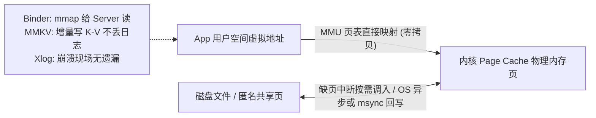

## 面试答题思路

- **本质原理**：`mmap` 是 POSIX/Linux 提供的内存映射系统调用——它直接在进程虚拟地址空间划出一块区间，通过页表将其**直接映射到内核的 `Page Cache`（文件页缓存或匿名物理内存页）**，从而打通用户态与内核态共享同一片物理内存。
- **解决传统 I/O 的两大痛点**：
  1. **减少内存拷贝**：常规 `read()`/`write()` 必须经历“磁盘 ↔ 内核 `Page Cache` ↔ 用户态 `byte[]` 缓冲区”两次拷贝和频繁系统调用陷入开销；`mmap` 后业务代码就像操作普通指针数组一样**直接读写那块内核 `Page Cache`（零多余用户态拷贝）**，既省 CPU 又省双倍内存；
  2. **App 闪退也不易丢数据**：由于写入瞬间已经进入操作系统内核管理的 `Page Cache`，就算应用进程下一毫秒突然 Java Crash 或被用户强杀，操作系统依然会在后台安全把脏页（Dirty Page）回写进磁盘！
- **三大经典 Android 落地案例**：① **Binder IPC**（跨进程 1 次拷贝通信）；② **MMKV**（高效 K-V 持久化免序列化与闪退不丢）；③ **Xlog / Logan 日志组件**（打一行日志零卡顿进内存映射缓冲，崩溃不丢最后现场日志）。

## 核心原理解析

### 1. 缺页中断（Page Fault）按需加载机制
调用 `mmap()` 映射一个 10MB 的大文件时，操作系统**并不会瞬间把 10MB 全读进物理 RAM**，它只是在内核进程结构 `vm_area_struct` 登记一段合法虚拟地址：
- 当代码首次真正读写某个 4KB 内存页时，CPU 硬件 MMU 发现页表尚未关联物理页，触发一次**缺页中断（Page Fault）**；
- 内核此时才真正从磁盘把这一小页（4KB）按需载入 `Page Cache` 并填好页表映射；
- 之后再访问同一页时全速纯内存指令执行，零系统调用开销（`Xlog` 与资源包读取 `AssetManager` 均受益于此！）。

### 2. `mmap` 映射的潜在坑点与限制
1. **虚拟地址空间占坑（早期 32 位机器灾难）**：尽管物理内存按需使用，但 `mmap` 会占满虚拟内存地址范围，早期 32 位进程总共只有 3–4GB 虚拟地址，映射过多大文件极易引发虚拟地址耗尽型 OOM（现 64 位已大幅缓解）；
2. **文件大小扩容成本**：普通文件映射不能动态变长（超过初始映射末尾会触发 `SIGBUS` 原生崩溃！），因此 `MMKV` 和 `Xlog` 写入满时必须做 `ftruncate` 扩文件并 `munmap` 重新建立映射；
3. **极端断电风险**：若还没来得及被内核回写（或未调用 `msync()` 强制刷盘）时**整个手机物理电池抠掉/突然断电重启**，最后几百毫秒在 `Page Cache` 里的脏页会丢失（应用本身 Crash 无影响）。

## 图解流程

## 高频追问与关键词

- **追问 1**：为什么像腾讯 `Xlog`（微信日志系统）不直接用 Java `BufferedWriter` 写文件，非要用 C++ `mmap`？
  - 关键词：① 普通流写日志有几 KB 用户态缓冲区，**一旦应用突发原生崩溃或 Java Crash 进程秒挂，留在用户态内存缓冲里的最后几十条最关键报错日志会瞬间全部丢失**；② 写一行调一次 `flush()` 系统调用又会严重卡顿主线程；③ `mmap` 让每条日志直接落地进内核共享内存页且支持流式压缩加密，既有内存速度又能在 App 崩溃时保住最后一条现场日志！
- **追问 2**：`mmap` 映射一段物理内存一定比传统 `read()` 更快吗？什么情况反而不适合用 `mmap`？
  - 关键词：对**几十 MB 级别以下反复随机读写的小文件或结构化追加日志**极快；但如果只顺序读一次超大几 GB 视频文件，大量缺页中断与页表维护成本并不比大块直接 I/O（`sendfile` / 大缓冲 `read`）快，且容易挤占其他活跃进程的系统 `Page Cache`。

## 延伸参考

参考 AOSP Binder `mmap` 架构文档与 Android `SharedMemory` 开发指南巩固虚拟内存映射常识。
