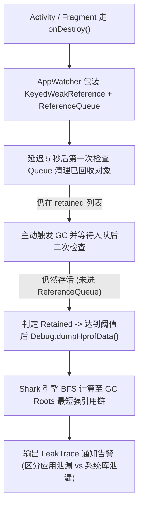

## 面试答题思路

- **核心判别哲学（一句话直击灵魂）**：把一个 **“本该被回收的对象”** 包裹进绑定了 **`ReferenceQueue` 的 `WeakReference`** 中——如果触发过 GC 之后，在 `ReferenceQueue` 里始终捞不到这个弱引用，就说明还有隐藏的强引用链吊着它导致泄漏！
- **完整四步工作链路**：
  1. **监听注册（`AppWatcher`）**：通过 `AppStart` 自动无侵入注册 `ActivityLifecycleCallbacks`、`FragmentLifecycleCallbacks` 以及监听 `ViewModel` `onCleared()`、Service 等销毁节点；
  2. **等待与触发 GC**：对象进入 `onDestroy` 后生成 `KeyedWeakReference(target, key, queue)` 放入监听集合；**延迟 5 秒**后先清理已进队列的对象；若仍在集合中，手动执行一次 `Runtime.getRuntime().gc()` 后再等一小会再次清理；
  3. **收集堆转储（Dump Hprof）**：若保留对象数达到阈值（如前后台累计 5 个保留实例），调用 **`Debug.dumpHprofData()`** 将进程内存快照写入私有文件（注意过程会短暂冻结几秒 App）；
  4. **离线高速分析（`Shark` 引擎）**：后台 `WorkManager` / 独立解析流程利用 **Shark**（替代早期笨重的 HAHA）流式扫描 `.hprof`，从所有活跃 **`GC Roots`**（避开弱软引用本身）做广度优先搜索（BFS），精确算出指向泄漏对象的**最短强引用路径**并把系统级误报（`AndroidReferenceMatchers` 已知固件泄漏）自动归类剥离。

## 核心原理解析

### 1. 为什么非要等 5 秒、而且还要结合 `ReferenceQueue` 二次校验？
- **等 5 秒**：刚走完 `onDestroy()` 时，消息队列或系统内部回调可能还存在短暂的过渡性临时引用还没弹栈清理，等 5 秒留出充分的“自然消亡缓冲”；
- **为什么要手动触发一次 GC 再查一次？**：`System.gc()` / `Runtime.getRuntime().gc()` 会提示 ART 虚拟机尽快跑一次回收（`LeakCanary` 的 `GcTrigger` 还额外 `Thread.sleep(100)` 让 Finalizer 和队列入队线程跑完）；如果触发完 GC 且过了缓冲期，`ReferenceQueue` 里仍然没有出现那个 `KeyedWeakReference`（即 `weakRef.get() != null`），几乎 100% 实锤存在强引用泄漏！

### 2. Shark 引擎相比老版 HAHA 为什么快得多、省内存得多？
老牌 HAHA（基于 Eclipse MAT 移植）会把几百 MB 的整份 `.hprof` 全部展开加载进分析进程的 Java 堆里构建臃肿的快照对象图，动不动就把分析器自己弄 OOM 崩了；而 Square 自研的 **Shark** 采用**懒索引 + 流式文件定位（Okio `RandomAccess` 按字节偏移读字段）+ Dominator 支配树计算泄漏字节大小**，内存占用缩减到原先的 1/10 以下，几秒就能把几百 MB Hprof 分析完毕！

## 图解流程

## 高频追问与关键词

- **追问 1**：为什么不能把 `LeakCanary` 直接带到线上 Release 生产环境全量运行监控？线上内存泄漏怎么抓？
  - 关键词：① `Debug.dumpHprofData()` 会直接 **STW 冻结全进程数秒导致用户界面卡死甚至触发 ANR**，且分析几百 MB Hprof 极度耗电发热占磁盘；② 线上方案借鉴了快手 **`KOOM`** 思路——**监控 Java Heap 水位线超标后利用 Linux `fork()` 子进程（写时复制免冻结主进程！）在子进程安全 Dump 并裁剪去掉多余的像素/字符串大块数据仅保留引用关系链回传分析**！
- **追问 2**：看 LeakCanary 的 LeakTrace 报告怎么一眼精准定位哪一行才是真正的“真凶泄漏节点”？
  - 关键词：Shark 会在链路上标注波浪线 **`~~~`（可疑/泄漏点）**、下划线（确定未泄漏）与 `status`；核心看从上往下第一处**状态从“已释放/正常（NO）”跃迁为“未释放/未知（YES/UNKNOWN）”** 的那一条业务引用边（比如静态单例字段持有 Context 或未注销 Listener）。

## 延伸参考

参考 Square LeakCanary 官方原理解析文档梳理 `KeyedWeakReference` 与 Shark 分析步骤。
