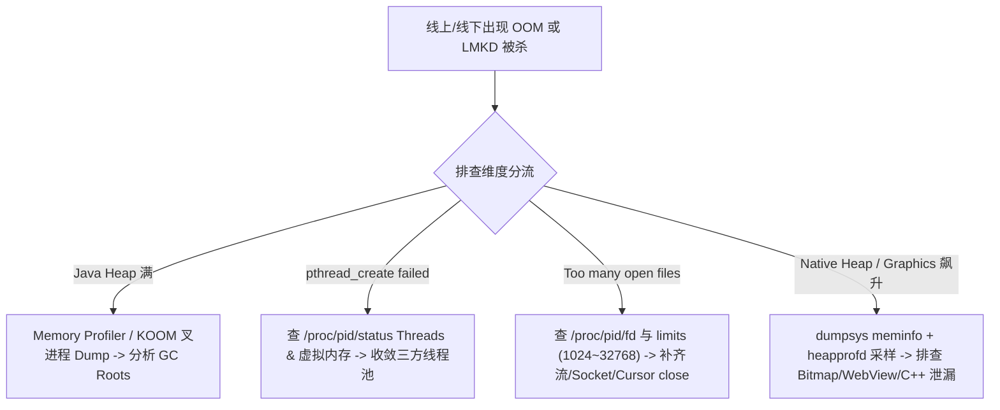

## 面试答题思路

- **先破除经典误区**：`OutOfMemoryError` **并不一定是因为 Java Heap 满了**！在 Android 上触发 OOM 主要有四大源头：
  1. **Java Heap 耗尽**：超出单进程硬上限（通过 `ActivityManager.getMemoryClass()` / `largeHeap` 可查，通常 256MB–512MB）；
  2. **Thread 数量超限或虚拟内存不足导致 `pthread_create failed`**：每个线程默认分配约 1MB 虚拟栈空间及内核线程描述符，32 位进程地址空间或系统单进程线程数上限耗尽时直接抛 OOM（哪怕 Java 堆还剩一半！）；
  3. **FD（文件描述符）数量溢出**：Socket、文件流、HandlerThread、`Surface`、`Ashmem`、Pipe 均消耗 FD，超出系统 `ulimit`（老系统低至 **1024**，现代 Android 设备通常放宽至 **4096–32768** 取决于机型配置）时打开新文件/建线程/分配窗口直接报 **`Too many open files` / `Could not read input channel file descriptors`** 崩溃；
  4. **Native 堆内存暴涨（Bitmap / `.so` C++ / WebView / OpenGL）**：虽不直接抛 Java `OutOfMemoryError`，但总物理内存（PSS/RSS）触碰红线后会被系统 **`lmkd` 直接后台甚至前台杀掉**。

## 核心原理解析

### 1. 四类内存溢出的线下精确排查工具链
- **看整体轮廓**：`adb shell dumpsys meminfo <pkg>` 观察 **`Java Heap`、`Native Heap`、`Graphics`、`Code`、`Stack`、`Private Dirty`** 各占多少 MB；
- **查 FD 泄漏**：`adb shell ls -l /proc/<pid>/fd | wc -l` 看当前 FD 总数并与 `/proc/<pid>/limits` 对比，进一步 `ls -l` 看是不是漏了一大堆 `socket:`、`anon_inode:[eventfd]` 或某日志文件；
- **查线程爆炸**：`adb shell ps -T -p <pid>` 或抓 `traces.txt` 统计重复线程前缀名（抓出哪个三方 SDK 没收敛线程池疯狂 `new Thread`）；
- **查 Native C++ 泄漏**：Android Studio **Native Memory Profiler**（结合 `heapprofd` 底层采样无侵入抓出 `.so` 哪个 `malloc` 函数调用栈申请不释放）。

### 2. 线上内存监控为什么需要 **KOOM**（快手开源）思路？
普通线上 App 直接在主进程调用 `Debug.dumpHprofData()` 会卡死用户 UI 几秒甚至招致 ANR，而且高达 300MB 的完整 Hprof 根本传不回服务器。**KOOM 核心两大绝招**：
1. **利用 Linux `fork()` 写时复制免冻结 Dump**：先通过轻量化 `Thread` 轮询检查 Java 堆占比超过 80% 时，在安全时机 `fork` 出一个子进程，**主进程立刻恢复丝滑流畅运行**，由子进程慢悠悠执行 `dumpHprofData()` 落盘并直接退出；
2. **线上裁剪分析（Hprof Strip / On-Device Shark）**：把巨大无比的 `Bitmap` 像素数组与字符串实体裁剪剥离，或者直接端上轻量 Shark 在后台空闲算好 `LeakTrace` 文本报告再压缩几十 KB 上传，彻底解决线上抓大内存的痛点！

## 图解流程

## 高频追问与关键词

- **追问 1**：为什么有时候 32 位包（仅打 `armeabi-v7a` 的老 App）跑在 8GB 内存的旗舰机上，才用到 1.5GB 内存就报 `pthread_create failed` 或 `OutOfMemoryError`？
  - 关键词：**32 位进程虚拟地址空间上限只有 3GB–4GB**！大量 `mmap` 映射、`.so` 加载、视频缓冲与数百个线程栈（每条耗 ~1MB 虚拟地址）很快把 3GB 虚拟地址切碎耗光，即使物理内存充裕也无法申请连续虚拟地址空间；现代工程全量接入 **`arm64-v8a` 64 位架构**即可彻底突破虚拟空间瓶颈。
- **追问 2**：Android 中常见的全局匿名 FD 泄漏除了文件流忘记关，还有哪些容易忽略的隐蔽源头？
  - 关键词：① 创建 **`HandlerThread` 忘记调 `quitSafely()`**（每个 Looper 都带一对 `eventfd`/`epoll` FD！）；② 创建 `InputChannel` / `Window` / `Socket` 未正常关闭；③ 未正确释放 `MediaMetadataRetriever` / `ParcelFileDescriptor` / `Surface`。

## 延伸参考

参考 Android Developers 内存概览文档与 `dumpsys meminfo` 命令行诊断指南。
