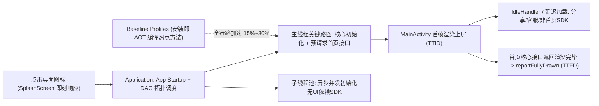

## 面试答题思路

- **先亮标准衡量指标（中级必备专业度）**：
  - **TTID（Time to Initial Display）**：从点击图标到系统绘制出应用第一帧（如首页框架或启动屏，系统 `ActivityTaskManager` 自动日志打印 `Displayed`，Play Vitals 警戒线通常 **< 5 秒**，优秀标准 **< 1–1.5 秒**）；
  - **TTFD（Time to Full Display）**：页面**真正异步接口加载完成、主内容完整可交互呈现**的耗时（通过业务调用 `Activity.reportFullyDrawn()` 打点上报）。
- **系统性优化五板斧（按生命周期分段打击）**：
  1. **系统白屏阶段体验优化**：接入 Jetpack **`SplashScreen` API**（主题 `windowSplashScreenBackground` 占位取代早期 `windowDisablePreview` 假死感，消除黑/白屏闪烁）；
  2. **Application 阶段瘦身与并行（DAG 启动器）**：合并消除冗余 `ContentProvider`（`App Startup`）；把二三十个三方 SDK 按“必须主线程前同步 / 可后台异步并行 / 首帧后 `IdleHandler` 延迟初始化”三级分类，结合 **DAG（有向无环图）拓扑排序**充分利用多核并发缩短关键路径；
  3. **ART 编译期提前加速（`Baseline Profiles`）**：在包内随 APK 下发基准配置文件（`baseline-prof.txt`），让 App 安装/首次运行时 ART 直接把启动与核心滑动类方法 **AOT 预编译成机器码**，绕过冷启动边解释边 JIT 的巨大卡顿，实测常提速 **15%–30%**！
  4. **首页渲染与 IO 减负**：减少首页 XML 嵌套（`ViewStub` 懒加载非首屏面板、异步预解析 XML）、严禁在 `Application`/`MainActivity.onCreate` 同步读 SP/查库/反射路由全量扫描；
  5. **网络接口前置预拉取**：在启动主流程开始前先发首页首屏接口并发请求，等首页布局渲染完毕时数据刚好已经回来！

## 核心原理解析

### 1. 为什么传统“无脑全塞进子线程初始化”反而可能变慢或崩溃？
- **依赖顺序崩溃**：SDK B 依赖 SDK A（比如崩溃监控依赖基础网络配置和 DeviceID 初始化完成）；盲目全部 `thread {}` 跑会出竞态空指针；
- **调度过载抢主线程 CPU**：启动瞬间开二三十条并发线程疯狂打满 CPU，反而挤占主线程抢时间片，拖慢 UI 渲染！
- **DAG 启动器（有向无环图）解法**：每个初始化节点声明 `dependencies()` 依赖前驱列表、`runOnMainThread()` 与优先级；初始化框架计算入度为 0 的任务并行投递给有限线程池（匹配 CPU 核数），主线程通过 **`CountDownLatch` / 协程 `await`** 仅等待强依赖首帧的任务完成，其余低优任务（分享、定位、客服）全部挂到首页首帧渲染完成后的 **`IdleHandler`** 分批执行。

### 2. ART JIT/AOT 混合编译与 `Baseline Profiles` 工作原理
Android 7.0+ 后安装 APK 时默认**不做全量 AOT 编译**（太慢且占存储），而是首次启动靠慢速解释器运行并记录热点方法生成 Profile，等手机插电空闲时后台 `dex2oat` 才做 AOT。这导致**用户装完第一次打开 App（以及每次大版本更新后首次打开）启动和滑动异常卡顿**！
引入 **`Baseline Profiles`**（配合 Jetpack Macrobenchmark 自动生成规则文件打进 AAR/APK）后，商店安装时/云端下发 DEX Metadata（DM）配合 `InstallDexOpt`，**开机即直接 AOT 预编译最核心的启动链路与 Compose/RecyclerView 关键路径**，实现安装即巅峰流畅度！

## 图解流程

## 高频追问与关键词

- **追问 1**：`SharedPreferences` 为什么会在冷启动时拖慢主线程？怎么排查启动期隐藏 IO？
  - 关键词：在 `Application.onCreate` 调用 `getSharedPreferences()` 会立刻开启后台加载整份 XML，若紧接着主线程调 `getBoolean()` 读取灰度开关就会被锁死阻塞等整份解析完成；线下可配合 **`StrictMode`**（开启 `detectDiskReads()` / `detectDiskWrites()` 惩罚告警）以及 **`Perfetto`** 查看启动期主线程 `Sleeping/Uninterruptible Sleep (IO)` 状态精确抓出。
- **追问 2**：首页首帧展示完成后怎么精准通知系统记录 `TTFD`（完全加载时间），以及线上怎么统计？
  - 关键词：调用 `ComponentActivity.reportFullyDrawn()`（Compose 可直接用 `ReportDrawnWhen { isDataReady }`）；线上也可通过向首页根布局挂载 `ViewTreeObserver.addOnDrawListener`（或 `Choreographer`）配合首屏接口完成时间戳计算内部监控 `TTID/TTFD` 埋点。

## 延伸参考

参考 Android Developers Launch Time 指标文档与 Baseline Profiles 官方接入指南。
