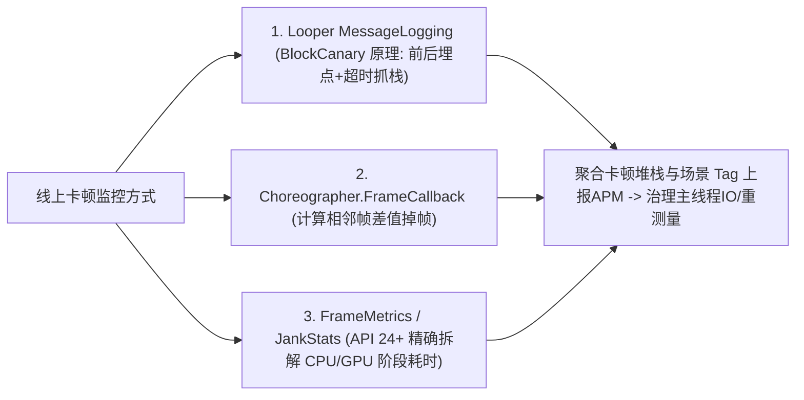

## 面试答题思路

- **线下排查 vs 线上监控两套打法**：
  - **线下精定位**：用 **Perfetto / Systrace** 看帧时间线与 CPU 调度，配合开发者选项的 **GPU 渲染模式分析（Profile GPU Rendering）** 与 **调试 GPU 过度绘制（Show GPU Overdraw）**；
  - **线上无感抓卡顿（必考三大监控方案）**：
    1. **`Looper.getMainLooper().setMessageLogging(printer)`（BlockCanary 核心原理）**：监控每条主线程消息执行耗时，大于阈值（如 > 50ms/100ms）时触发后台高频采样线程打印当时主线程堆栈（缺点：高版本字符串拼接略有微弱开销，线上多用采样或原生替代）；
    2. **`Choreographer.FrameCallback` / Jetpack `JankStats`**：对比相邻两次 `doFrame(frameTimeNanos)` 间隔是否超过单帧预算（如 16.6ms / 8.3ms）统计精确掉帧数；
    3. **`Window.addOnFrameMetricsAvailableListener`（API 24+，官方最推崇低开销）**：直接从底层渲染管线拿到精准的**测量/布局/绘制/GPU 交换耗时明细**，零字符串拼接污染主线程！

## 核心原理解析

### 1. `BlockCanary` 基于 `Looper.setMessageLogging` 的经典原理与局限
`Looper.loop()` 每次派发执行 `msg.target.dispatchMessage(msg)` 前后都会调用：
- `logging.println(">>>>> Dispatching to ...")`
- `logging.println("<<<<< Finished to ...")`
监控器接到 `>>>>>` 后向后台子线程投递一个延迟任务（如 80ms）；若任务按时收到 `<<<<<` 就取消；若超时还没收到 `<<<<<`，说明主线程正卡死在这条消息里，后台线程立刻调用 `Looper.getMainLooper().thread.stackTrace` 抓出当前主线程堆栈上报！
**线上注意点**：频繁拼 `String` 易制造微量内存抖动，工业级线上组件多采用 **Hook/字节码插桩统计耗时** 或 **`FrameMetrics` + `JankStats`**，平时不抓栈，仅发生严重卡顿才按采样率触发信号抓栈。

### 2. 常见渲染卡顿优化清单（按收益排序）
- **剥离主线程非 UI 操作**：主线程严禁读写数据库/文件/SP、大量 JSON 解析、复杂正则或大图片同步解码；
- **布局扁平化与懒加载**：用 **`ConstraintLayout`** 替代深层嵌套的 `LinearLayout(weight)` / `RelativeLayout` 消除指数级二次测量；非首屏异常态/弹窗内嵌视图使用 **`<ViewStub>`** 按需 `inflate()`，复用共用头尾抽离 `<merge>` 标签减少节点数；
- **异步布局预渲染（慎用边界）**：对极复杂首屏列表卡片，可在后台使用 **`AsyncLayoutInflater`** 提前 inflate 视图树并缓存（注意子线程 inflate 无法支持某些依赖当前 Activity 主题/内部创建 `Handler` 的特殊自定义控件）；
- **控制过度绘制（Overdraw）**：去掉窗口多余的全局默认主题背景 `window.setBackgroundDrawable(null)`（如果页面自己铺满了实色背景）及叠加重复的父子背景色；合理剪裁 `canvas.clipRect()`。

## 图解流程

## 高频追问与关键词

- **追问 1**：如果在主线程利用 `Looper.setMessageLogging` 计算了所有消息耗时，为什么有时候页面滑起来明明卡成 PPT，单条消息耗时监控却没报警？
  - 关键词：可能存在**高频微卡顿累积（“碎卡顿”）或 GPU 瓶颈**——比如每条主线程消息只跑 12ms 没到 80ms 单次卡顿阈值，但因为过度绘制、离屏渲染 `saveLayer`、海量透明图层阴影导致 **`RenderThread` / GPU 栅格化超时**，或者不断小额 GC 停顿；此时必须靠 **`FrameMetrics`**（看 `DRAW_DURATION` / `SYNC_DURATION` / `GPU_DURATION`）和 **Perfetto** 才能抓出真正元凶！
- **追问 2**：为什么大量使用 `View.ALPHA` 半透明重叠或圆角遮罩会导致渲染变慢？
  - 关键词：整组包含子控件的复杂视图调 `setAlpha()` 或频繁使用 `PorterDuffXfermode` 往往会触发 GPU **离屏渲染缓冲区（Offscreen Buffer / `saveLayer`）** 分配与切换，增加大量显存带宽消耗；半透明文字/纯色背景尽量直接改颜色值透明度，圆角优先使用 `ViewOutlineProvider`（`clipToOutline`）由硬件高效裁剪。

## 延伸参考

参考 Android Developers JankStats 与过度绘制优化官方文档。
