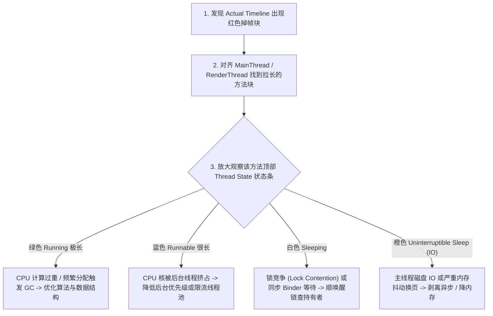

## 面试答题思路

- **定位价值**：Systrace 已被官方全面升级替换为功能更强、无时间窗口长度死限的新一代系统级性能追踪平台 **`Perfetto`**。当出现“为什么冷启动慢 1 秒”、“为什么滑动突然卡了一帧”时，Perfetto 能把 **App 代码打点、Framework 绘制阶段、Binder 跨进程交互与 Linux 内核 CPU 线程调度** 全部放在同一条纳秒级时间轴上对齐透视。
- **抓 Trace 三种常用姿势**：① 手机开发者选项里直接开启“**系统跟踪（System Tracing）**”悬浮窗录完拉回浏览器 `ui.perfetto.dev` 打开；② Android Studio Profiler **System Trace**；③ 命令行通过 `adb shell perfetto` 或配合代码里手动注入 **`Trace.beginSection("MyBizTag") ... Trace.endSection()`**（发布版可开 `profileable` 保证贴近真实性能！）。
- **核心看图口诀（四步锁定真凶）**：**先看 `Frames` 找红/黄掉帧块 → 对齐下方 `MainThread` 与 `RenderThread` 看谁超预算 → 切开线程上方“CPU 调度状态条”辨别是真计算慢还是等锁/等 CPU/等磁盘 I/O → 顺着 `Binder` 链路查是不是在等系统服务回包**。

## 核心原理解析

### 1. Perfetto 必看四大核心泳道（Tracks）
1. **`Expected Timeline` 与 `Actual Timeline`（Android 12+ 帧泳道）**：直白标出每一帧的 VSync 预算区间与真实结束点——**绿色**正常，**橙色/红色**即发生掉帧（Jank）以及是谁导致的（`App Deadline Missed` 应用自身超时 vs `SurfaceFlinger` 延迟）；
2. **应用进程主线程（`MainThread`）**：直观展开 `Choreographer#doFrame` → `traversal` → `measure/layout/draw` 以及你自己的 `Trace.beginSection` 自定义方法块耗时；
3. **渲染线程（`RenderThread`）**：看 `DrawFrame` / `eglSwapBuffers` 是否因为复杂路径或着色器编译卡住 GPU；
4. **`Binder` 事务标记**：当某段调用突然陷入等待时，点开 `binder transaction` 箭头可以直接跳过去查看对端进程（比如 `system_server` 或 `surfaceflinger`）正卡在什么锁上。

### 2. 看懂线程头顶的四大 CPU 调度状态颜色条（高含金量细节！）
如果看到 `MainThread` 里一个 `measure` 方法莫名其妙拉长了 50ms，千万别盲猜代码逻辑复杂——放大看它头顶那一细条 **Thread State**：
- **绿色 `Running`**：真正在 CPU 核心上全力跑指令（说明这里就是你的代码计算重、循环多或频繁反射）；
- **蓝色 `Runnable`（可运行等待队列）**：**代码根本没慢，而是 CPU 核全被其他后台高优进程或并发线程池占满了**，主线程在就绪队列里排队干等调度！点击可看到最终唤醒并抢走 CPU 的是谁；
- **白色/灰色 `Sleeping`（可中断睡眠）**：主动进入等待队列，如 `synchronized` / `ReentrantLock` 锁竞争挂起、`wait()`、或发起同步 **Binder IPC 等待系统服务返回**（点 Wakeup 源头即可抓出谁持锁不放！）；
- **橙色/砖红色 `Uninterruptible Sleep`（不可中断睡眠 / `D` 态，常伴随 `IO Wait`）**：正在内核里硬等**磁盘物理读写（`fsync`）或严重内存换页（`kswapd` / 缺页中断读文件）**！

## 图解流程

## 高频追问与关键词

- **追问 1**：为什么要求测性能抓 Perfetto 一定要用 **`Release` 构建 + `<profileable android:shell="true"/>`**，不能用普通 Debug 包？
  - 关键词：Debug 包默认带 `debuggable="true"`，会让 ART 禁用大部分 AOT 与内联优化走慢速模式并挂上调试器探针，抓出来的耗时严重失真；在 `AndroidManifest.xml` `<application>` 里加入 `<profileable android:shell="true"/>` 配 Release 包（开启 R8）才能测出线上真实用户的精确帧率与方法耗时。
- **追问 2**：怎么在自己的关键业务代码块加上 Perfetto 泳道标签，而又不影响线上性能？
  - 关键词：接入 Jetpack `androidx.tracing.Trace.beginSection("FeedBind")` / `endSection()`（或 KTX **`trace("FeedBind") { ... }`**）；在未打开系统 Trace 录屏开关时，底层只是读一个内核共享开关位，开销为纳秒级几乎为零；注意异常分支要用 `try-finally`（或 `trace {}`）保证成对闭合。

## 延伸参考

参考 Perfetto 官方 Android 应用跟踪文档与 Android Developers 设备端系统追踪教程。
