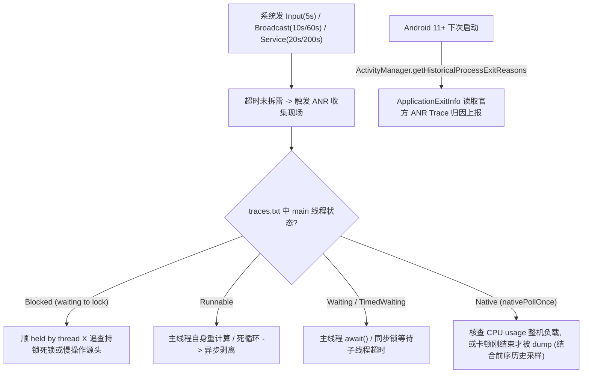

## 面试答题思路

- **ANR 本质机制（“埋炸弹与拆炸弹”）**：并非只要主线程卡 5 秒就立刻弹 ANR，而是**当系统发出某个高敏感调度事件（点击/广播/服务）并在 AMS/InputDispatcher 埋下定时炸弹后，到了超时阈值还没收到应用侧的完成回执（拆炸弹）**，才会引爆触发 ANR 收集进程堆栈。
- **四大经典超时阈值（必背准确数字）**：
  1. **Input 按键/触摸事件无响应**：**5 秒**（只有发生实际点击滑动等输入事件且 5 秒未消费完才触发）；
  2. **BroadcastReceiver 超时**：前台广播 **10 秒**，后台广播 **60 秒**；
  3. **Service 超时**：前台服务 **20 秒**，后台服务 **200 秒**；
  4. **ContentProvider `publish` / 响应超时**：约 **10 秒**。
- **线上捕获进化（重要加分）**：过去线上抓不到准确 ANR 现场（高版本无权读公共 `/data/anr/traces.txt`），现代除了依靠 `SIGQUIT` 信号拦截外，**Android 11（API 30）官方重磅推出 `ActivityManager.getHistoricalProcessExitReasons()`（`ApplicationExitInfo`）**，下次启动可直接精准拉取上次因 `REASON_ANR` / `REASON_LOW_MEMORY` / `REASON_CRASH_NATIVE` 死亡时的系统官方 `traceInputStream` 全量线程快照！

## 核心原理解析

### 1. 怎么快速看懂 `/data/anr/traces.txt` 核心字段？
拿到 `traces.txt` 第一时间看应用包名所在进程区块顶部的 **`"main"` 主线程（`tid=1`）** 状态与调用栈：
- **`prio=5 tid=1 Runnable`**：主线程正在狂跑重度 CPU 计算（如下面堆栈卡死在某个 `for` 循环、大 JSON 解析或复杂正则里）；
- **`Blocked`（等待对象锁）**：输出类似 **`- waiting to lock <0x0a1b2c3d> held by thread 24`**！说明主线程在等子线程 24 持有的锁（经典如 `synchronized` 或等后台初始化完才放行主线程）；立刻往下搜 **`tid=24`** 看它在干嘛（是否互相持有造成死锁，或 24 号线程自己也在慢网络/慢磁盘 IO！）；
- **`Native`**：看是否卡在 `android.os.MessageQueue.nativePollOnce`——**重要辨析！如果堆栈停在 `nativePollOnce`，极可能是 ANR 触发那一瞬间其实原本卡死的大任务“刚刚好”执行结束恢复空闲等待了，或者是系统全局 CPU 极度过载导致调度慢半拍**（看文件顶部 `CPU usage` 指标判断是不是系统整机卡顿或友商应用拉高了负载！）；
- **`Waiting` / `TimedWaiting`**：如 `Thread.sleep`、`CountDownLatch.await()` 死等工作线程回调。

### 2. 如何利用 `ApplicationExitInfo` 构建线上零侵入 ANR 复盘体系？
在 Android 11+ 上，App 每次冷启动异步查询 `activityManager.getHistoricalProcessExitReasons(packageName, 0, 5)`：
- 遍历检查上次退出原因 `reason` 是否为 `ApplicationExitInfo.REASON_ANR`、`REASON_CRASH_NATIVE` 或 `REASON_LOW_MEMORY`（LMK 杀后台/前台内存超限）；
- 当发现 `REASON_ANR` 时，调用 **`exitInfo.traceInputStream`** 直接读出系统留存的那份**官方完整 ANR 现场各线程快照**并连带 `exitInfo.description` 压缩上报，精准度极高且完全不依赖容易受污染的自定义 `SIGQUIT` 钩子！

## 图解流程

## 高频追问与关键词

- **追问 1**：如果在 `Activity.onCreate()` 里直接写 `Thread.sleep(10000)` 睡 10 秒，一定会在第 5 秒立刻弹出 ANR 对话框吗？
  - 关键词：**不会在第 5 秒立刻弹！** 如果睡眠期间用户手指完全没碰屏幕（没有发 Input 事件），也没收到广播或启动其他 Service，`onCreate` 睡觉本身并不会直接弹 ANR（但如果这段期间屏幕黑掉没响应用户点击，从用户**第一次点屏幕或按返回键**的时刻才开始算 **5 秒**引爆 Input ANR）。
- **追问 2**：Android 11 以下老版本没有 `ApplicationExitInfo`，线上怎么抓 ANR 堆栈？
  - 关键词：系统产生 ANR 时会向目标进程发送 **`SIGQUIT (信号 3)`** 让虚拟机自己打印 traces；线下/线上 APM 工具可在原生层配合 **`SIGQUIT` 信号监听器** 触发时，自己遍历抓取主线程及相关锁线程堆栈并检测到底是不是发生了真实 ANR（配合 `ActivityManager.getProcessesInErrorState` 二次确认）。

## 延伸参考

参考 Android Developers ANR 专题文档与 `ApplicationExitInfo` API 文档。
