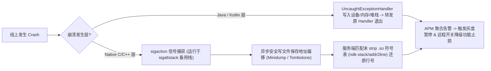

## 面试答题思路

- **Java Crash 捕获机理**：通过 `Thread.setDefaultUncaughtExceptionHandler()` 注册全局处理器，但**千万记得保存原先的系统/三方默认 Handler 并在记录保存完现场后转发给旧 Handler**（否则会截断系统弹窗/上报或导致僵尸卡死进程无法正常退出）。
- **Native Crash 捕获机理（C/C++ 崩溃防线）**：Java 层 `try-catch` 和 `UncaughtExceptionHandler` 抓不到 JNI/C++ 的非法内存访问崩溃！必须在 Native 层利用 Linux **`sigaction()`** 拦截 `SIGSEGV`（空指针/越界段错误）、`SIGABRT`（断言中止）、`SIGBUS` 等致命信号，提前开辟 **`sigaltstack()` 备用信号栈**防主栈已溢爆时信号处理函数自己崩溃，借助 **`libunwind`** 回溯寄存器与十六进制指令地址落盘，上传后台后再由调试符号表（带调试信息的未 strip `.so`）配合 **`ndk-stack` / `addr2line`** 还原出精确文件名和行号。
- **工程化稳定性闭环**：抓到 Crash 只是第一步，更重要的是配合 **分阶段灰度放量（1% → 5% → 20% → 100%）+ 实时崩溃率告警熔断 + 远程动态开关（Feature Flag）降级止损**。

## 核心原理解析

### 1. Native Crash 捕获必考的三大高危坑点
1. **必须保存并重发原信号处理函数**：捕获采集现场后，还原默认 `SIG_DFL` 或转发给原系统 `debuggerd` 处理器重新抛出，让系统正常写出 Tombstone 与记录 `ApplicationExitInfo`，避免进程卡成僵尸；
2. **信号处理函数里严禁调用非异步安全函数**：在信号上下文中**绝对不能调 `malloc`、`printf`、JNI 复杂调用**（因为原崩溃可能就死在 `malloc` 内部锁里，再次调 `malloc` 瞬间死锁！），只能用异步信号安全的系统调用（如 `write()` 直接写事先打开好的日志文件 FD），或者另 `fork` 守护子进程/发信号给等待中的监控线程执行栈回溯；
3. **预先分配 `sigaltstack` 备用信号栈**：如果崩溃本身是由 C++ 无限递归导致的 **栈溢出（Stack Overflow）**，当前线程栈已耗尽，必须靠 `sigaltstack()` 指定预先申请好的一块独立内存让信号处理函数安全运行。

### 2. Java Crash 为什么不能简单“吞掉异常继续运行”？
虽然网上偶尔流行用 `while(true) { try { Looper.loop() } catch (e) ... }` 强行保活，但在主线程未知点抛崩溃后（尤其是 `performTraversals` 绘制或生命周期中间半截中断），UI 状态与数据结构已经彻底破坏错乱，强行续命往往引发黑屏点不动或更离谱的数据错乱；**主线程致命 Crash 应该安全落盘并在独立后台/下次启动上报后迅速结束当前受损进程**（仅可对少数已确认安全的子线程/特定非核心入口做受控兜底捕获）。

## 图解流程

## 高频追问与关键词

- **追问 1**：为什么打 Release APK 时 `.so` 体积瘦身通常被 `strip` 掉了符号表，还能还原出 C++ 崩溃行号？
  - 关键词：打包流程中 Gradle 会同时产出两份产物——打进最终 APK 的是剔除调试符号以瘦身的 **stripped `.so`**，同时会在 build 目录保留一份完整的 **带调试信息（DWARF debug symbols）的 unstripped `.so`**（类似 Java 代码混淆留下的 `mapping.txt`）专门上传给 APM 后台用于离线符号化反解还原行号。
- **追问 2**：如果新版本一上线在某特定机型上发生 **启动阶段秒崩（Launch Crash Loop）**，连拉取远程开关接口的机会都没有怎么办？
  - 关键词：**端侧自愈保护模式（SafeMode）**！连续记录 3 次“冷启动后 5 秒内即崩溃”，第 4 次打开时自动触发内置兜底安全模式——清理可能损坏的本地缓存/SP/热修补丁、跳过非核心首页推广模块，只保留最核心降级登录/拉配置路径实现端侧自救！

## 延伸参考

参考 AOSP Native Crash Debugging (Tombstones) 与 Google Play Crash Vitals 治理指南。
