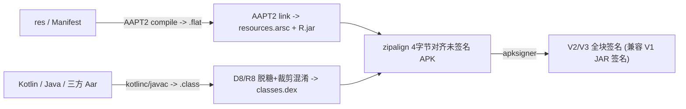

## 面试答题思路

- **核心流程五阶段串联**：
  1. **资源编译（`AAPT2` 两步走）**：先 **`compile`** 将每个 XML/图片独立编译为二进制 `.flat` 文件（支持单文件粒度增量缓存！），再 **`link`** 合并产出二进制 `AndroidManifest.xml`、资源映射索引表 **`resources.arsc`** 与 `R.jar`；
  2. **代码与字节码处理**：`kotlinc`/`javac` 编译为 `.class` → **`D8` / `R8`** 完成 Java 8+ 语法脱糖、代码裁剪、混淆并转化为 Dalvik 字节码 `classes.dex`；
  3. **打包与对齐**：聚合 dex、`.so`、`resources.arsc`、`assets/` 打包为未签名 APK，先经过 **`zipalign`** 按 4 字节边界对齐（方便系统 `mmap` 直接映射未压缩资源零拷贝读取）；
  4. **APK 签名校验**：使用 `apksigner` 注入 **V1 / V2 / V3 / V4** 签名（注意顺序：**V2+ 必须放在 `zipalign` 之后**，因为任何对 ZIP 字节的再对齐修改都会破坏全文件块签名！）。

## 核心原理解析

### 1. AAPT2 为什么拆成 `compile` 和 `link`？以及非传递 R 类（Non-Transitive R）
- **老 AAPT 痛点**：任何模块改一行布局颜色，整个项目都要全量重新编译全部资源生成巨型 `R.java`；
- **`AAPT2` 拆分优势**：`compile` 阶段完全独立并发增量跑（改哪个 XML 就只重编那一个 `.flat`）；`link` 阶段才统一汇总 ID（`0x7f...`）写进 **`resources.arsc`**（记录资源 ID 到具体路径/多语言值偏移量的映射表）；
- **AGP 8+ 非传递 R 类默认开启**：过去模块 A 的 `R` 类把底层全部依赖模块的几万个常量全拷贝一份导致 R 类爆大；现在每个模块只生成自身直接定义的资源常量，大幅减少方法/字段数与编译重编传播。

### 2. V1 → V2 → V3 → V4 签名演进核心区别
- **V1（JAR 签名）**：逐个对 ZIP 内的文件单独计算摘要存在 `META-INF/`。**致命缺点**：校验慢，且不校验 ZIP 文件尾和压缩包元数据，允许攻击者往 ZIP 注释/未保护区赛私货篡改甚至绕过部分校验；
- **V2（全文件 APK Signing Block 签名，Android 7.0+）**：在 ZIP 中央目录前插入一整块专用签名块，对整个文件除签名块外全部字节做哈希，**安全性极高、安装校验极快**（但一旦之后又改包如写入渠道信息就会验签失败！）；
- **V3（密钥轮换支持，Android 9.0+）**：允许应用在不换包名的前提下安全平滑更换新签名私钥，签名块内置“新旧证书轮替证明链”；
- **V4（流式增量安装，Android 11+）**：在 APK 外侧生成 `.apk.idsig` 独立签名文件（配合 ADB `--incremental`），支持只传几 MB 核心代码块边下载边安装极速调试大型游戏。

## 图解流程

## 高频追问与关键词

- **追问 1**：为什么不能先把老包做 V2 签名，然后再往 ZIP 注释里写“多渠道号”？现代多渠道怎么绕过？
  - 关键词：因为 V2 签名覆盖了 ZIP Central Directory 与 End of Central Directory 全部字节，改注释会直接破签报 `INSTALL_PARSE_FAILED_NO_CERTIFICATES`；多渠道方案（如腾讯 **`VasDolly` / 美团 `Walle`**）利用的是 **V2 签名验证器在算哈希时会精准跳过 APK Signing Block 内部特定 Custom ID 区块** 的特性，将渠道字符串注入到独立的 ID-Value 槽位里（或者直接使用 Gradle `productFlavors` 分别出包签名）。
- **追问 2**：`.so` 文件在 APK 里存放在 `lib/` 下，不压缩（`extractNativeLibs="false"`）有什么优缺点？
  - 关键词：不压缩会略微增大下载包 APK 体积，但支持系统在安装时不解压拷贝一份 `.so` 到 `/data/app/.../lib/`，而是直接让内核 **`mmap` 页对齐直读 APK 内的原生库**（节省用户手机双倍存储空间并加快安装速度，且从 Android 15 16KB 页大小起这也是强推荐行为）。

## 延伸参考

参考 Android Developers Build 概览与 AOSP APK Signature Scheme 安全规范。
