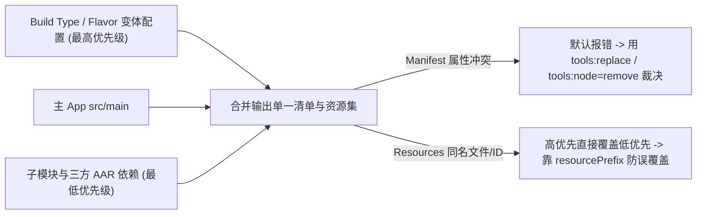

## 面试答题思路

- **合并大背景**：一个 Android 工程往往包含几十个三方 SDK `.aar`、内部业务组件模块以及不同 `buildType`/`productFlavor` 变体，最终 APK 里却只能有一份 `AndroidManifest.xml` 与一份 `resources.arsc`。
- **Manifest 合并优先级（从高到低）**：**Build Variant（`buildType` / `flavor`） > 主 App `main` 清单 > 依赖库模块与三方 AAR 清单**。若高优先级与低优先级对同一个节点定义了冲突属性（如两个库写了不同的 `android:allowBackup` 或 `android:theme`），Manifest Merger 默认直接报错失败，需在主 Manifest 引入 `xmlns:tools` 并用 **`tools:replace="android:allowBackup"`** 或 **`tools:node="remove"`** 显式裁决！
- **Resources 资源同名覆盖原则**：与 Manifest 同理，按优先级 **高优先静默覆盖低优先**（不同于 Manifest 冲突会报错，资源同名**不报错而是悄悄覆盖**——这也极易成为多模块隐藏 Bug 源头！），因此组件化开发强制在各模块配置 **`android.resourcePrefix "module_name_"`**！

## 核心原理解析

### 1. `AndroidManifest.xml` 常用 `tools:` 合并控制属性实战
在主模块 `app/src/main/AndroidManifest.xml` 解决三方库污染的三大招：
- **`tools:replace="attr1,attr2"`**：当三方 SDK 强行声明了不同的 `android:theme`、`android:name`（Application）或 `android:label` 引发合并报错时，以主 App 节点值为准强行覆盖；
- **`tools:node="remove"`**：某些老三方库在 AAR 里偷偷申请了敏感危险权限（如 `READ_PHONE_STATE`、`REQUEST_INSTALL_PACKAGES`）或无用的开机广播/Activity，在主 Manifest 写一条同名权限标签并加上 **`tools:node="remove"`** 直接彻底剔除防上架合规驳回！
- **`manifestPlaceholders`**：在 `build.gradle` 定义动态占位符（如 `[appAuthRedirectScheme: "myapp"]`），在 Manifest 里以 `${appAuthRedirectScheme}` 注入实现不同环境/渠道动态区分深度链接和 SDK AppKey。

### 2. Resources 资源合并机制与暗坑防范
- **同级多模块资源重名谁赢？**：按依赖声明在 `dependencies` 中的靠前/后顺序决定（主 `app` 模块永远最高），一旦两个底层的业务 AAR 都叫 `ic_empty.png` 或 `activity_detail.xml`，编译不报错但运行期其中一个模块打开界面居然显示出另一个模块的布局或图标！
- **标准工程防线**：所有业务模块在 `build.gradle(.kts)` 中配置 `resourcePrefix = "pay_"` / `"chat_"`，配合 Lint 校验强制所有 XML、Drawable、String 必须带模块前缀。

## 图解流程

## 高频追问与关键词

- **追问 1**：怎么直观查看三方 SDK 到底给我们的最终 APK 偷偷塞了什么权限或组件？
  - 关键词：不要靠猜，Android Studio 打开主 `AndroidManifest.xml` 切换到底部 **`Merged Manifest`** 视图即可一目了然看到每一条标签来自哪个 AAR，以及具体冲突报错与被剔除记录（或在 `build/outputs/logs/manifest-merger-*-report.txt` 查看详细日志）。
- **追问 2**：如果两个三方库之间关于某个 MetaData 的 `android:value` 发生合并冲突，主 App 明明自己用不着这个字段怎么办？
  - 关键词：可以在主 Manifest 复制声明这个 `<meta-data>` 节点并加上 `tools:replace="android:value"` 选定其中一个正确值即可。

## 延伸参考

参考 Android Developers Merge Multiple Manifest Files 与 Configure Build Variants 官方文档。
